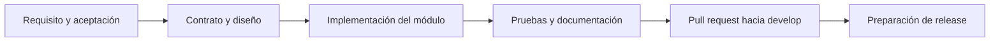

# Contribuir a Quantify Core

El trabajo se organiza por requisitos, contratos y cambios revisables. Empieza por la [ruta de incorporación](docs/guias/incorporacion.md) y el [mapa documental](docs/README.md). Las aplicaciones de producto están por implementar; el prototipo de la Práctica 07 tiene un alcance y pruebas independientes.

## Del requisito al cambio

1. Relacionar el trabajo con un requisito `RF-XX` y una tarea del equipo; no inventar claves de Jira.
2. Revisar [reglas de negocio](docs/requerimientos/reglas-negocio.md), contratos, diseño y decisiones pendientes. Registrar las decisiones nuevas con [ADR](docs/arquitectura/adr/README.md).
3. Desarrollar sobre la rama acordada. `docs/arquitectura` reúne esta base documental; las tareas nuevas siguen los prefijos y destinos del [Git Flow](docs/guias/git-flow.md).
4. Implementar el cambio con sus pruebas y actualizar el README del módulo si cambian requisitos, configuración o instrucciones.
5. Revisar el diff y abrir un pull request con objetivo, comportamiento resultante, validación y limitaciones. La persona responsable del área revisa el contenido antes de integrar.

## Antes de iniciar y antes de publicar

Desde la raíz, comprobar el estado con `git status` y obtener referencias con `git fetch origin`. No sobrescribir archivos ajenos ni descartar cambios para conseguir una copia limpia. Si se comparte una rama, incorporar los cambios remotos con un procedimiento que conserve el trabajo antes de publicar.

Usar commits con intención concreta, por ejemplo `docs(api): definir contrato de check-ins` o `feat(habits): validar frecuencia semanal`. Agrupar archivos relacionados; evitar commits que mezclen rediseño, migraciones y una corrección sin relación.

`git diff --check` detecta errores de espacios en el diff. Revisar también rutas, ejemplos, enlaces y documentación de variables. El uso de agentes no sustituye la revisión del resultado: indicar qué cambió y cómo se verificó, sin necesidad de registrar conversaciones privadas.

## Criterio de terminado

- El comportamiento responde al requisito y sus criterios de aceptación.
- Contratos, permisos, fechas, errores y estados de UI coinciden entre los módulos afectados.
- Las pruebas relevantes pasan y el resultado es reproducible; las pruebas pendientes se identifican.
- Se documentan cambios de configuración, compatibilidad, migración y recuperación cuando aplican.
- No hay secretos, datos reales de usuarios ni archivos generados sin propósito.
- La documentación identifica correctamente qué está implementado, qué está propuesto y qué queda pendiente.

Para cambios solo documentales se valida coherencia, enlaces, diagramas y ejemplos. La evidencia de una demo no certifica seguridad, despliegue ni funcionamiento del producto.

## Coordinación

El liderazgo coordina alcance y decisiones transversales; frontend revisa experiencia y clientes; backend revisa API y procesos; el responsable de datos revisa esquemas y migraciones. La asignación concreta de móvil, Wear OS, seguridad, infraestructura y operación se registra en cada tarea; no se presume cubierta por un README.

Consultar los [estándares de desarrollo](docs/guias/estandares-desarrollo.md), la [estrategia de pruebas](tests/README.md) y las [instrucciones para agentes](AGENTS.md).
