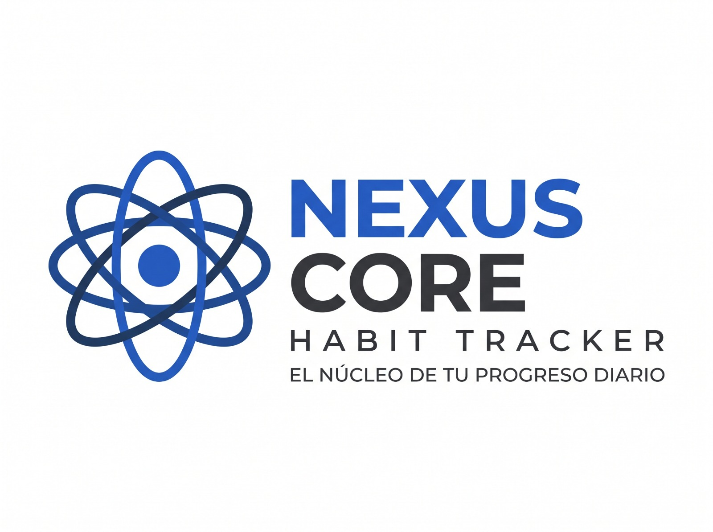
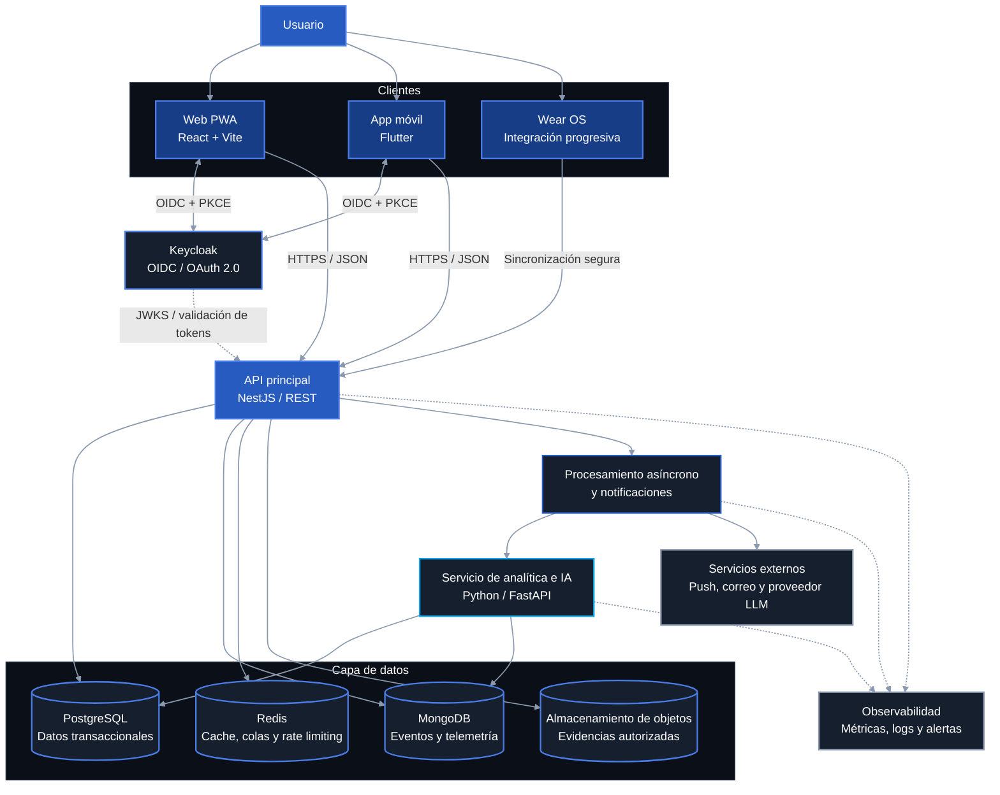
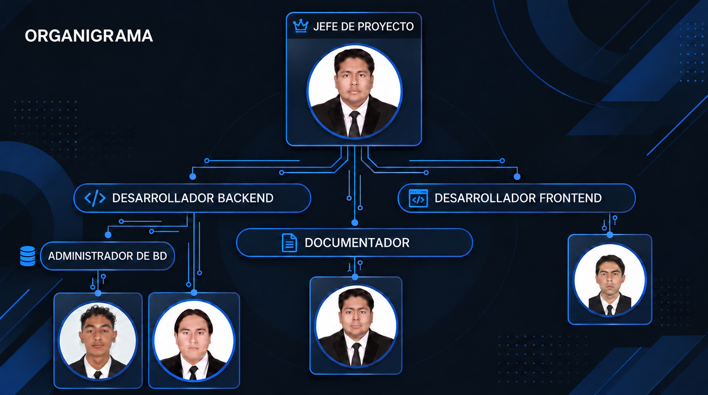

<h1 align="center">Quantify Core V2.0</h1>

<div align="center">
  
  
</div>

<p align="center">
  <em>El núcleo inteligente para registrar, analizar y mejorar hábitos con evidencia, biometría e inteligencia artificial.</em>
</p>

<p align="center">
  
  
  
</p>

> [!IMPORTANT]
> Este documento define la visión y la arquitectura **propuesta** para Quantify Core V2.0. No implica que todos los módulos descritos estén implementados. Las capacidades disponibles deberán identificarse en cada entrega y validarse contra el código, las pruebas y la documentación técnica.

## Sitio del proyecto

<p align="center">
  <a href="https://angeljesus13.github.io/Quantify-Core/">
    
  </a>
</p>

- [Página principal del proyecto (Portal Web en GitHub Pages)](https://angeljesus13.github.io/Quantify-Core/)
- [Práctica 04 — Business Model Canvas Interactivo](https://angeljesus13.github.io/Quantify-Core/docs/Practica04/business-model-canvas.html)
- [Práctica 05 — Diagrama Interactivo de Roles de Usuario](https://angeljesus13.github.io/Quantify-Core/docs/Practica05/diagrama-roles-quantify.html)
- [Práctica 07 — Prototipo Interactivo de Sketches](https://angeljesus13.github.io/Quantify-Core/docs/practica-07/)
- [Práctica 07 — Mapa de Navegación de Sketches](https://angeljesus13.github.io/Quantify-Core/docs/practica-07/navegacion.html)

## Contenido

- [Descripción](#descripción)
- [Planteamiento del problema](#planteamiento-del-problema)
- [Propuesta de solución](#propuesta-de-solución)
- [Objetivos](#objetivos)
- [Alcance de V2.0](#alcance-de-v20)
- [Módulos funcionales](#módulos-funcionales)
- [Arquitectura propuesta](#arquitectura-propuesta)
- [Flujos principales](#flujos-principales)
- [Datos, IA y biometría](#datos-ia-y-biometría)
- [Seguridad y privacidad](#seguridad-y-privacidad)
- [Roadmap](#roadmap)
- [Estructura propuesta del proyecto](#estructura-propuesta-del-proyecto)
- [Instalación y ejecución](#instalación-y-ejecución)
- [Documentación y prácticas académicas](#documentación-y-prácticas-académicas)
- [Identidad visual](#identidad-visual)
- [Equipo e información académica](#equipo-e-información-académica)
- [Decisiones pendientes](#decisiones-pendientes)
- [Estado y licencia](#estado-y-licencia)
- [Stack tecnológico](#stack-tecnológico)

## Descripción

**Quantify Core V2.0** es una plataforma multiplataforma de seguimiento de hábitos personales orientada a convertir registros cotidianos en información verificable y útil. Su visión combina una experiencia web, una aplicación móvil y la integración gradual con dispositivos Wear OS para relacionar el cumplimiento declarado por el usuario con señales contextuales y biométricas autorizadas.

La plataforma busca ir más allá de un contador de rachas. Su propósito es analizar consistencia, descanso, estrés y carga acumulada para generar indicadores preventivos —por ejemplo, una estimación de riesgo de desgaste o un arquetipo de productividad— y recomendaciones comprensibles. Estos resultados son apoyo informativo y **no constituyen diagnóstico médico**.

V2.0 conserva la esencia de Quantify V1, pero replantea su identidad, experiencia y base tecnológica para atender los nuevos requisitos académicos. El videojuego desarrollado con Unity no forma parte del alcance ni del diagrama referencial de esta versión.

## Planteamiento del problema

Las aplicaciones tradicionales de hábitos suelen depender casi por completo de registros manuales. Esa dependencia permite omisiones, modificaciones posteriores y falsos positivos: una racha puede representar lo que la persona declaró, no necesariamente el esfuerzo realizado. Al mismo tiempo, muchas soluciones muestran métricas aisladas sin relacionarlas con descanso, estrés o fatiga acumulada.

La falta de trazabilidad y análisis contextual limita la detección temprana de patrones perjudiciales, tales como jornadas sostenidas sin recuperación, metas incompatibles con el descanso o caídas de constancia asociadas con una carga excesiva. También dificulta explicar por qué una recomendación fue emitida y qué datos se utilizaron para producirla.

Quantify Core aborda este problema desde tres principios:

1. **Trazabilidad:** conservar evidencia suficiente del origen, momento y evolución de cada registro.
2. **Contexto:** relacionar hábitos con telemetría y biometría únicamente cuando el usuario lo autorice.
3. **Explicabilidad:** presentar indicadores y recomendaciones con límites claros, sin sustituir criterios médicos o profesionales.

## Propuesta de solución

La propuesta consiste en un ecosistema modular con clientes web y móvil, una API central, persistencia políglota y servicios especializados de análisis. La información transaccional se mantiene separada de la telemetría de alto volumen; los eventos relevantes se registran de forma append-only o auditable para reducir alteraciones silenciosas y facilitar la reconstrucción del historial.

El sistema podrá:

- crear, programar y registrar hábitos;
- calcular rachas, cumplimiento y tendencias mediante reglas versionadas;
- sincronizar datos móviles y, de forma gradual, señales de Wear OS;
- procesar telemetría y biometría con consentimiento explícito;
- estimar indicadores preventivos y arquetipos mediante modelos evaluados;
- explicar resultados en lenguaje claro, con evidencia y advertencias;
- enviar recordatorios y alertas configurables;
- ofrecer paneles de seguimiento personal y administración académica u operativa.

La “inmutabilidad” se entiende como **trazabilidad verificable**: eventos anexados, sellos de tiempo, auditoría y controles de integridad. No se afirma el uso de blockchain ni una garantía absoluta contra toda manipulación.

## Objetivos

### Objetivo general

Desarrollar un sistema integral web, móvil y compatible de forma progresiva con Wear OS para registrar, cuantificar y analizar hábitos humanos, utilizando inteligencia artificial y datos autorizados por el usuario para apoyar la prevención del desgaste, la optimización del descanso y la construcción de rutinas sostenibles.

### Objetivos específicos

- **Arquitectura transaccional tolerante a fallos:** separar cuentas, permisos y configuración en una base relacional, y telemetría o eventos de alto volumen en un almacén documental.
- **Interfaces orientadas a decisiones:** diseñar tableros reactivos que permitan comprender tendencias, alertas y métricas sin sobrecarga visual.
- **Análisis preventivo:** construir y evaluar modelos supervisados o no supervisados que estimen patrones de riesgo y perfiles de productividad con métricas reproducibles.
- **Metas y rachas confiables:** aplicar reglas de validación, idempotencia y auditoría para disminuir duplicados, sobreingestas y modificaciones no justificadas.
- **Captura móvil y wearable:** habilitar sincronización segura, tolerancia temporal a desconexiones y asociación explícita entre dispositivo, usuario y fuente de datos.
- **Privacidad por diseño:** limitar la recolección, proteger datos sensibles y permitir al usuario consultar, exportar o solicitar la eliminación de su información según la política aplicable.

## Alcance de V2.0

### Incluido en la propuesta

- cliente web responsivo y con capacidades PWA;
- aplicación móvil multiplataforma;
- integración progresiva con Wear OS para datos autorizados;
- gestión de cuentas, perfiles, roles y sesiones;
- catálogo, programación y registro de hábitos;
- rachas, métricas, historial y visualizaciones;
- telemetría auditable y sincronización offline controlada;
- recomendaciones e indicadores asistidos por IA;
- notificaciones y alertas configurables;
- observabilidad, documentación de API y despliegue contenerizado.

### Fuera del alcance actual

- videojuego o cliente Unity;
- diagnóstico, tratamiento o monitoreo médico de emergencia;
- garantías clínicas sobre las predicciones de IA;
- lectura de biometría sin consentimiento explícito;
- integraciones con todos los modelos de smartwatch desde la primera entrega;
- blockchain, criptoactivos o recompensas con valor monetario;
- una promesa de infraestructura productiva antes de concluir pruebas, seguridad y gobierno de datos.

## Módulos funcionales

| Módulo | Responsabilidad | Estado documental |
|---|---|---|
| Identidad y acceso | Registro, inicio de sesión, roles, sesiones y vinculación de cuentas | Propuesto |
| Perfil y consentimiento | Preferencias, zona horaria, privacidad y permisos de fuentes biométricas | Propuesto |
| Hábitos y metas | Alta, edición, programación, pausas y criterios de cumplimiento | Propuesto |
| Registro y evidencia | Check-ins, origen del dato, marcas de tiempo, adjuntos y deduplicación | Propuesto |
| Motor de reglas | Rachas, puntuación, validaciones y reglas versionadas | Propuesto |
| Analítica personal | Tendencias, correlaciones, descanso, constancia y carga acumulada | Propuesto |
| IA y recomendaciones | Indicadores preventivos, arquetipos, sugerencias y explicaciones | Propuesto |
| Biometría y dispositivos | Asociación de dispositivos, ingesta autorizada y sincronización | Propuesto por fases |
| Notificaciones | Recordatorios, alertas y preferencias de entrega | Propuesto |
| Administración | Catálogos, soporte, auditoría y métricas operativas según rol | Propuesto |
| Observabilidad | Métricas, logs, trazas y alertas técnicas | Propuesto |

## Arquitectura propuesta

La siguiente arquitectura es la **base recomendada**, no una declaración de implementación. Se selecciona una opción principal por capa para evitar que el repositorio comunique stacks incompatibles como si todos fueran definitivos. Sus nodos usan la [paleta de Quantify Core](#identidad-visual): azul Laser para la API, Cobalt para clientes y superficies Obsidian para datos y servicios.



> El diagrama excluye de manera intencional el videojuego Unity de la referencia original.

### Stack tecnológico base propuesto

| Capa | Selección base | Motivo |
|---|---|---|
| Web | React + TypeScript + Vite, PWA | Cliente desacoplado, compilación ligera y despliegue estático; evita asumir SSR antes de necesitarlo |
| Móvil | Flutter + Dart | Base multiplataforma para Android e iOS y posibilidad de compartir modelos y diseño |
| Wearable | Wear OS, integración por fases | Prioriza Android wearable; protocolo y SDK concretos aún deben definirse |
| API | Node.js + TypeScript + NestJS | Estructura modular, validación, inyección de dependencias y contratos claros |
| Analítica/ML | Python + FastAPI | Ecosistema de ciencia de datos y separación del ciclo de vida de modelos |
| Datos relacionales | PostgreSQL | Integridad ACID, tipos avanzados y buena base para auditoría y analítica relacional |
| Eventos y telemetría | MongoDB | Documentos flexibles para señales heterogéneas y evolución de esquemas |
| Cache y trabajos | Redis | Cache, control de frecuencia y soporte de colas; el uso exacto se validará por carga |
| Identidad | Keycloak con OpenID Connect | Identidad central, roles y posibilidad de federar Google sin acoplar la plataforma a un único proveedor |
| Contratos | REST/JSON + OpenAPI | Interoperabilidad entre clientes y documentación verificable |
| Contenedores | Docker + Docker Compose | Entorno reproducible para desarrollo y demostración académica |
| Web hosting | Vercel o GitHub Pages según artefacto | Vercel para la aplicación; GitHub Pages para documentación y prácticas |
| Gestión | GitHub + Jira | Versionado, revisión, integración continua y seguimiento de trabajo ágil |
| Observabilidad | OpenTelemetry + Prometheus/Grafana y logs centralizados | Visibilidad técnica; selección final de backend de logs pendiente |

### Conciliación de alternativas del material original

| Discrepancia | Base propuesta para V2.0 | Alternativa conservada | Criterio de cierre |
|---|---|---|---|
| MySQL vs. PostgreSQL | **PostgreSQL** | MySQL | Prueba de compatibilidad, experiencia del equipo y estrategia de migración |
| Google OAuth vs. Keycloak | **Keycloak como IdP** | Google como identidad federada opcional | Complejidad operativa, roles, SSO y requisitos institucionales |
| Next.js vs. Vite | **React + Vite PWA** | Next.js si se requiere SSR/SEO dinámico | Necesidad real de renderizado en servidor y costo de despliegue |
| Express vs. NestJS | **NestJS** sobre Node.js | Express directo para servicios mínimos | Tamaño del dominio, mantenibilidad y capacidad del equipo |
| Node.js vs. FastAPI | **NestJS para negocio; FastAPI para ML** | Un único backend si el alcance se reduce | Aislamiento de modelos frente a complejidad operativa |
| MySQL/PostgreSQL + MongoDB | **PostgreSQL + MongoDB**, con propiedad clara de datos | Solo PostgreSQL si el volumen no justifica dos motores | Medición de volumen, consistencia requerida y carga de mantenimiento |

La adopción final de cualquier componente requiere un registro de decisión arquitectónica (ADR), una prueba técnica y aprobación del equipo.

### Principios técnicos

- **Modular antes que distribuido:** comenzar con un backend modular y extraer servicios únicamente cuando exista una razón medible.
- **Una fuente de verdad por dato:** no duplicar entidades maestras entre PostgreSQL y MongoDB sin reglas de sincronización.
- **Contratos versionados:** versionar API, eventos, reglas de cálculo y modelos de IA.
- **Idempotencia:** evitar duplicados durante reintentos o sincronización offline.
- **Mínimo privilegio:** cada cliente, servicio y rol recibe solo los permisos necesarios.
- **Observabilidad desde el inicio:** correlacionar solicitudes, trabajos y errores mediante identificadores no sensibles.

## Flujos principales

### Autenticación web y móvil

1. El cliente inicia OpenID Connect mediante **Authorization Code con PKCE**.
2. Keycloak autentica al usuario localmente o, si se habilita, delega en Google como proveedor federado.
3. El cliente recibe tokens de corta duración sin almacenar credenciales del usuario.
4. El cliente envía el access token a la API a través de HTTPS.
5. La API valida firma, emisor, audiencia, expiración y permisos con las claves públicas publicadas por Keycloak.
6. La API aplica autorización por rol y por pertenencia al recurso.
7. La renovación o cierre de sesión sigue la política definida en el IdP; la aplicación no emite un segundo JWT propietario salvo que un ADR lo justifique.

Para web deberá preferirse una estrategia que reduzca la exposición de tokens a JavaScript —por ejemplo, BFF y cookies `HttpOnly`, `Secure` y `SameSite`— si la topología final lo permite. La decisión queda pendiente de la prueba de arquitectura.

### Vinculación de Wear OS

1. El usuario inicia la vinculación desde una sesión autenticada.
2. La plataforma genera un desafío de un solo uso, de vida corta y asociado al usuario.
3. El dispositivo confirma el desafío mediante un canal seguro.
4. La API registra el dispositivo, sus capacidades y los consentimientos concedidos.
5. Cada lote de telemetría incluye identificador de fuente, periodo, versión de esquema y clave de idempotencia.
6. La desvinculación revoca credenciales y detiene nuevas ingestas, sin alterar la política de conservación ya aceptada.

No se presupone que el emparejamiento final use OTP, Bluetooth o Wi-Fi de forma exclusiva; el mecanismo deberá elegirse tras validar las APIs de Wear OS y el modelo de amenazas.

### Registro de un hábito

1. El usuario crea un hábito con frecuencia, zona horaria y criterio de cumplimiento.
2. La API valida el comando y guarda la configuración transaccional.
3. Un check-in posterior se recibe con una clave idempotente y el origen del dato.
4. La API registra el resultado y anexa un evento auditable.
5. El motor de reglas recalcula racha y métricas con una versión de reglas identificable.
6. Los procesos asíncronos actualizan agregados, recomendaciones y notificaciones.
7. El cliente muestra el estado confirmado; los datos offline pendientes no se presentan como sincronizados.

### Inferencia y recomendación

1. Un proceso autorizado obtiene características minimizadas y seudonimizadas.
2. Se valida calidad, suficiencia y ventana temporal de los datos.
3. El servicio ejecuta una versión registrada del modelo o de reglas estadísticas.
4. Se almacenan versión, parámetros relevantes, resultado, nivel de confianza y trazabilidad.
5. La capa de explicación traduce el resultado a lenguaje comprensible sin inventar evidencia.
6. El usuario recibe una recomendación informativa, puede consultar sus fundamentos y ofrecer retroalimentación.
7. En caso de datos insuficientes, el sistema debe abstenerse de emitir una conclusión categórica.

## Datos, IA y biometría

### Propiedad de los datos

| Dominio | Almacén propuesto | Ejemplos |
|---|---|---|
| Identidad | Keycloak | Credenciales, sesiones, federación y roles globales |
| Negocio transaccional | PostgreSQL | Perfil interno, hábitos, agenda, consentimientos y dispositivos vinculados |
| Eventos y telemetría | MongoDB | Check-ins auditables, lotes de sensores y eventos de sincronización |
| Cache y datos efímeros | Redis | Límites de frecuencia, trabajos, bloqueos y resultados temporales |
| Objetos | Proveedor por definir | Evidencias o exportaciones autorizadas, cifradas y con caducidad |

Los identificadores compartidos entre almacenes deberán ser opacos. Las operaciones que abarquen más de un motor usarán eventos, patrón outbox y reconciliación, no una supuesta transacción distribuida automática.

### Integridad y calidad

- conservar `timestamp` del evento y de recepción, fuente, zona horaria y versión de esquema;
- aplicar claves de idempotencia y ventanas de tolerancia a duplicados;
- registrar correcciones como nuevos eventos o auditorías, sin sobrescribir silenciosamente el origen;
- distinguir datos declarados, inferidos y capturados por dispositivo;
- definir reglas para datos faltantes, atípicos, fuera de orden o enviados con retraso;
- documentar retención, respaldo, restauración, exportación y eliminación.

### Inteligencia artificial responsable

La IA se plantea como asistencia, no como autoridad. Antes de publicar una función predictiva se deberá documentar:

- objetivo y población prevista del modelo;
- procedencia, licencia y representatividad de los datos de entrenamiento;
- métricas de desempeño, validación y umbrales de abstención;
- sesgos conocidos y escenarios fuera de distribución;
- versión del modelo, características utilizadas y fecha de inferencia;
- supervisión humana, mecanismo de retroalimentación y plan de retirada;
- costo, privacidad y tratamiento de datos si se utiliza un proveedor LLM externo.

Las explicaciones generadas por LLM no deben alterar el resultado cuantitativo ni presentar causalidad donde solo existe correlación.

### Biometría

La captura biométrica será opcional, granular y revocable. Cada fuente deberá especificar qué mide, con qué frecuencia, durante cuánto tiempo se conserva y para qué finalidad se utiliza. Los paneles diferenciarán una señal de bienestar de un diagnóstico clínico, y evitarán recomendaciones de emergencia basadas únicamente en un modelo experimental.

## Seguridad y privacidad

### Controles mínimos propuestos

- HTTPS en tránsito y cifrado administrado en reposo;
- OIDC con PKCE, tokens breves, rotación y revocación de sesiones;
- autorización por roles y por propiedad del recurso;
- validación de entrada y salida, límites de tamaño y consultas parametrizadas;
- rate limiting, protección contra automatización y bloqueo progresivo cuando aplique;
- gestión de secretos fuera del repositorio y separación por ambiente;
- auditoría de accesos administrativos, consentimientos y exportaciones;
- análisis de dependencias, revisión de código, pruebas y escaneo de contenedores;
- copias de seguridad cifradas con ejercicios de restauración;
- minimización, seudonimización y periodos de retención explícitos;
- respuesta a incidentes y canal documentado para reportar vulnerabilidades.

### Clasificación orientativa

| Nivel | Datos | Tratamiento esperado |
|---|---|---|
| Público | Documentación, identidad visual y prácticas publicadas | Puede hospedarse en GitHub Pages |
| Interno | Métricas operativas sin datos personales y configuración no secreta | Acceso limitado al equipo |
| Confidencial | Perfil, hábitos, historial y notificaciones | Cifrado, autorización y auditoría |
| Sensible | Biometría, inferencias de bienestar y evidencia personal | Consentimiento explícito, minimización y controles reforzados |

El equipo deberá validar la normativa y las políticas institucionales aplicables antes de recolectar datos reales. Durante prototipos y demostraciones se recomiendan datos sintéticos o anonimizados.

## Roadmap

Las fechas y responsables se gestionarán en Jira. Este roadmap expresa orden y criterios de avance, no compromisos de entrega.

### Fase 0 — Definición

- cerrar alcance, requisitos y criterios de aceptación;
- resolver las decisiones arquitectónicas pendientes;
- modelar amenazas, consentimiento y gobierno de datos;
- definir diseño, contratos y estrategia de pruebas.

### Fase 1 — Núcleo verificable

- preparar repositorio, calidad y entornos locales;
- implementar identidad, perfiles, hábitos y check-ins;
- incorporar auditoría, idempotencia y documentación OpenAPI;
- entregar un panel web mínimo con pruebas automatizadas.

### Fase 2 — Experiencia móvil

- implementar cliente Flutter y sincronización offline;
- configurar recordatorios y preferencias;
- validar accesibilidad, zonas horarias y conflictos de sincronización.

### Fase 3 — Telemetría y Wear OS

- ejecutar prueba técnica de vinculación y permisos;
- ingerir lotes de telemetría con calidad y trazabilidad;
- probar consumo energético, conectividad y revocación.

### Fase 4 — Analítica e IA

- construir una línea base estadística antes de modelos complejos;
- evaluar datos, sesgos, desempeño y explicabilidad;
- desplegar recomendaciones con umbrales de abstención y monitoreo.

### Fase 5 — Preparación operativa

- realizar pruebas de seguridad, carga, respaldo y restauración;
- completar observabilidad y respuesta a incidentes;
- ejecutar piloto controlado y documentar resultados;
- evaluar criterios institucionales para una liberación posterior.

## Estructura propuesta del proyecto

La estructura definitiva dependerá de las decisiones de repositorio y despliegue. Una organización monorepo posible es:

```text
Quantify-Core/
├── apps/
│   ├── web/                    # React + Vite PWA
│   ├── mobile/                 # Flutter para Android/iOS
│   └── wear/                   # Integración Wear OS por fases
├── services/
│   ├── api/                    # NestJS y reglas de negocio
│   ├── analytics/              # FastAPI, características y modelos
│   └── workers/                # Procesos asíncronos y notificaciones
├── packages/
│   ├── contracts/              # OpenAPI, eventos y esquemas compartidos
│   ├── design-tokens/          # Colores, tipografía y recursos de marca
│   └── config/                 # Configuración común no secreta
├── infrastructure/
│   ├── docker/                 # Imágenes y configuración local
│   ├── observability/          # Métricas, logs y alertas
│   └── deployment/             # Manifiestos del entorno elegido
├── docs/
│   ├── requerimientos/
│   ├── arquitectura/
│   │   └── adr/                # Registros de decisiones
│   ├── diseno/
│   ├── api/
│   ├── seguridad/
│   ├── datos-ia/
│   ├── guias/
│   ├── despliegue/
│   ├── Practica04/
│   └── Practica05/
├── assets/
│   └── images/                 # Logos y recursos visuales
├── tests/                      # Pruebas de integración y sistema
├── .github/                    # Plantillas y automatización
├── README.md
└── LICENSE                     # Pendiente de definir
```

Esta estructura es una guía. No debe crearse de manera artificial hasta que cada componente tenga un propósito y responsable claros.

## Instalación y ejecución

> [!WARNING]
> **Pendiente.** El material disponible no define todavía repositorios de código, versiones de runtime, variables de entorno, migraciones ni comandos verificables. Para evitar instrucciones ficticias, la guía de instalación se publicará cuando exista un entorno base reproducible.

La futura guía deberá incluir, como mínimo:

1. prerrequisitos y versiones soportadas;
2. plantilla de variables de entorno sin secretos;
3. levantamiento de dependencias con Docker Compose;
4. migraciones y datos de prueba;
5. ejecución de web, móvil, API, worker y analítica;
6. pruebas, formato y análisis estático;
7. cuentas o realms de desarrollo de Keycloak;
8. solución de problemas y procedimiento de limpieza seguro.

No deben agregarse credenciales, datos biométricos reales ni archivos `.env` al repositorio.

## Documentación y prácticas académicas

La documentación general se organizará en [docs/](docs/), separando el producto y el desarrollo de los entregables académicos. El índice se encuentra disponible en [docs/README.md](docs/README.md).

| Práctica | Título y recurso interactivo (GitHub Pages) | Descripción | Firmas | Estatus |
|---|---|---|---:|---|
| Práctica 04 | [Modelo Canvas Interactivo](https://angeljesus13.github.io/Quantify-Core/docs/Practica04/business-model-canvas.html) · [Doc](docs/Practica04/README.md) | Elaboración asistida del Business Model Canvas del proyecto integrador | 20 | Terminado |
| Práctica 05 | [Diagrama de roles de usuario](https://angeljesus13.github.io/Quantify-Core/docs/Practica05/diagrama-roles-quantify.html) · [Doc](docs/Practica05/README.md) | Diagrama interactivo de roles de usuario del proyecto | 15 | Terminado |
| Práctica 07 | [Prototipo interactivo](https://angeljesus13.github.io/Quantify-Core/docs/practica-07/) · [Mapa de navegación](https://angeljesus13.github.io/Quantify-Core/docs/practica-07/navegacion.html) · [Doc](docs/practica-07/README.md) | Prototipo interactivo de navegación de sketches para Usuario y Administrador en móvil y PWA | 20 | Terminado |

Los modelos, diagramas y prototipos interactivos enlazan directamente a su versión desplegada en **GitHub Pages** para su ejecución interactiva en vivo. Los enlaces de documentación técnica dirigen a los archivos correspondientes en el repositorio.

### Prácticas de trabajo

- historias de usuario y criterios de aceptación trazables;
- ramas breves y cambios revisados mediante pull request;
- commits claros y vinculados con el trabajo planificado;
- definición de terminado con pruebas y documentación;
- ADR para decisiones que afecten arquitectura, seguridad o datos;
- diagramas y documentación actualizados junto con el cambio de código;
- evidencias académicas separadas de secretos y datos personales.

## Identidad visual

<div align="center">
  <div style="display: inline-block; margin: 12px 24px; text-align: center;">
    <p><strong>Logo empresarial</strong></p>
    
  </div>
  <div style="display: inline-block; margin: 12px 24px; text-align: center;">
    <p><strong>Logo del producto</strong></p>
    
  </div>
</div>

La identidad de Quantify Core combina blanco, tonos Obsidian y **Laser Blue (`#275BC0`)**. La paleta sirve como base para web, móvil, documentación y visualización de datos.

### Colores primarios

| Muestra | Tono | HEX | Uso principal |
|:---:|---|---|---|
|  | Laser Blue (Core) | `#275BC0` | Acción principal, enlaces y marca |
|  | Sky Laser | `#4A7DE8` | Hover, selección y estados activos |
|  | Deep Cobalt | `#183D87` | Estado presionado y contraste |

### Neutros y superficies

| Muestra | Tono | HEX | Uso principal |
|:---:|---|---|---|
|  | Obsidian Slate | `#0B0F17` | Fondo oscuro principal |
|  | Midnight Navy | `#161F2E` | Tarjetas y paneles oscuros |
|  | Steel Border | `#283548` | Bordes y divisores |
|  | Cool Gray | `#8A99AD` | Texto secundario y metadatos |
|  | Pure Mist | `#F4F7FD` | Fondo claro principal |
|  | Optical White | `#FFFFFF` | Tarjetas claras y texto sobre oscuro |

### Colores semánticos

| Muestra | Estado | HEX | Uso principal |
|:---:|---|---|---|
|  | Éxito / Rachas | `#10B981` | Hábitos completados y rachas activas |
|  | Advertencia | `#F59E0B` | Recordatorios y pendientes |
|  | Error / Ruptura | `#EF4444` | Errores, alertas y rachas interrumpidas |
|  | IA y métricas | `#0EA5E9` | Recomendaciones y visualizaciones |

Los colores no deben ser el único medio para comunicar estados; toda interfaz deberá acompañarlos con texto, iconos o patrones accesibles y verificar contraste.

## Equipo e información académica

### Organigrama

<p align="center">
  <a href="assets/images/organigrama-quantify-core.png" title="Ver organigrama en alta resolución">
    
  </a>
</p>

### Equipo de desarrollo

| Integrante | Rol registrado |
|---|---|
| Ángel de Jesús Baños Telles | Lider de Proyecto |
| Al Farias Leyva | Desarrollador Frontend |
| Francisco García García | Desarrollador Backend |
| Jesús Alejandro Artiaga Morales | Administrador de BD |

### Información académica

- **Universidad:** Universidad Tecnológica de Xicotepec de Juárez
- **Carrera / Especialidad:** Desarrollo y Gestión de Software
- **Cuatrimestre:** 10.º
- **Grupo:** A
- **Asignatura:** Proyecto Integrador

## Decisiones pendientes

Antes de presentar la arquitectura como definitiva, el equipo deberá cerrar y documentar:

- [ ] confirmar PostgreSQL o justificar la continuidad con MySQL;
- [ ] validar Keycloak, su alojamiento y la federación opcional con Google;
- [ ] decidir si la web requiere Next.js o si React + Vite cubre el producto;
- [ ] aprobar NestJS y los límites entre API, workers y servicio FastAPI;
- [ ] comprobar si MongoDB aporta valor suficiente frente a operar un solo motor;
- [ ] definir proveedor y protocolo de datos biométricos para Wear OS;
- [ ] especificar el significado de evidencia, inmutabilidad y reglas antifraude;
- [ ] establecer esquema de roles y permisos;
- [ ] acordar política de consentimiento, retención, exportación y eliminación;
- [ ] seleccionar proveedores de correo, push, objetos, LLM y observabilidad;
- [ ] definir alojamiento, ambientes, dominio, presupuesto y objetivos de servicio;
- [ ] elegir estrategia de monorepo o repositorios separados;
- [ ] publicar requisitos funcionales, no funcionales y criterios de aceptación;
- [ ] definir licencia, lineamientos de contribución y código de conducta;
- [ ] asignar funciones específicas del equipo y responsables por módulo.

## Estado y licencia

Quantify Core V2.0 se encuentra en fase de definición y desarrollo académico. La licencia y los términos de uso están pendientes; mientras no exista un archivo `LICENSE`, no se concede de forma automática permiso de reutilización, modificación o distribución.

## Stack tecnológico

> Tecnologías base propuestas para el desarrollo de Quantify Core V2.0. La selección podrá ajustarse conforme se validen los requisitos y las decisiones arquitectónicas pendientes.

*Frontend web:*

   

*Aplicaciones móviles y wearables:*

   

*Backend, API y analítica:*

     

*Bases de datos y procesamiento:*

  

*Identidad y seguridad:*

  

*DevOps, despliegue y colaboración:*

      

*Observabilidad:*

  

---

<p align="center">
  <strong>Quantify Core V2.0</strong><br />
  Construido con disciplina, evidencia y respeto por los datos de las personas.
</p>
