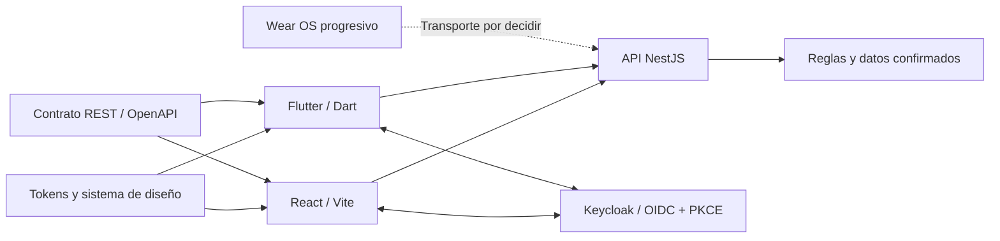

# Aplicaciones cliente

**Estado: especificación para desarrollo; estas carpetas todavía no contienen aplicaciones ejecutables.** Los clientes presentan datos y capturan acciones; la API valida permisos, reglas y persistencia. La base tecnológica está en el [README general](../README.md).

| Cliente | Stack previsto | Responsabilidad | Guía |
|---|---|---|---|
| Web / PWA | React + TypeScript + Vite | Rutina personal y operación administrativa autorizada | [Web](web/README.md) |
| Móvil | Flutter + Dart | Rutina, permisos del dispositivo y sincronización | [Móvil](mobile/README.md) |
| Wearable | Wear OS por fases | Captura autorizada y acciones breves; SDK y transporte pendientes | [Wear OS](wear/README.md) |

## Antes de implementar una pantalla

1. Ubicar el requisito en el [catálogo funcional](../docs/requerimientos/catalogo.md) y revisar sus [reglas](../docs/requerimientos/reglas-negocio.md).
2. Revisar los [recorridos](../docs/diseno/recorridos.md), el [sistema de diseño](../docs/diseno/sistema-diseno.md) y los [tokens](../packages/design-tokens/README.md).
3. Acordar la operación y sus errores en [contratos](../packages/contracts/README.md) antes de conectar el cliente. Los ejemplos académicos de endpoints no sustituyen ese contrato.
4. Declarar estados, permisos, comportamiento sin conexión y criterios de aceptación. Los datos ficticios deben identificarse y aislarse de producción.
5. Implementar una funcionalidad completa con pruebas de resultado y actualizar este README si cambia su configuración o estructura.

## Reglas compartidas para desarrolladores y agentes

- Separar presentación, estado de interfaz, acceso a datos y adaptadores de plataforma. Evitar peticiones HTTP o cálculos de dominio dispersos en componentes.
- Tratar respuestas externas como datos no confiables; validar y convertir DTO a modelos de presentación. TypeScript y Dart no reemplazan la validación del servidor.
- Compartir significado de modelos y tokens, no importar widgets Flutter desde React ni asumir que Dart consume paquetes TypeScript. La generación de clientes queda pendiente de decisión.
- La API determina permisos por rol y propiedad del recurso. Ocultar una pantalla o un botón es una ayuda de interfaz, no un control de autorización.
- Usuario administra sus datos. Administrador gestiona catálogo, accesos, configuración y métricas agregadas; su rol no habilita rutinas privadas.
- Mostrar una acción como **confirmada** únicamente al recibir confirmación del servidor. Distinguir borrador, pendiente de envío, enviando, confirmada, conflicto y rechazada.
- Un check-in comunica el valor acumulado absoluto del hábito para su fecha de negocio, con zona horaria, versión e idempotencia según el contrato. Reintentar conserva la clave de la misma operación; una acción nueva recibe otra.
- Conservar la configuración histórica de metas y frecuencia. Cambiar la zona del dispositivo no debe reasignar silenciosamente registros anteriores; un día programado todavía abierto no rompe una racha.
- Nunca guardar contraseñas, claves privadas o secretos de cliente en bundles, repositorio, logs o datos de demostración. La configuración compilada de los clientes es pública.
- La biblioteca de estado, navegación, almacenamiento y componentes se decide por ADR antes de adoptarla como convención. Las menciones a Riverpod o SQLite en prácticas son referencias históricas, no una dependencia ya instalada.

## Qué significa paridad entre clientes

Web y móvil deben respetar las mismas reglas, permisos, fechas, errores y resultados. Pueden adaptar navegación, tamaños y entradas a cada plataforma. El visor móvil/PWA de la [Práctica 07](../docs/practica-07/README.md) representa esa intención; sus controles para cambiar de rol y saltar a sketches son herramientas de revisión.

La administración web forma parte del alcance previsto. La entrega de administración móvil debe confirmarse en la planificación: el prototipo la representa, pero no compromete su disponibilidad en la primera aplicación Flutter. Wear OS incorpora solo el subconjunto aprobado para cada fase.

## Entrega mínima de cada funcionalidad

- Referencia al RF y criterio de aceptación, contrato y permisos cubiertos.
- Carga, vacío, error, falta de permisos y desconexión verificados; formularios conservados cuando sea seguro.
- Pruebas para cancelación, doble envío, sesión vencida y cambio de usuario.
- Accesibilidad y estados visuales revisados en los tamaños de pantalla acordados.
- Sin datos reales de usuarios en fixtures, capturas o telemetría del cliente.
- Comandos reproducibles, versiones fijadas y evidencia de ejecución cuando exista código.

[Volver al proyecto](../README.md) · [Índice de diseño](../docs/diseno/README.md) · [Decisiones pendientes](../docs/arquitectura/decisiones-pendientes.md)
