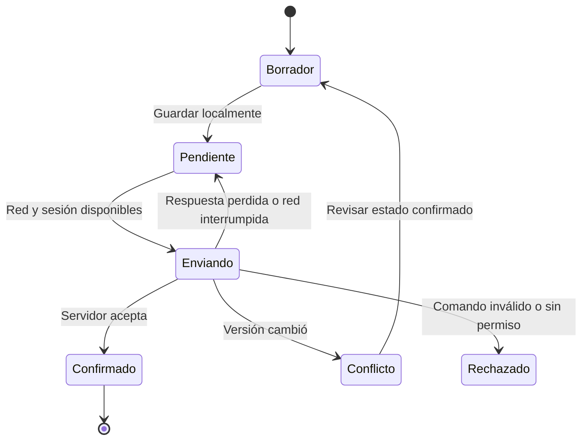

# Aplicación móvil

**Estado: especificación, sin proyecto Flutter generado.** Stack base: **Flutter + Dart**, Android e iOS. Esta carpeta aún no contiene `pubspec.yaml`, plataformas generadas ni binarios. Las versiones mínimas del sistema operativo se decidirán al validar dispositivos, permisos y dependencias.

## Responsabilidad y límites

Ofrecer rutina personal, registro de avance, métricas, recordatorios, recomendaciones, perfil, consentimiento y estado de dispositivos. Consumir los [contratos REST](../../packages/contracts/README.md) de la API NestJS; no conectarse a PostgreSQL, MongoDB, Redis ni FastAPI desde la app.

El esquema móvil del [prototipo](../../docs/practica-07/README.md) orienta recorridos, pero no contiene widgets Flutter ni demuestra integración nativa. Administración móvil es alcance por confirmar; cualquier implementación debe mantener el límite de datos agregados y nunca otorgar acceso a rutinas privadas por el rol administrador.

## Estructura propuesta

Separar UI y acceso a datos con repositorios y adaptadores. Es coherente con la [guía oficial de arquitectura Flutter](https://docs.flutter.dev/app-architecture/guide); el equipo concretará el manejo de estado en un ADR antes de instalar paquetes.

```text
lib/
  app/                    # Arranque, navegación, tema y sesión
  features/
    <feature>/
      presentation/       # Pantallas, widgets y estado de presentación
      application/        # Coordinación de acciones y casos de uso
      domain/             # Modelos e interfaces que la función necesite
      data/               # Conversión de DTO y repositorios
  shared/
    api/                  # Transporte, autenticación y errores
    config/               # Configuración pública por ambiente
    design/               # Adaptación Flutter de tokens compartidos
    storage/              # Almacenamiento local aprobado
    sync/                 # Cola, reintentos y conflictos
    platform/             # Notificaciones, permisos y vínculos nativos
test/
integration_test/
```

Es una estructura prevista, no un inventario de implementación. Evitar capas vacías o lógica de negocio dentro de widgets. Las reglas de rachas, validación final y autorización pertenecen al backend; el cliente puede ofrecer validaciones inmediatas consistentes con el contrato.

## Configuración y desarrollo local

1. Fijar versión de Flutter/Dart y registrar la matriz Android/iOS y las herramientas nativas necesarias. Compilar iOS requiere el entorno de Apple correspondiente.
2. Crear el proyecto en una entrega específica con identificadores de aplicación por ambiente; no reutilizar credenciales de producción para demostraciones.
3. Definir un ejemplo de configuración pública: `API_BASE_URL` con `/api/v1`, `OIDC_ISSUER`, `OIDC_CLIENT_ID` y `OIDC_REDIRECT_URI`. Estos nombres son propuesta, aún no tienen lector implementado.
4. Registrar retorno OIDC, enlaces de aplicación y orígenes permitidos por plataforma. Los valores empaquetados en una app, incluso mediante `--dart-define`, no son secretos.
5. Documentar en esa entrega los comandos reales de dependencias, ejecución y builds por flavor. Con proyecto creado, incorporar `flutter analyze`, `flutter test` y pruebas de integración a sus validaciones; actualmente no hay aplicación sobre la cual ejecutarlos.

## Sesión y permisos

Usar Keycloak / OIDC Authorization Code con PKCE S256 y navegador del sistema mediante una integración nativa mantenida, con validación de `state`, `nonce` y retorno. No crear formularios que envíen contraseñas a una API propia ni embeber secretos de cliente.

Elegir almacenamiento seguro vinculado a las capacidades del sistema para material de sesión que necesite persistir; documentar exclusión de backups cuando corresponda, borrado al salir y comportamiento en dispositivos compartidos. El plugin concreto queda pendiente. No guardar tokens junto con los comandos offline en una base de datos de propósito general.

Solicitar permisos en contexto, explicar la finalidad y permitir continuar con captura manual si se rechazan. Separar permiso de notificaciones, permisos del sistema para señales y consentimiento de tratamiento: ninguno sustituye a los otros. No registrar tokens ni datos biométricos en logs de dispositivo o reporte de errores.

## Sincronización y funcionamiento offline



La escritura offline requiere aprobar motor local, cifrado/protección, migraciones, cuotas, caducidad y política de eliminación. SQLite aparece en material académico, pero **no está adoptado ni instalado**. Mientras no exista esta base, deshabilitar la acción sin conexión con una explicación y conservar solo borradores permitidos.

Cada comando debe vincular cuenta, entidad, clave idempotente, versión conocida, instante de captura, fecha de negocio y zona según su esquema contractual. El check-in transmite avance absoluto acumulado, no un incremento que pueda duplicarse. El cliente no inventa nombres de campos; consume los fijados en contratos.

- Reintentar una operación conserva su clave; una edición posterior es otro comando. El backend resuelve duplicados y concurrencia.
- Al recuperar conexión o reabrir la app, comprobar sesión y enviar con orden por entidad y reintentos acotados. La sincronización en segundo plano depende del sistema; ofrecer reintento en primer plano.
- Si un hábito se archivó o cambió de versión en otro dispositivo, mostrar el rechazo o conflicto y conservar información suficiente para que la persona lo resuelva.
- Los gráficos indican cuándo usan datos confirmados y su última actualización. Un registro pendiente no aumenta la racha confirmada.
- Cambiar zona horaria no reescribe el histórico. Conservar la fecha de negocio y la versión de programación de cada registro; el servidor valida periodos.
- Al cerrar sesión, advertir sobre comandos pendientes antes de descartarlos, borrar datos privados locales y revocar la sesión según su política. Nunca sincronizar la cola de una cuenta con la sesión de otra.

## Notificaciones y dispositivos

La elección de notificaciones locales, push o combinación sigue pendiente. Diseñar identificadores estables para evitar duplicados, cancelación al archivar hábitos y coherencia al editar horarios. El centro de avisos no debe afirmar que un mensaje fue entregado al dispositivo sin evidencia del mecanismo implementado.

La vinculación Wear OS se define en su [guía por fases](../wear/README.md); no suponer que todas las señales ni el emparejamiento están disponibles en iOS. Mostrar compatibilidad, estado de permiso, última sincronización y forma de desvincular.

## Diseño y verificación

Adaptar los [tokens](../../packages/design-tokens/README.md) a un tema Flutter y mantener el [catálogo de componentes](../../docs/diseno/sistema-diseno.md). Probar escalado de texto, orientación, áreas seguras, teclado, TalkBack/VoiceOver, semántica de controles y objetivos táctiles. Flutter proporciona soporte de accesibilidad y APIs de prueba; la accesibilidad se valida por pantalla, no por adoptar un widget. [Documentación oficial](https://docs.flutter.dev/ui/accessibility).

| Nivel | Evidencia esperada |
|---|---|
| Unitario | Conversión contractual, estados, cola y clasificación de errores con datos ficticios |
| Widgets | Formularios, vacío/error, foco, semántica y texto grande |
| Integración | Login/retorno, crear hábito, check-in, pérdida de red, respuesta perdida y conflicto |
| Dispositivo | Permisos denegados/revocados, reanudación, cambio de usuario, cambio de zona, recordatorios y almacenamiento lleno |

Bloqueos por cerrar: manejo de estado y navegación, paquetes OIDC y almacenamiento seguro, persistencia offline, notificaciones, soporte mínimo de SO y alcance administrativo. Cada selección requiere compatibilidad documentada, mantenimiento y prueba técnica; Riverpod no se vuelve obligatorio por aparecer en la Práctica 05.

[Volver a aplicaciones](../README.md) · [Recorridos](../../docs/diseno/recorridos.md) · [Decisiones pendientes](../../docs/arquitectura/decisiones-pendientes.md)
