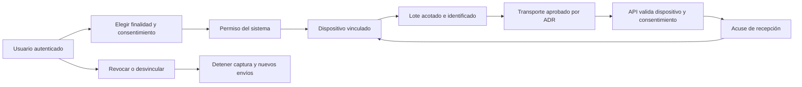

# Integración Wear OS

**Estado: investigación y especificación por fases; no hay app de reloj ni SDK seleccionado.** Wear OS es la plataforma objetivo, no una afirmación de que Flutter cubra automáticamente todos sus sensores, widgets o canales de comunicación.

## Alcance inicial y fases

La integración deberá aportar contexto autorizado al seguimiento de hábitos (RF-08). El cumplimiento manual y las funciones centrales continuarán disponibles sin reloj. No inferir una condición médica ni garantizar que un sensor comprueba por sí solo el cumplimiento de cualquier hábito.

| Fase | Trabajo | Condición para avanzar |
|---|---|---|
| 0. Viabilidad | Inventariar modelos, versiones, sensores, permisos y consumo | Prueba en equipo real y ADR de SDK, transporte y credenciales |
| 1. Vinculación | Asociar/desvincular dispositivo y mostrar capacidades/estado | Identidad, consentimiento y revocación verificadas |
| 2. Señal limitada | Ingestar una señal con frecuencia y finalidad acordadas | Calidad, idempotencia, batería, desconexión y retención evaluadas |
| 3. Ampliación | Añadir señales y acciones breves aprobadas | Evidencia por modelo y compatibilidad documentada |

## Decisiones que requieren evidencia

- Lenguaje y SDK del cliente Wear OS, dependencia o independencia del teléfono, autenticación del dispositivo y rotación/revocación de sus credenciales.
- Modelo mínimo, versiones soportadas, señales disponibles, unidades, precisión, frecuencia, consumo y huecos esperables. No afirmar soporte de sueño, estrés u otra señal sin validar la fuente concreta.
- Transporte teléfono/reloj o acceso directo a API, esquema de lotes, límites y acuses. La ruta punteada de la arquitectura no es un protocolo ya implementado.
- Health Services es una API oficial para capacidades de salud en Wear OS; su uso concreto depende del dispositivo y de los permisos. [Documentación Android](https://developer.android.com/health-and-fitness/health-services).
- Data Layer ofrece comunicación entre dispositivos Wear OS y Android vinculados; no equivale a una API de backend ni acredita compatibilidad con iOS. Evaluar sus condiciones antes de elegirlo. [Descripción oficial](https://developer.android.com/training/wearables/data/overview).

La futura estructura podría separar `app/` (interfaz del reloj), `capture/` (adaptadores de señales), `sync/` (lotes y acuses) y `tests/`; sus nombres dependen de la plataforma aprobada. No crear un scaffold hasta cerrar la fase 0.

## Contrato de captura y sincronización

Definir en [contratos](../../packages/contracts/README.md), sin inventar un endpoint exclusivo del cliente, la identificación seudónima del dispositivo, fuente, tipo/unidad, instante o intervalo UTC, zona cuando corresponda, calidad, versión de esquema, vínculo al consentimiento y clave idempotente. La [guía de datos](../../docs/datos-ia/README.md) determina propiedad y ciclo de vida.

La hora del reloj puede desviarse y los lotes llegar tarde o desordenados: distinguir captura, recepción y fecha de negocio. Los datos faltantes se marcan como ausentes, nunca como cero. Un lote reenviado no debe duplicar mediciones. El reloj muestra “pendiente” hasta el acuse; conserva únicamente los datos autorizados durante una ventana y cuota por definir.

El desafío de vinculación debe ser de un solo uso, duración corta y ligado a usuario y dispositivo. El teléfono o reloj no recibe credenciales administrativas ni claves de servicios. Rechazar un dispositivo desvinculado aunque conserve datos antiguos en su cola.

## Consentimiento y desconexión

Solicitar cada permiso en contexto y distinguirlo del consentimiento de la plataforma. Ante revocación, detener captura y envío de la finalidad afectada, invalidar credenciales cuando proceda y tratar el lote pendiente según la política de datos; no enviarlo automáticamente al volver la red. La conservación o eliminación del histórico sigue la solicitud y política correspondientes, no un borrado indiscriminado al desvincular.

La interfaz muestra sin conexión, sin permiso, no compatible, capturando, pendiente, sincronizado, error recuperable y desvinculado. Debe existir una acción para continuar usando hábitos sin biometría. Mantener etiquetas breves, contraste, objetivos táctiles adecuados y una alternativa en el teléfono para tareas largas.

## Evidencia necesaria para declarar una fase terminada

- Modelo/SO/SDK y permisos probados, configuración pública de entorno y comandos exactos de build reproducible.
- Pruebas de vinculación inválida, desafío vencido/reutilizado, revocación, dispositivo perdido y aislamiento entre cuentas.
- Lotes duplicados, perdidos, tardíos y desordenados; desconexión prolongada, cuota y batería baja.
- Señales no soportadas, unidades incompatibles y reloj con hora desviada, con respuesta definida por contrato.
- Mediciones de consumo y frecuencia real; resultados de accesibilidad en pantalla del reloj.
- Datos de prueba sintéticos o autorizados y minimizados; ninguna biometría o credencial real en el repositorio.

[Volver a aplicaciones](../README.md) · [Cliente móvil](../mobile/README.md) · [Decisiones pendientes](../../docs/arquitectura/decisiones-pendientes.md)
