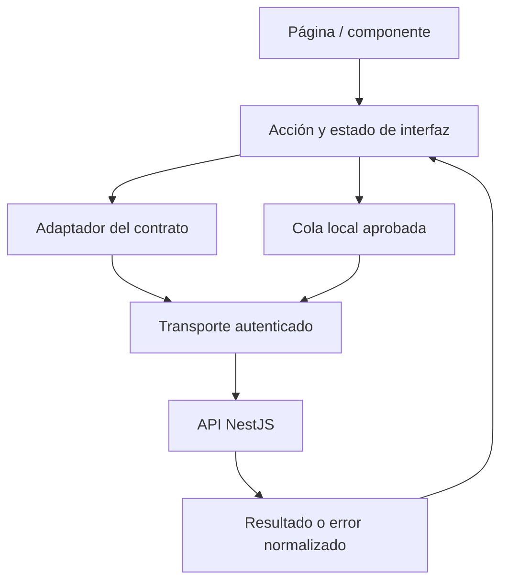

# Aplicación web y PWA

**Estado: especificación, sin proyecto React generado.** Stack base: **React + TypeScript + Vite**, consumo REST/JSON y capacidades PWA progresivas. No hay `package.json`, scripts, manifiesto ni service worker de producto en esta carpeta.

## Alcance y organización

La web ofrecerá identidad, perfil y consentimiento, hábitos y check-ins, rachas y análisis, recordatorios, recomendaciones, gestión de dispositivos y solicitudes sobre datos propios (RF-01 a RF-08 y RF-10). Las rutas administrativas cubrirán RF-09 con permisos de API y datos agregados.

Estructura orientativa para el primer scaffold; **no son archivos existentes**:

```text
src/
  app/                  # Arranque, composición, navegación y sesión
  features/             # identity, habits, check-ins, analytics, etc.
    <feature>/
      ui/               # Páginas y componentes de esa función
      application/      # Acciones, estados y coordinación
      data/             # Adaptador al contrato y modelos de presentación
  shared/
    ui/                 # Componentes visuales reutilizables
    api/                # Transporte, errores y correlación
    config/             # Lectura y validación de configuración pública
    offline/            # Cola y almacenamiento, cuando se aprueben
  assets/               # Recursos de producto autorizados
tests/                  # Integración y recorridos completos
```

La UI puede depender de la capa de aplicación y esta de interfaces de datos. Centralizar la autenticación y el transporte; no conectar componentes directamente a bases de datos o al servicio de IA. No copiar el `app.js` de la demo como arquitectura React.



## Configuración y arranque

Antes del primer código fijar versiones compatibles de Node.js, React, TypeScript y Vite, gestor de paquetes y un único lockfile de acuerdo con [configuración compartida](../../packages/config/README.md). No instalar automáticamente la última versión ni introducir SSR o un framework diferente sin ADR.

Propuesta de nombres públicos que el scaffold deberá confirmar:

| Variable propuesta | Contenido | Validación |
|---|---|---|
| `VITE_API_BASE_URL` | URL de API con prefijo `/api/v1` | HTTPS fuera de desarrollo; evitar duplicar el prefijo |
| `VITE_OIDC_ISSUER` | Emisor del realm de Keycloak | Coincidir con el emisor registrado |
| `VITE_OIDC_CLIENT_ID` | Identificador público de cliente web | Distinto por ambiente |
| `VITE_OIDC_REDIRECT_URI` | Retorno OIDC registrado | Coincidencia exacta; sin comodines amplios |

Estas variables **todavía no son consumidas**. Una configuración BFF puede modificar las necesarias. Publicar un ejemplo sin secretos y fallar con mensaje explícito ante configuración faltante. Vite expone al bundle las variables `VITE_*`; no deben contener secretos. [Documentación de variables de Vite](https://vite.dev/guide/env-and-mode).

La primera entrega deberá documentar instalación reproducible, desarrollo, compilación, comprobación de tipos, lint y pruebas con los scripts realmente creados. Hasta entonces no existe un comando de arranque de producto. El [prototipo académico](../../docs/practica-07/README.md) sí tiene instrucciones propias.

## Identidad y permisos

- Usar Keycloak con Authorization Code y PKCE S256, verificando `state` y `nonce` con una integración mantenida. El servidor valida emisor, audiencia, firma, expiración y autorización.
- Resolver por ADR la topología **SPA con cliente público** o **BFF con cookies** antes de implementar la sesión. La base Vite no obliga a una u otra.
- Si se elige SPA, mantener tokens en memoria y no persistirlos en `localStorage`, `sessionStorage` o IndexedDB; renovar mediante el adaptador elegido. Keycloak documenta que sus tokens del adaptador JavaScript se mantienen en memoria. [Adaptador oficial](https://www.keycloak.org/securing-apps/javascript-adapter).
- Si se elige BFF, definir cookies `HttpOnly`, `Secure`, `SameSite`, protección CSRF y alcance de dominios en el ADR. Los tokens permanecen del lado del servidor.
- Esperar a resolver la sesión antes de cargar datos privados. Guardar solo retornos internos permitidos para evitar redirecciones abiertas.
- Centralizar una renovación en curso y limitar el reintento tras 401. Si falla, pedir acceso de nuevo, pausar la cola y proteger el borrador; 403 muestra permiso insuficiente sin bucles de login.
- Cerrar sesión elimina datos privados y caches de esa cuenta. Si hay comandos pendientes, explicar que se descartarán y permitir cancelar el cierre antes de ejecutarlo.

## PWA y desconexión

El manifiesto, iconos, instalación y service worker se incorporan como capacidades verificadas. El navegador puede no permitir instalación o ejecución en segundo plano; la app debe seguir funcionando en línea. Los service workers tienen un ciclo de vida propio y no garantizan ejecución continua. [Guía de service workers](https://web.dev/learn/pwa/service-workers).

| Recurso | Política prevista |
|---|---|
| JS, CSS, fuentes y recursos estáticos versionados | Cache por versión con limpieza de versiones antiguas |
| Navegación | Pantalla de desconexión útil cuando no exista contenido local |
| Identidad y respuestas OIDC | Fuera de la cache del service worker |
| Respuestas de API y datos personales | Sin cache genérica; persistencia explícita, minimizada y por cuenta tras aprobar su política |
| Escrituras | Cola explícita de comandos, nunca cachear un POST como si estuviera confirmado |
| Actualización de versión | Avisar y activar sin perder formularios ni operaciones pendientes |

La primera iteración puede requerir conexión para escribir. No ofrecer escritura offline hasta que existan almacenamiento, aislamiento por usuario, migración de cola y pruebas. Si se habilita, los check-ins mantienen valor absoluto, fecha de negocio, zona, versión y clave idempotente. Una respuesta perdida se reintenta con la misma clave. Un conflicto requiere resolverlo con el estado del servidor, sin sumar avances ni sobrescribir automáticamente el otro dispositivo.

Mostrar la última sincronización y distinguir datos locales pendientes de métricas confirmadas. La sesión vencida pausa la sincronización; cambiar de usuario nunca transfiere la cola. No depender de Background Sync: incluir reanudación al recuperar conexión y reintento visible.

## Estados, accesibilidad y errores

Aplicar el [catálogo de componentes y estados](../../docs/diseno/sistema-diseno.md). Cada página debe cubrir carga, contenido, vacío, error recuperable, permiso insuficiente, sesión vencida y contenido desactualizado. Un error de formulario se asocia al campo; un error global incluye acción útil y código de correlación cuando exista, sin stack trace.

Usar HTML semántico, navegación por teclado, foco visible, anuncios de estado moderados, títulos de página y alternativa textual para gráficas. Validar zoom, reducción de movimiento, contraste y lectores de pantalla. Los permisos de notificaciones se piden al activar un recordatorio y su rechazo no impide usar hábitos.

## Verificación de la primera entrega

- Compilar y comprobar tipos con las versiones fijadas; el equipo decidirá la herramienta de pruebas antes de añadir dependencias.
- Probar acceso/retorno/cierre, sesión vencida, 401/403, usuario distinto y rutas administrativas.
- Probar crear, editar y archivar hábito; doble clic y respuesta perdida del check-in; fecha y zona alrededor de medianoche.
- Probar teclado y lector de pantalla en formularios, diálogos y errores; gráficas con resumen y tabla.
- Si incluye PWA: primer acceso sin service worker, actualización, cache antigua, conexión intermitente, almacenamiento lleno o no disponible y limpieza al cerrar sesión.
- Verificar que el bundle no contiene secretos y que logs/analítica no capturan tokens, formularios ni nombres privados de hábitos.

Pendientes: biblioteca de navegación, estado, componentes y pruebas; topología de sesión; política y motor de almacenamiento; matriz de navegadores; metas de rendimiento y soporte offline. Registrar su cierre en [decisiones](../../docs/arquitectura/decisiones-pendientes.md).

[Volver a aplicaciones](../README.md) · [Contratos](../../packages/contracts/README.md) · [Recorridos](../../docs/diseno/recorridos.md)
