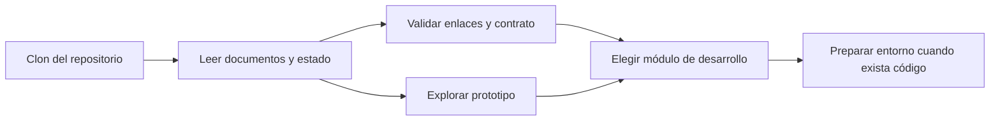

# Installation · Preparación del entorno

Esta carpeta indica qué puede prepararse **hoy** y qué instrucciones faltan para instalar el producto. Se usa el nombre `Installation` solicitado para la estructura; la guía está en español. **Estado:** documentación y prototipo; aún no existen manifiestos de React, Flutter, NestJS, FastAPI ni `compose.yaml` ejecutable.



## Requisitos disponibles

- Git para obtener y cambiar a la rama de trabajo.
- Node.js con `node --test` para las comprobaciones documentales y del prototipo. La [revisión registrada](../guias/validacion-documental.md) usó Node.js v24.14.1 en Windows; no se ha fijado aún la versión mínima del futuro producto.
- Un navegador moderno para la [Práctica 07](../practica-07/README.md). Su demo HTML no requiere instalar paquetes del producto.

Desde la raíz del repositorio:

```bash
git status
node scripts/check-docs.mjs
node --test docs/practica-07/tests/prototipo.test.cjs
```

Estos comandos ya existen y comprueban documentación y lógica de la demo. El [manual de la práctica](../practica-07/README.md) explica cómo abrir su HTML localmente o en GitHub Pages. No probarán bases de datos, Keycloak ni despliegue.

## Instalación futura del producto

Cuando exista una aplicación o servicio, su README deberá indicar versión y gestor de paquetes, manifiesto y lockfile, variables de ejemplo, dependencias, migraciones, datos sintéticos, comandos de inicio/parada, prueba de salud, pruebas automatizadas y solución de fallos. Registrar los sistemas operativos realmente comprobados.

El [entorno Docker](../../infrastructure/docker/README.md) establece requisitos de contenedores y la [configuración compartida](../../packages/config/README.md) define cómo documentar variables. Los pasos de publicación pertenecen a [despliegue](../despliegue/README.md). No crear archivos `.env` con secretos antes de configurar y verificar exclusiones de Git.

<details>
<summary>Comprobación para saber si una guía de instalación está lista</summary>

Una persona nueva debe poder repetirla desde un clon limpio con datos sintéticos y obtener el resultado indicado. Si falta un archivo, una versión o un proveedor, marcar el paso pendiente y enlazar la [decisión](../arquitectura/decisiones-pendientes.md) que lo resuelve.

</details>
