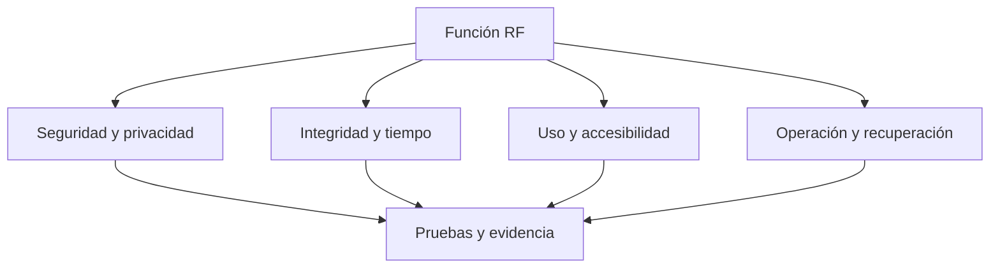

# NFRs · Requisitos no funcionales

**NFRs** define cómo debe comportarse el sistema además de sus funciones. La fuente completa es la sección [no funcional del catálogo](../requerimientos/catalogo.md); los IDs `RNF-XX` se conservan aquí para revisión por área. **Estado:** criterios de diseño y pruebas pendientes de implementación.

| ID | Calidad | Evidencia que deberá existir |
|---|---|---|
| RNF-01 | Aislamiento y autorización | Usuario A no accede a recursos de B; administrador tampoco ve rutinas privadas por defecto. |
| RNF-02 | Integridad | Reintentos y escrituras simultáneas producen un resultado confirmado sin duplicados. |
| RNF-03 | Tiempo | Fechas de negocio reproducibles con zona IANA y cambios de horario. |
| RNF-04 | Accesibilidad | Formularios y gráficos utilizables con teclado, lector y señales adicionales al color. |
| RNF-05 | Privacidad | Consentimiento comprobado y datos sensibles ausentes de logs y trazas. |
| RNF-06 | Rendimiento | Perfil de carga medido antes de acordar límites de latencia y capacidad. |
| RNF-07 | Recuperación | Restauración probada y trabajos reconciliados tras un fallo. |
| RNF-08 | Mantenibilidad | Un contrato canónico y consumidores verificados ante cambios. |
| RNF-09 | Observabilidad | Solicitudes y trabajos diagnosticables sin exponer información personal. |
| RNF-10 | Reproducibilidad | Entorno y comandos documentados y repetibles desde un clon limpio. |

No se fijan porcentajes de disponibilidad, p95, RPO o RTO sin una carga, presupuesto y responsables aprobados. La [decisión D-08](../arquitectura/decisiones-pendientes.md) requiere esa evidencia. Para cada cambio, escoger casos relevantes de la [estrategia de pruebas](../../tests/README.md) y registrar ambiente, resultado y límites.
