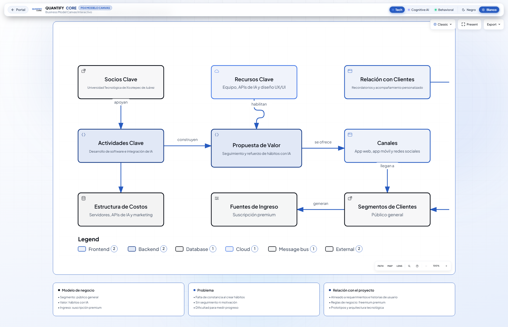

# Práctica 04 — Modelo Canvas Interactivo

> Business Model Canvas Interactivo del Proyecto Integrador **Quantify Core**, generado con **Archify** y validado con revisión visual automatizada.

## Descripción

Este documento presenta el **Business Model Canvas del proyecto Quantify Core**, una aplicación de seguimiento y refuerzo de hábitos con inteligencia artificial. El modelo describe cómo la aplicación llega a sus usuarios, qué problema resuelve, qué propuesta de valor ofrece, qué recursos requiere y cómo genera ingresos sostenibles. Fue estructurado de forma colaborativa por el equipo y transformado en un diagrama interactivo con Archify.

  

  

<em>Haz clic en la imagen o en el enlace superior para abrir el canvas interactivo.</em>

## Interpretación del modelo

- **Lado derecho (mercado):** Segmentos de clientes, canales de distribución, relación con clientes y fuentes de ingreso. Define a quién se dirige el servicio y cómo se monetiza.
- **Centro (valor):** La propuesta de valor (seguimiento inteligente y refuerzo de hábitos con IA), núcleo central del modelo.
- **Lado izquierdo (operación):** Recursos clave, actividades principales y socios estratégicos que posibilitan la entrega de valor.
- **Base (finanzas):** Estructura de costos que sostiene la infraestructura y operación del proyecto.
- Cada bloque es interactivo: al seleccionarlo despliega información detallada de dicho componente.

## Objetivo

Analizar el contexto del Proyecto Integrador y representar formalmente su propuesta de negocio mediante un Business Model Canvas interactivo, empleando herramientas de apoyo basadas en agentes inteligentes.

## Bloques del canvas

| Bloque | Definición en Quantify Core |
|---|---|
| Segmentos de Clientes | Público general interesado en la mejora y seguimiento de hábitos personales. |
| Propuesta de Valor | Seguimiento cuantitativo, métricas de constancia y recomendaciones de hábitos con IA. |
| Canales | Aplicación web, aplicación móvil (Android e iOS) y presencia en redes sociales. |
| Relación con Clientes | Recordatorios inteligentes, notificaciones contextuales y acompañamiento continuo. |
| Fuentes de Ingreso | Suscripción premium (modelo freemium con funcionalidades avanzadas de IA). |
| Recursos Clave | Equipo de ingeniería, infraestructura cloud, APIs de inferencia IA y diseño UX/UI. |
| Actividades Clave | Desarrollo de software, refinamiento de modelos de IA y soporte continuo. |
| Socios Clave | Universidad Tecnológica de Xicotepec de Juárez y proveedores cloud. |
| Estructura de Costos | Servidores, consumo de cómputo/APIs de IA, herramientas de desarrollo y difusión. |

## Archivos y entregables

- `prompt.txt` — Especificación y directrices empleadas para generar el modelo.
- `business-model-canvas.html` — Canvas interactivo en HTML autocontenido (con modal por bloque, selector de tema claro/oscuro y paleta corporativa).
- `business-model-canvas.json` — Especificación estructurada del modelo en formato JSON.
- `business-model-canvas.visual-check.*` — Reportes y capturas de evidencia de validación visual automatizada en diversos viewports.

## Enlaces

- **Portal principal del proyecto:** https://angeljesus13.github.io/Quantify-Core/
- **Canvas interactivo directo:** https://angeljesus13.github.io/Quantify-Core/docs/Practica04/business-model-canvas.html

## Equipo

Grupo A · 10° Cuatrimestre · Universidad Tecnológica de Xicotepec de Juárez

- Al Farias Leyva
- Francisco García García
- Ángel de Jesús Baños Telles
- Jesús Alejandro Artiaga Morales
