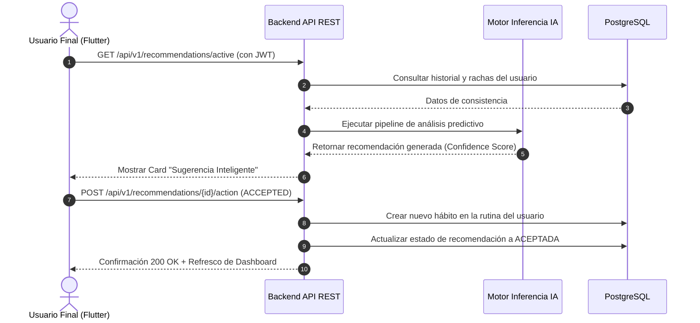

# HU-QC-05 — Recomendaciones de Hábitos Impulsadas por IA

> **Contexto histórico:** esta historia documenta la Práctica 05. La definición de producto para recomendaciones es [RF-07](../requerimientos/catalogo.md), con [reglas](../requerimientos/reglas-negocio.md) y [decisiones pendientes](../arquitectura/decisiones-pendientes.md). Sus umbrales, estado de completitud y elecciones de bibliotecas no se trasladan automáticamente a la implementación.

## 1. Identificación

| Atributo                 | Detalle                                                              |
| ------------------------ | -------------------------------------------------------------------- |
| **Proyecto**             | Quantify Core — Sistema Inteligente de Hábitos y Productividad       |
| **Aplicación**           | App Móvil Multiplataforma (Flutter / Android & iOS) + Backend API    |
| **Módulo**               | Motor Asistente de IA / Sugerencias Adaptativas                      |
| **Identificador (ID)**   | HU-QC-05                                                             |
| **Nombre**               | Recepción y Aceptación de Recomendaciones de Hábitos por IA          |
| **Actor Principal**      | Usuario Final (Estudiante / Profesional)                             |
| **Actores Secundarios**  | Motor Backend e Inferencia IA (Soporte) / Administración (Auditoría) |
| **Épica**                | Motor Inteligente y Personalización Adaptativa del Hábito            |
| **Prioridad**            | Alta (Core diferencial y propuesta de valor de Quantify Core)        |
| **Estado**               | Propuesta Aprobada / Lista para Implementación                       |
| **Plataforma Principal** | Mobile (Flutter) + Microservicio Backend (FastAPI / Node.js)         |
| **Tipo**                 | Funcional e Inteligente                                              |

---

## 2. Historia de Usuario

**Como** usuario habitual de Quantify Core que busca optimizar su rutina y bienestar diario,  
**quiero** recibir recomendaciones contextualizadas y personalizadas de hábitos sugeridos por la Inteligencia Artificial a partir del análisis de mi consistencia y rachas históricas,  
**para** descubrir e incorporar progresivamente mejoras en mi estilo de vida sin sufrir fatiga de decisión ni incertidumbre sobre qué hábito implementar a continuación.

---

## 3. Valor de Negocio

El diferenciador clave de **Quantify Core** frente a trackers tradicionales de hábitos es la transición de una herramienta pasiva de registro a un **asistente activo y proactivo**.

La implementación de esta funcionalidad genera valor en las siguientes dimensiones:

- **Retención y Engagement:** Incrementa el tiempo de permanencia y regreso diario al ofrecer nuevo contenido adaptado a cada persona.
- **Reducción del Churn:** Los usuarios novatos que no saben qué hábitos seguir reciben guía inmediata basada en personas con perfiles similares.
- **Validación del Algoritmo:** Permite calibrar el modelo predictivo con base en la tasa de aceptación (`Acceptance Rate`) de las sugerencias.
- **Monetización Freemium/Premium:** Sirve como base para planes avanzados que ofrezcan sugerencias hiperpersonalizadas en tiempo real.

---

## 4. Precondiciones y Disparador

### Precondiciones

1. El usuario debe poseer una sesión activa y autenticada con token JWT válido.
2. El usuario debe tener al menos siete (7) días naturales de registros de hábitos o un mínimo de 15 eventos de micro-progreso confirmados.
3. El usuario debe haber otorgado consentimiento explícito en los ajustes de privacidad para el análisis anonimizado de patrones por IA.
4. No debe existir una recomendación idéntica en estado pendiente en la bandeja activa del usuario.

### Disparador (Trigger)

La historia se activa bajo dos condiciones:

- **Automática (Backend Cron / Event-driven):** El motor de analítica detecta una racha consolidada (ej. 7 días cumpliendo "Lectura 20 min") o una ruptura reiterada, disparando un evento en segundo plano que genera una recomendación contextual.
- **Manual (On-Demand):** El usuario navega a la sección "Sugerencias IA" de la aplicación móvil y solicita una nueva optimización de su rutina.

---

## 5. Flujo Principal (Paso a Paso)



1. **Acceso al Dashboard:** El usuario abre Quantify Core e inicia sesión; la aplicación consulta al backend por sugerencias pendientes.
2. **Detección de Oportunidad:** El motor de IA identifica una correlación positiva en el comportamiento del usuario (ejemplo: alto cumplimiento matutino).
3. **Presentación de la Tarjeta:** En la pantalla principal aparece el pod interactivo: _"Sugerencia IA para ti: Sesión de Hidratación de 500ml tras despertar"_.
4. **Consulta de Justificación:** El usuario pulsa sobre la sugerencia para desplegar el modal explicativo: el sistema expone el razonamiento de la IA (_"Notamos que tus días con mayor energía inician antes de las 7:30 AM"_).
5. **Ajuste de Parámetros:** El usuario puede modificar parámetros sugeridos (horario, días de repetición o meta numérica) antes de confirmar.
6. **Aceptación:** El usuario presiona _"Añadir a mi rutina"_.
7. **Persistencia e Integración:** La aplicación móvil envía la confirmación a la API; el nuevo hábito queda guardado en PostgreSQL y se actualizan los recordatorios locales.
8. **Calibración:** El motor registra el evento de aceptación como retroalimentación positiva para el vector de preferencias del usuario.

---

## 6. Criterios de Aceptación (Formato Gherkin)

### CA-01 — Visualización de recomendación cualificada

- **Dado que** el usuario cuenta con más de 7 días de registros y existe una recomendación calculada con puntaje de confianza $\ge 80\%$,
- **cuando** accede a su pantalla principal de Quantify Core,
- **entonces** el sistema debe renderizar la tarjeta destacada con distintivo de IA, nombre del hábito sugerido y botón de acción rápida.

### CA-02 — Explicabilidad de la sugerencia (Explainable AI)

- **Dado que** el usuario visualiza una recomendación en pantalla,
- **cuando** toca el botón "Por qué te sugerimos esto",
- **entonces** la aplicación debe mostrar una explicación en lenguaje natural y comprensible sobre el patrón o racha que motivó la sugerencia.

### CA-03 — Incorporación directa del hábito sugerido

- **Dado que** el usuario revisa la recomendación y pulsa "Añadir a mi rutina",
- **cuando** el sistema confirma la petición vía API,
- **entonces** el hábito se añade a la lista de hábitos diarios del usuario, se programa el recordatorio predeterminado y la tarjeta de recomendación se oculta con una animación de éxito.

### CA-04 — Descarte respetuoso y aprendizaje del modelo

- **Dado que** el usuario no está interesado en la sugerencia actual,
- **cuando** presiona "Descartar",
- **entonces** la tarjeta desaparece inmediatamente de la vista, se actualiza su estado a `DISMISSED` en base de datos y el motor de IA no volverá a sugerir el mismo hábito en los próximos 21 días.

### CA-05 — Modo sin conexión (Offline Resilience)

- **Dado que** el dispositivo móvil pierde conexión a internet tras haber recibido sugerencias cacheadas,
- **cuando** el usuario decida aceptar una recomendación en modo offline,
- **entonces** la app registrará la aceptación en SQLite local y sincronizará los cambios con el backend en cuanto se reanude la conectividad.

---

## 7. Reglas de Negocio (RN)

- **RN-01 (Límite de saturación):** El sistema nunca mostrará más de dos (2) recomendaciones simultáneas no resueltas para evitar saturación cognitiva.
- **RN-02 (Confianza mínima):** Solamente se desplegarán recomendaciones con un índice de confianza (`confidenceScore`) mayor o igual a $0.75$.
- **RN-03 (Privacidad de datos):** La inferencia de recomendaciones se realiza sobre identificadores disociados (UUID); ningún dato personal sensible ni de geolocalización es procesado por el modelo.
- **RN-04 (No duplicidad):** No se pueden generar sugerencias para hábitos que el usuario ya tenga activos o archivados recientemente (menos de 30 días).
- **RN-05 (Personalización previa al guardado):** El usuario siempre tiene la facultad de ajustar el horario y la frecuencia antes de aceptar el hábito generado por la IA.
- **RN-06 (Auditoría administrativa):** Las decisiones de los usuarios (Aceptar/Descartar) se registran en una tabla de métricas globales agregadas para la administración de Quantify Core sin exponer la identidad individual.

---

## 8. Estructura de Datos y Modelo de la Recomendación

| Campo                | Tipo              | Requerido | Descripción                                            |
| -------------------- | ----------------- | :-------: | ------------------------------------------------------ |
| `idRecommendation`   | UUID (v4)         |    Sí     | Identificador único de la sugerencia                   |
| `idUser`             | UUID (v4)         |    Sí     | Identificador del usuario receptor                     |
| `habitTitle`         | String (100)      |    Sí     | Título del hábito propuesto                            |
| `habitCategory`      | Enum              |    Sí     | `SALUD`, `PRODUCTIVIDAD`, `MINDFULNESS`, `ESTUDIO`     |
| `suggestedFrequency` | Array[String]     |    Sí     | Días recomendados (ej. `["LUN", "MIE", "VIE"]`)        |
| `suggestedTarget`    | Integer           |    Sí     | Meta cuantitativa (ej. `20` minutos o `2000` ml)       |
| `confidenceScore`    | Float (0.0 - 1.0) |    Sí     | Grado de certeza predictiva del modelo                 |
| `aiExplanation`      | Text (300)        |    Sí     | Justificación comprensible del motivo de la sugerencia |
| `status`             | Enum              |    Sí     | `PENDING`, `ACCEPTED`, `DISMISSED`, `EXPIRED`          |
| `createdAt`          | DateTime (UTC)    |    Sí     | Marca de tiempo de emisión                             |
| `resolvedAt`         | DateTime (UTC)    |    No     | Marca de tiempo de respuesta del usuario               |

---

## 9. Especificación de Endpoints API REST

### 1. Obtener recomendaciones activas

- **Método:** `GET`
- **Ruta:** `/api/v1/recommendations/active`
- **Cabeceras:** `Authorization: Bearer <JWT_TOKEN>`
- **Respuesta 200 OK:**

```json
{
  "total": 1,
  "data": [
    {
      "idRecommendation": "d8e3b7a1-87c2-4a0b-9df1-8e541b6c7a23",
      "habitTitle": "Hidratación Matutina (500ml)",
      "habitCategory": "SALUD",
      "suggestedFrequency": ["LUN", "MAR", "MIE", "JUE", "VIE", "SAB", "DOM"],
      "suggestedTarget": 500,
      "confidenceScore": 0.88,
      "aiExplanation": "Completas el 92% de tus hábitos matutinos; un vaso con agua al despertar maximizará tu energía inicial.",
      "status": "PENDING"
    }
  ]
}
```

### 2. Registrar acción del usuario (Aceptar o Descartar)

- **Método:** `POST`
- **Ruta:** `/api/v1/recommendations/{idRecommendation}/action`
- **Cabeceras:** `Authorization: Bearer <JWT_TOKEN>`, `Content-Type: application/json`
- **Payload:**

```json
{
  "action": "ACCEPTED",
  "customizedTarget": 500,
  "customizedFrequency": ["LUN", "MAR", "MIE", "JUE", "VIE"]
}
```

- **Respuesta 201 Created:**

```json
{
  "message": "Recomendación aceptada y hábito incorporado exitosamente a la rutina diaria.",
  "createdHabitId": "f109b43e-3158-45e0-827c-9b7e4f1a238b"
}
```

---

## 10. Componentes Flutter Sugeridos (Frontend Móvil)

Siguiendo la arquitectura multiplataforma de Quantify Core (Flutter + Riverpod + Clean Architecture):

- **Vistas y Widgets:**
  - `lib/features/recommendations/presentation/screens/ai_recommendations_screen.dart`
  - `lib/features/recommendations/presentation/widgets/ai_suggestion_card.dart`
  - `lib/features/recommendations/presentation/widgets/ai_rationale_modal.dart`
- **Controladores y Providers:**
  - `lib/features/recommendations/presentation/providers/recommendations_provider.dart`
- **Modelos y Entidades:**
  - `lib/features/recommendations/domain/entities/habit_recommendation.dart`
  - `lib/features/recommendations/data/models/habit_recommendation_model.dart`
- **Repositorios y Servicios:**
  - `lib/features/recommendations/data/datasources/recommendations_api_service.dart`
  - `lib/features/recommendations/data/repositories/recommendations_repository_impl.dart`

---

## 11. Estados de la Interfaz de Usuario

```
[ Inactivo ] ──(Trigger)──> [ Loading Inferencia ] ──(Éxito)──> [ Tarjeta Visible ]
                                                                      │
                         ┌────────────────────────────────────────────┴────────────────────────────────────────────┐
                         ▼                                                                                         ▼
             [ Acción: Aceptar ]                                                                       [ Acción: Descartar ]
                         │                                                                                         │
                         ▼                                                                                         ▼
             [ Loading Guardado ]                                                                      [ Animación Ocultar ]
                         │                                                                                         │
                         ▼                                                                                         ▼
           [ Éxito: Hábito Creado ]                                                                  [ Estado: Dismissed ]
```

- **Idle / Inactivo:** Sin sugerencias pendientes; la app muestra la vista habitual de hábitos.
- **Loading:** Skeleton placeholder con efecto shimmer y micro-animación de pulso azul (#1E54C9).
- **Displayed:** Tarjeta visible con badge de IA, porcentaje de afinidad y botones de decisión.
- **Saving:** Deshabilita botones temporalmente para prevenir doble envío accidental.
- **Success:** Notificación tipo SnackBar o modal emergente con retroalimentación háptica.
- **Error:** Notificación no bloqueante permitiendo reintentar.

---

## 12. Casos de Prueba Básicos (Plan de Pruebas)

| ID        | Escenario                                          | Entrada                                  | Resultado Esperado                                                  |
| --------- | -------------------------------------------------- | ---------------------------------------- | ------------------------------------------------------------------- |
| **CP-01** | Usuario con historial suficiente recibe sugerencia | Usuario con 10 días de racha activa      | Se muestra tarjeta con score $\ge 0.75$ y texto explicativo         |
| **CP-02** | Usuario nuevo sin historial suficiente             | Usuario registrado hace 2 días           | No se generan sugerencias hasta acumular 7 días mínimos             |
| **CP-03** | Aceptación directa de la recomendación             | Presionar "Añadir a mi rutina"           | Se envía POST, status cambia a `ACCEPTED`, hábito aparece en lista  |
| **CP-04** | Aceptación con personalización previa              | Modificar frecuencia a "Lunes a Viernes" | El hábito se persiste con los parámetros modificados                |
| **CP-05** | Descarte de la recomendación                       | Presionar "Descartar"                    | Tarjeta se oculta, status `DISMISSED`, no se repite en 21 días      |
| **CP-06** | Pérdida momentánea de conectividad                 | Aceptar sin internet activo              | Operación guardada en cola local de sincronización offline          |
| **CP-07** | Token JWT expirado durante la interacción          | Presionar acción con token vencido       | Interceptor redirige a renovación de token o login limpio           |
| **CP-08** | Control de concurrencia y no duplicidad            | Presionar doble clic rápido en "Añadir"  | El botón se desactiva en el primer tap, evitando hábitos duplicados |

---

## 13. Requerimientos No Funcionales (RNF)

- **RNF-01 (Rendimiento y Latencia):** La consulta de recomendaciones activas no debe demorar más de 350 ms en responder en condiciones normales de red 4G/Wi-Fi.
- **RNF-02 (Usabilidad Móvil):** La tarjeta de sugerencia debe poder evaluarse y aceptarse en menos de dos (2) toques de pantalla.
- **RNF-03 (Seguridad en Tránsito y Reposo):** Comunicación cifrada con HTTPS (TLS 1.3) y autenticación mediante JSON Web Tokens (JWT) firmados asimétricamente.
- **RNF-04 (Diseño Adaptativo):** Soporte fluido para interfaces en modo oscuro (`#2C3036`) y modo claro, con escala visual adaptable a pantallas móviles compactas y tablets.

---

## 14. Definition of Done (DoD)

La Historia de Usuario se declara formalmente **Terminada (Done)** cuando:

- [x] Modelo de datos definido y migración de base de datos ejecutada.
- [x] Endpoints API REST de obtención y resolución implementados con pruebas unitarias de backend.
- [x] Pantalla y widgets Flutter implementados con gestión de estado mediante Riverpod.
- [x] Criterios de aceptación (CA-01 a CA-05) verificados y aprobados.
- [x] Casos de prueba (CP-01 a CP-08) ejecutados sin incidencias bloqueantes.
- [x] Diagrama de roles y flujo de comunicación documentado y actualizado.
- [x] Código versionado y fusionado en la rama correspondiente de Git mediante Pull Request revisado.
