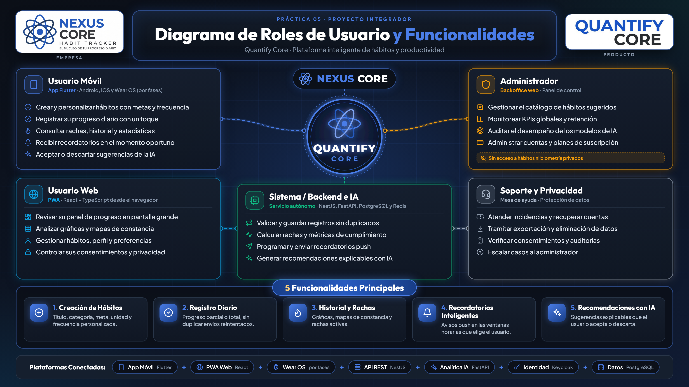

# Practica 05 - Diagrama de Roles de Usuario y Funcionalidades Principales

*Vista previa de la Práctica 05. Haz clic en la imagen para abrir el diagrama interactivo en GitHub Pages. [Abrir infografía en alta resolución](./diagrama-roles-infografia.png).*

> **Contexto:** esta práctica conserva decisiones y ejemplos de su entrega académica. Para implementar V2.0, consultar [requisitos](../requerimientos/README.md), [arquitectura](../arquitectura/README.md), [contratos](../../packages/contracts/README.md) y [diseño](../diseno/README.md). Librerías, umbrales y colores de esta práctica no quedan aprobados para el producto por aparecer aquí.

**Proyecto Integrador:** Quantify Core  
**Asignatura / Contexto:** Desarrollo de Aplicaciones Multiplataforma / Ingenieria de Software  
**Caso de Estudio de Referencia:** MecaGest (Sistema de Gestion de Talleres Mecanicos)

---

## Visualizacion en Vivo (GitHub Pages)

El diagrama interactivo de roles de usuario y las funcionalidades principales se encuentran desplegados y listos para su visualizacion en linea a traves de GitHub Pages:

- **Enlace directo en GitHub Pages:** [Visualizar Diagrama Interactivo de Roles](https://angeljesus13.github.io/Quantify-Core/docs/Practica05/diagrama-roles-quantify.html)
- **Portal del proyecto:** [https://angeljesus13.github.io/Quantify-Core/](https://angeljesus13.github.io/Quantify-Core/)
- **Archivo fuente local:** [diagrama-roles-quantify.html](./diagrama-roles-quantify.html)

> **Publicación verificada:** GitHub Pages sirve este repositorio desde la raíz de `main`, por lo que la URL del diagrama incluye `/docs/Practica05/`. Si cambia la fuente de publicación, revisar el enlace directo y los recursos del HTML antes de actualizar esta guía.

---

## 1. Objetivo de la Practica

Disenar y documentar formalmente el **Diagrama de Roles de Usuario**, la **descripcion detallada de cada rol** y al menos **cinco (5) funcionalidades principales (features)** a desarrollar en la plataforma **Quantify Core**, tomando como referencia metodologica y estandar de calidad el caso de estudio de _MecaGest_.

---

## 2. Definicion y Descripcion Exhaustiva de Roles

En la plataforma **Quantify Core**, los roles de usuario se han clasificado segun su ambito de interaccion, responsabilidad y canal de consumo tecnologico (Movil vs. Web / Backoffice):

| Rol                                             | Tipo de Actor                            | Canal / Interfaz                                                    | Descripcion y Alcance en la Plataforma                                                                                                                                                                                                                                                                                                                         |
| ----------------------------------------------- | ---------------------------------------- | ------------------------------------------------------------------- | -------------------------------------------------------------------------------------------------------------------------------------------------------------------------------------------------------------------------------------------------------------------------------------------------------------------------------------------------------------- |
| **Usuario Final (Estudiante / Profesional)**    | **Actor Principal** (Consumidor Directo) | **App Movil Multiplataforma** (Flutter - Android / iOS)             | Es el protagonista del sistema. Utiliza la aplicacion para estructurar sus rutinas, establecer metas diarias, registrar avances, consultar estadisticas de constancia y recibir recomendaciones inteligentes personalizadas. Su experiencia esta optimizada para interacciones rapidas, micro-habitos y retroalimentacion haptica.                             |
| **Sistema / Backend e Inteligencia Artificial** | **Soporte / Servicio Autonomo**          | **Microservicios Cloud & Workers** (Node.js / FastAPI / PostgreSQL) | Actua como el motor silencioso de la plataforma. Procesa eventos de telemetria y consistencia, gestiona la persistencia segura, programa y despacha notificaciones push en momentos optimos, y ejecuta modelos de inferencia heuristica/IA para predecir y sugerir habitos de alta afinidad para el usuario.                                                   |
| **Administracion**                              | **Actor Secundario / Supervisor**        | **Backoffice Web PWA** (React / Panel de Control)                   | Equipo tecnico y operativo detras de Quantify Core. Monitorea metricas operativas globales (usuarios activos, tasa de retencion, volumen de habitos), audita el rendimiento y sesgo de los modelos predictivos de IA, y gestiona los catalogos y politicas de suscripcion (Freemium vs. Premium). No tiene acceso a datos personales privados de los usuarios. |

---

## 3. Las 5 Principales Funcionalidades (Features) de la Plataforma

Siguiendo el estandar solicitado, se han identificado, disenado y mapeado en el diagrama las 5 funcionalidades nucleares de la plataforma:

### Feature 01: Creacion y Personalizacion de Habitos

- **Actor Principal:** Usuario Final
- **Rol de Soporte:** Sistema / Backend
- **Descripcion:** Permite al usuario parametrizar habitos definiendo titulo, categoria tematica (Salud, Estudio, Productividad, Mindfulness), frecuencia semanal personalizada, metas cuantitativas (ej. minutos, repeticiones o litros) e icono distintivo.

### Feature 02: Registro de Progreso Diario y Micro-interacciones

- **Actor Principal:** Usuario Final
- **Rol de Soporte:** Sistema / Backend
- **Descripcion:** Mecanismo agil de registro diario donde el usuario marca el cumplimiento parcial o total de sus habitos del dia mediante interacciones tactiles y actualizacion inmediata de estado con persistencia de marcas de tiempo (timestamps).

### Feature 03: Consulta de Historial, Rachas y Estadisticas Analiticas

- **Actor Principal:** Usuario Final
- **Rol de Soporte:** Sistema / Backend
- **Descripcion:** Modulo analitico visual con graficos de desempeno acumulado, mapas de calor de constancia y calculo automatico de rachas consecutivas activas (streaks) para reforzar la motivacion y el progreso sostenido.

### Feature 04: Configuracion y Disparo de Recordatorios Inteligentes

- **Actor Principal:** Usuario Final
- **Rol de Soporte:** Sistema / Backend (Scheduler)
- **Descripcion:** El usuario programa sus ventanas horarias preferidas y el despachador del backend sincroniza notificaciones push locales y remotas optimizadas para avisar en los momentos estrategicos de su jornada.

### Feature 05: Recepcion y Aceptacion de Recomendaciones Adaptativas por IA

- **Actor Principal:** Usuario Final
- **Rol de Soporte:** Sistema / Motor de Inferencia IA
- **Rol Supervisor:** Administracion (Auditoria de metricas de aceptacion)
- **Descripcion:** Algoritmo heuristico que analiza correlaciones y consistencia del usuario para sugerirle nuevos micro-habitos contextualmente relevantes con puntaje de confianza, explicabilidad en lenguaje natural y decision de aceptacion o descarte.

---

## 4. Matriz de Responsabilidades y Permisos

| Funcionalidad / Accion en Plataforma      |        Usuario Final        |       Sistema / Backend e IA        |           Administracion            |
| ----------------------------------------- | :-------------------------: | :---------------------------------: | :---------------------------------: |
| Crear y personalizar habitos propios      | **Crear / Editar / Borrar** |          Almacena y Valida          |     Sin acceso a habitos ajenos     |
| Registrar progreso y micro-interacciones  |   **Registrar (Diario)**    |       Valida y Calcula Rachas       |             Sin acceso              |
| Consultar historial y graficos personales |    **Lectura Completa**     |       Entrega Datos Agregados       |             Sin acceso              |
| Configurar recordatorios de rutina        |    **Definir Horarios**     |     Calendariza y Despacha Push     |             Sin acceso              |
| Generar inferencias y sugerencias IA      |       Recibe y Decide       | **Calcula y Emite (Score >= 0.75)** | Audita tasas de aceptacion globales |
| Aceptar o descartar sugerencias IA        |   **Aceptar / Descartar**   |      Actualiza Perfil y Rutina      |    Monitorea conversion general     |
| Auditoria y metricas de plataforma        |         Sin acceso          |      Emite Logs de Rendimiento      |     **Monitoreo Global y KPIs**     |
| Configuracion de modelos y suscripciones  |         Sin acceso          |    Ejecuta Politicas de Servicio    | **Gestion Comercial y Modelos IA**  |

---

## 5. Entregables y Archivos Incluidos

1. **[Diagrama Interactivo de Roles (diagrama-roles-quantify.html)](./diagrama-roles-quantify.html):**
   - Diagrama grafico visual de alta fidelidad desarrollado en SVG nativo.
   - Siluetas semanticas: _Terminal Smartphone_ para Usuario Final, _Procesador Neural Octogonal_ para Sistema e IA, y _Bunker de Mando_ para Administracion.
   - Tuberias de datos bidireccionales con etiquetas de flujo (DATOS, AVISOS / IA, METRICAS, CONTROL).
   - Seccion interactiva con las 5 principales funcionalidades y matriz analitica de permisos.
   - Fichas modales emergentes con responsabilidades, privilegios y casos de uso por rol.
   - Soporte para Tema Oscuro (#2C3036) y Tema Claro con animaciones al scroll y microinteracciones hover.

2. **[Historia de Usuario Detallada (HU-Recomendaciones-IA.md)](./HU-Recomendaciones-IA.md):**
   - Especificacion tecnica profesional para la funcionalidad de _Recomendaciones de Habitos por IA_ inspirada en el estandar del caso de estudio de _MecaGest_.
   - Incluye formato Como / Quiero / Para, Valor de Negocio, Precondiciones, Disparador, Flujo Principal con diagrama de secuencia Mermaid, Criterios de Aceptacion en formato Gherkin (Dado-Cuando-Entonces), Reglas de Negocio, Estructura de Datos JSON, Endpoints REST con autenticacion JWT, Componentes Flutter sugeridos, Matriz de Casos de Prueba (CP-01 a CP-08) y Definition of Done (DoD).

3. **[Documento Descriptivo General (README.md)](./README.md):**
   - Guia integral de la practica, enlaces de despliegue en GitHub Pages y justificacion metodologica.

---

## 6. Trazabilidad con el Caso de Estudio de Referencia (MecaGest)

| Criterio Evaluado por el Profesor              | Caso de Estudio MecaGest                                              | Implementacion en Quantify Core                                                                                        | Estado de Cumplimiento |
| ---------------------------------------------- | --------------------------------------------------------------------- | ---------------------------------------------------------------------------------------------------------------------- | :--------------------: |
| **Diagrama de Roles Atractivo e Innovador**    | Diagrama radial automotriz acorde a la paleta del taller mecanico.    | Diagrama visual con siluetas vectoriales (Smartphone, Procesador IA, Bunker) con la paleta oficial (#2C3036, #1E54C9). |     Cumple al 100%     |
| **Descripcion de Roles de Usuario**            | 7 roles definidos con alcance operativo y responsabilidades.          | 3 roles clave (Usuario Final, Sistema/IA, Administracion) detallados en documentacion y modales interactivos.          |     Cumple al 100%     |
| **Al menos 5 Principales Funcionalidades**     | Casos de uso principales por canal y actividades por rol.             | 5 funcionalidades principales descritas paso a paso y mapeadas en el diagrama y matriz.                                |     Cumple al 100%     |
| **Especificacion de Historia de Usuario (HU)** | HU-CLI-07 con criterios Given-When-Then, reglas, endpoints y Flutter. | HU-QC-05 con la misma estructura exhaustiva (Gherkin, RN, API REST, Riverpod, DoD).                                    |     Cumple al 100%     |
