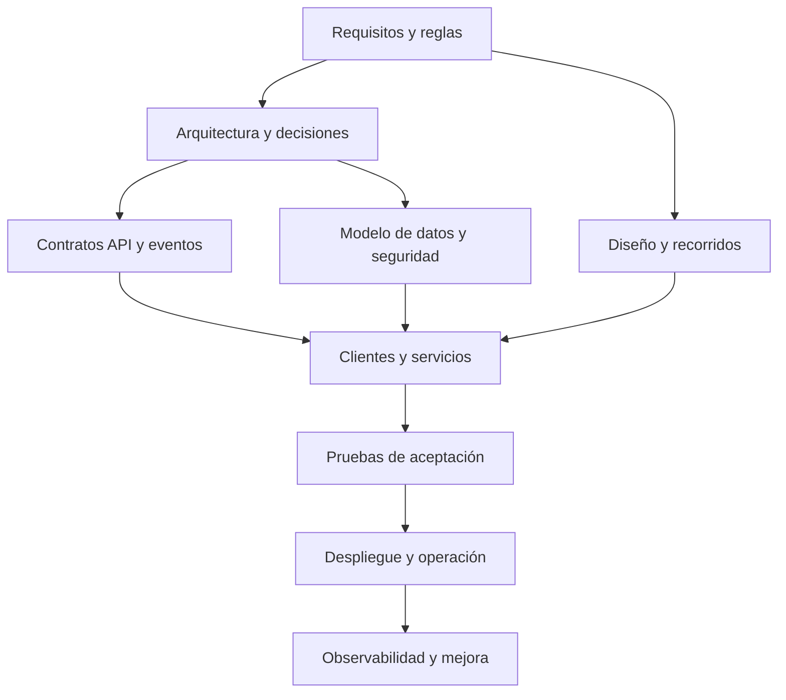

# Documentación para desarrollar Quantify Core

Mapa de referencia para que el equipo y sus agentes implementen el mismo producto con contratos, reglas y diseño coherentes. Empezar por [incorporación](guias/incorporacion.md), [contribución](../CONTRIBUTING.md) y el README del componente que se modificará.

**Estado:** base de desarrollo y contratos propuestos. El prototipo académico es ejecutable; los clientes y servicios del producto siguen pendientes de implementación. Cada módulo debe actualizar su estado y aportar evidencia cuando cambie esta situación.

## Carpetas por tipo de documento

| Carpeta | Contenido y referencia |
|---|---|
| [BRs](BRs/README.md) | Reglas de negocio y enlace a su definición `RN-P`. |
| [FRs](FRs/README.md) | Requisitos funcionales `RF-01` a `RF-10`. |
| [GUI](GUI/README.md) | Pantallas, estados, prototipo y diseño del producto. |
| [Installation](Installation/README.md) | Preparación comprobable y requisitos de instalación futura. |
| [Manual](Manual/README.md) | Guía técnica para diseñar, programar y entregar cambios. |
| [NFRs](NFRs/README.md) | Requisitos no funcionales `RNF-01` a `RNF-10`. |
| [UHs](UHs/README.md) | Historias de usuario y [primer recorrido](UHs/primer-flujo.md). |
| [UserManual](UserManual/README.md) | Uso del prototipo disponible y alcance del manual futuro. |

Estas carpetas organizan la lectura solicitada. Los requisitos, reglas y contratos mantienen sus fuentes canónicas enlazadas desde cada README; la misma definición no se vuelve a editar en ocho lugares.

## Entregables interactivos en vivo (GitHub Pages)

- [Portal principal](https://angeljesus13.github.io/Quantify-Core/)
- [Práctica 04 — Business Model Canvas Interactivo](https://angeljesus13.github.io/Quantify-Core/docs/Practica04/business-model-canvas.html)
- [Práctica 05 — Diagrama de Roles de Usuario Interactivo](https://angeljesus13.github.io/Quantify-Core/docs/Practica05/diagrama-roles-quantify.html)
- [Práctica 07 — Prototipo Interactivo de Sketches](https://angeljesus13.github.io/Quantify-Core/docs/practica-07/)
- [Práctica 07 — Mapa de Navegación de Sketches](https://angeljesus13.github.io/Quantify-Core/docs/practica-07/navegacion.html)

## Cómo se conectan las decisiones

Los diagramas usan [Mermaid compatible con Markdown de GitHub](https://docs.github.com/en/get-started/writing-on-github/working-with-advanced-formatting/creating-diagrams). Los bloques desplegables permiten consultar detalles sin perder la ruta principal; su formato está descrito en la [documentación de GitHub](https://docs.github.com/en/get-started/writing-on-github/working-with-advanced-formatting/organizing-information-with-collapsed-sections).

## Ruta según tu trabajo

| Área | Leer primero | Continuar con |
|---|---|---|
| Todo el equipo | [Requerimientos](requerimientos/README.md), [arquitectura](arquitectura/README.md), [estándares](guias/estandares-desarrollo.md). | [Decisiones pendientes](arquitectura/decisiones-pendientes.md) y [pruebas](../tests/README.md). |
| Frontend web | [Web](../apps/web/README.md), [sistema de diseño](diseno/sistema-diseno.md). | [Recorridos](diseno/recorridos.md), [contrato API](../packages/contracts/README.md). |
| Móvil y wearable | [Flutter](../apps/mobile/README.md), [Wear OS](../apps/wear/README.md). | [Consentimiento y datos](datos-ia/README.md), [seguridad](seguridad/README.md). |
| Backend | [API NestJS](../services/api/README.md), [referencia API](api/README.md). | [Workers](../services/workers/README.md), [modelo de datos](datos-ia/modelo-datos.md). |
| Datos e IA | [Datos e IA](datos-ia/README.md), [analítica FastAPI](../services/analytics/README.md). | [Calidad y ciclo de vida](datos-ia/calidad-ciclo-vida.md), [reglas](requerimientos/reglas-negocio.md). |
| Infraestructura | [Infraestructura](../infrastructure/README.md), [Docker](../infrastructure/docker/README.md). | [Operación](despliegue/README.md), [observabilidad](../infrastructure/observability/README.md). |
| Agentes | [AGENTS.md](../AGENTS.md), [contribución](../CONTRIBUTING.md). | README del área, contrato y criterio de aceptación de la tarea. |

## Fuentes de referencia

| Tema | Documento responsable |
|---|---|
| Qué construir y cómo aceptar | [Catálogo de requisitos](requerimientos/catalogo.md), [reglas de negocio](requerimientos/reglas-negocio.md) y [aceptación](requerimientos/aceptacion.md). |
| Límites y comunicación | [Componentes](arquitectura/componentes.md) y [flujos](arquitectura/flujos.md). |
| Cambios de decisiones | [ADR](arquitectura/adr/README.md) y [registro de pendientes](arquitectura/decisiones-pendientes.md). |
| Intercambio de información | [Contratos](../packages/contracts/README.md); la [guía API](api/README.md) explica su uso. |
| Datos, métricas e inferencia | [Modelo de datos](datos-ia/modelo-datos.md) y [analítica e IA](datos-ia/analitica-ia.md). |
| Permisos y riesgos | [Seguridad](seguridad/README.md) y [amenazas](seguridad/amenazas.md). |
| Identidad y estados visuales | [Diseño](diseno/README.md) y [tokens compartidos](../packages/design-tokens/README.md). |
| Herramientas y configuración | [Configuración compartida](../packages/config/README.md). |
| Colaboración y entrega | [Git Flow](guias/git-flow.md), [plantillas de GitHub](../.github/CONFIGURACION.md) y [pruebas](../tests/README.md). |

No copiar una regla para crear una segunda definición en otro módulo: enlazar su fuente. Los desacuerdos entre código, contrato y documentación se resuelven con una decisión y cambios coordinados, sin esconder la discrepancia.

<strong>Si solo vas a implementar el primer flujo</strong>

El recorrido inicial es identidad → perfil → hábito → check-in → métricas, relacionado con RF-01 a RF-05. Leer sus criterios y el contrato antes de crear pantallas, tablas o endpoints. Recordatorios, recomendaciones, Wear OS y administración tienen fases y dependencias propias; no se presumen listos por aparecer en el prototipo.

<strong>Qué significan los estados de documentación</strong>

- **Propuesto / borrador:** diseño para orientar el trabajo, pendiente de validaciones indicadas.
- **Implementado:** existe código o configuración; debe identificarse dónde y con qué alcance.
- **Verificado:** hay evidencia reproducible, entorno y límites de la comprobación.
- **Histórico / académico:** material de referencia de una entrega; no reemplaza decisiones vigentes del producto.

Un documento aceptado define una decisión; no demuestra por sí mismo que la implementación la cumpla.

## Referencias académicas

- [Práctica 04 — Business Model Canvas](Practica04/README.md).
- [Práctica 05 — Roles y funcionalidades](Practica05/README.md).
- [Práctica 07 — Prototipo y navegación](practica-07/README.md).
- [Portal académico](index.html).

Las prácticas conservan su contexto. Paletas, cuentas demo, modelos de almacenamiento local y umbrales ilustrativos se interpretan según su alcance; la implementación sigue los contratos y decisiones de esta base. Consultar la [validación de la documentación](guias/validacion-documental.md) para conocer las comprobaciones realizadas y sus límites.
