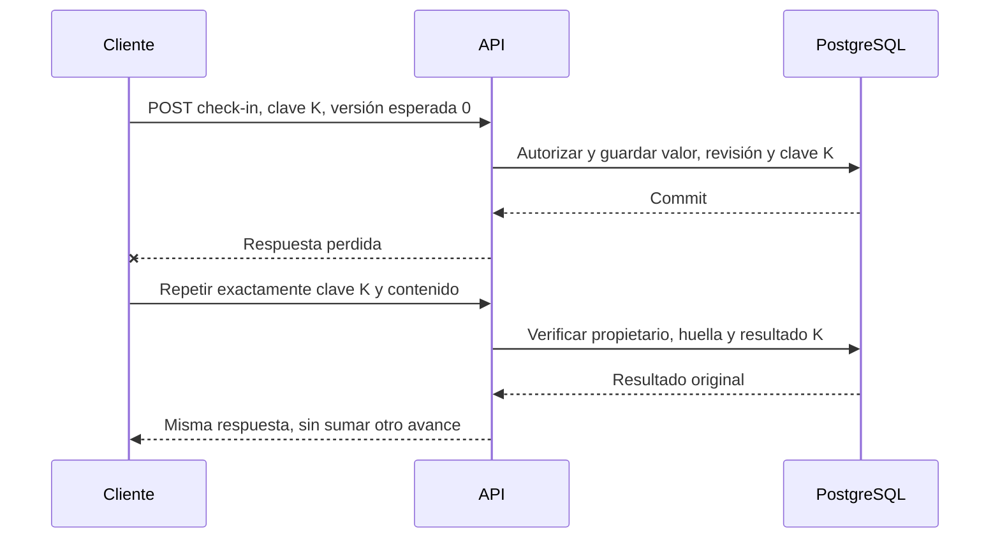

# API REST e integración

> **Estado: borrador para desarrollo. Ningún endpoint de esta guía se declara operativo.** La fuente de esquemas, campos, tipos y respuestas es [packages/contracts/openapi.json](../../packages/contracts/openapi.json). Esta guía explica cómo implementar y consumir ese contrato.

## Primer flujo propuesto

Servidor relativo: `/api/v1`. No se fija dominio, puerto ni ambiente inexistente. Todos los endpoints requieren access token de Keycloak, propiedad del recurso y cuenta habilitada.

| Método y ruta | Propósito | Requisito |
|---|---|---|
| `GET /api/v1/me` | Leer el perfil de negocio propio y permisos normalizados | RF-01, RF-02 |
| `GET /api/v1/habits` | Listar hábitos propios con cursor | RF-03 |
| `POST /api/v1/habits` | Crear hábito con agenda y meta | RF-03 |
| `GET /api/v1/habits/{habitId}` | Obtener hábito propio y ETag | RF-03 |
| `PATCH /api/v1/habits/{habitId}` | Editar, pausar o archivar con versión esperada | RF-03 |
| `GET /api/v1/habits/{habitId}/check-ins` | Consultar registros propios por fecha | RF-04 |
| `POST /api/v1/habits/{habitId}/check-ins` | Crear o corregir valor absoluto con historial | RF-04 |
| `GET /api/v1/habits/{habitId}/metrics` | Consultar métricas de periodos cerrados | RF-05 |

Identidad se gestiona en Keycloak. Consentimientos, recordatorios, recomendaciones, Wear OS, administración, exportación y eliminación requieren una ampliación de contratos. Los endpoints ilustrados por prácticas académicas son propuestas de su entrega; no son una segunda API canónica ni pruebas de disponibilidad.

## Autenticación y autorización

Enviar `Authorization: Bearer <access_token>` por HTTPS. La API valida token, rol y propiedad, no acepta el ID token como credencial ni recibe contraseña. `GET /me` representa un perfil interno previamente provisionado; el proceso idempotente de provisión al primer acceso se definirá antes de integrar el flujo de alta. La lectura no debe crear una cuenta silenciosamente.

Un recurso ajeno responde `404`. Un administrador solo accede a sus recursos personales por estas rutas; las funciones administrativas tendrán contratos y permisos separados. Véase la [matriz de permisos](../seguridad/README.md).

## JSON, nombres y tiempo

- Cuerpos `application/json`, propiedades `camelCase`, UUID opacos y enums en minúsculas. El esquema exacto manda; no convertir nombres a conveniencia de cada cliente.
- Comandos rechazan campos desconocidos para impedir asignación masiva. Consumidores toleran campos nuevos de respuesta compatibles y muestran estado seguro ante enums desconocidos.
- Instantes RFC 3339 normalizados a UTC con `Z`; fechas de negocio `YYYY-MM-DD`; zona IANA validada, por ejemplo `America/Mexico_City`.
- `occurredAt` refleja el instante declarado por el dispositivo; `recordedAt` lo asigna el servidor. No se usa el reloj del cliente como prueba suficiente de cumplimiento.
- `businessDate` y `timeZone` identifican el periodo del hábito según la agenda vigente para esa fecha. Cambiar zona del perfil no reinterpreta historia.
- Una agenda inicial contiene días ISO de la semana (`1` lunes a `7` domingo) y fecha de inicio. Cambios de meta, unidad, frecuencia o zona requieren nueva revisión y `effectiveFrom` futuro; no reescriben periodos cerrados.

## Idempotencia y conflictos

Toda mutación del borrador exige `Idempotency-Key` con un UUID nuevo por **intención del usuario**. Reintentar la misma intención conserva clave, body y cabeceras de precondición. El servidor vincula clave a actor, método y ruta normalizada, y guarda una huella del contenido relevante y resultado durable.

Misma clave y mismo contenido devuelve el resultado original con el mismo código, una vez autorizada la petición. Misma clave con contenido diferente produce `409 IDEMPOTENCY_KEY_REUSED`. Un duplicado todavía en curso devuelve `409 OPERATION_IN_PROGRESS` y permite reintentar con espera. Fallos antes del commit no confirman una operación; el cliente conserva la clave si el resultado es incierto.

Los check-ins incluyen además `clientEventId` durable, único por actor e intención. Su deduplicación se conserva junto con la evidencia de la operación, incluso si se pierde caché. No eliminar esas claves por un TTL de Redis. Retención de operaciones y máximo periodo offline se deben resolver antes de permitir limpieza de registros idempotentes.

| Caso | Acción del cliente |
|---|---|
| Crear check-in | `expectedVersion: 0`; recibir revisión inicial y `201` |
| Corregir registro existente | Enviar nuevo `clientEventId`, nueva clave, valor absoluto, versión actual y motivo; recibir `200` |
| Otro dispositivo ya cambió el registro | `409 VERSION_CONFLICT`; recargar, mostrar conflicto y confirmar nueva intención |
| Editar hábito | Reenviar ETag fuerte recibido en `If-Match`; una versión antigua recibe `412` |
| Falta `If-Match` | `428 PRECONDITION_REQUIRED`; obtener el recurso y reintentar con intención revisada |
| Red o respuesta desconocida | Repetir clave original; no sumar progreso ni generar otra intención automáticamente |

La deduplicación se evalúa antes de rechazar una versión vieja en una repetición ya confirmada; de otro modo un éxito cuya respuesta se perdió parecería un conflicto. Toda repetición vuelve a comprobar autenticación y permiso. `value` representa el total de esa fecha, no un incremento: enviar 20 dos veces no produce 40. Cada corrección conserva revisión previa, actor, motivo y fecha del servidor.

## Archivo, pausa y métricas

Archivar conserva historia y desactiva progreso nuevo y recordatorios. Pausa excluye periodos según las reglas de negocio y no borra registros anteriores. Las transiciones y su efecto temporal deben validarse en la API; un cambio de estado no autoriza a reinterpretar fechas ya cerradas.

`from` y `to` son fechas inclusivas. Métricas y rachas incluyen solo periodos programados cerrados en ese intervalo; el progreso de hoy se muestra como provisional por separado. `currentStreak` y `longestStreak` están **limitadas a ese intervalo** y la UI debe indicar “en este periodo”. Si no hay periodos computables, `completionRate` es `null`, no un 0 % que parezca incumplimiento. La respuesta identifica versión de reglas, zona y momento del cálculo.

## Paginación y lectura

Listas devuelven `items` y `nextCursor`; `null` termina el recorrido. `limit` tiene valor por defecto 20 y máximo propuesto 100. El cursor es opaco, vinculado a actor y filtros; no se interpreta ni modifica en el cliente.

Hábitos se ordenan por `(createdAt, id)` descendente; registros por `(businessDate, id)` descendente. La paginación por cursor no promete una fotografía transaccional de todas las páginas. Una actualización concurrente puede cambiar resultados; una exportación consistente tendrá un contrato específico. Cambiar filtros reinicia cursor. La API comprueba acceso en cada página y no expone totales globales de otras cuentas.

## Errores y reintentos

Los errores usan `application/problem+json`, conforme al modelo de [RFC 9457](https://www.rfc-editor.org/rfc/rfc9457.html), con extensiones del proyecto `code`, `requestId` y, si corresponde, `errors`. `type: about:blank` se utiliza cuando no haya una URI documental propia; `code` identifica la causa de negocio de forma estable. La interfaz traduce mensajes por código, no compara el texto de `detail`.

| Estado | Significado | Reintento |
|---|---|---|
| 400 | JSON, campo, cursor o formato inválido | Corregir la petición |
| 401 | Falta token o no es válido | Renovar sesión mediante IdP según política; no bucle infinito |
| 403 | Operación global sin permiso o cuenta suspendida | No automático |
| 404 | Perfil/recurso no encontrado o ajeno | No automático |
| 409 | Duplicidad incompatible, versión o estado de negocio | Reconciliar; en operación en curso esperar y repetir clave |
| 412 / 428 | ETag obsoleto / precondición ausente | Recargar antes de crear otra intención |
| 422 | Petición estructuralmente válida que viola regla de negocio | Corregir según código, sin mutación |
| 429 | Límite de solicitudes | Respetar `Retry-After`, espera y cancelación |
| 500 / 503 | Error inesperado / dependencia no disponible | Reintento acotado de lecturas o escritura con misma clave si resultado incierto |

No exponer stack traces, consultas, existencia de recursos ajenos ni valores personales rechazados. Respuestas personales deberán usar `Cache-Control: no-store`; las estrategias offline de cada cliente requieren almacenamiento local aislado por cuenta y política de purga. Los límites concretos de rate limiting, payload y plazos se fijarán antes de exponer la API.

## Compatibilidad y verificación

Consultar [política de contratos](../../packages/contracts/README.md). Cada PR que cambie interfaces deberá probar permisos, esquema de entrada/salida, ejemplos, reintentos, concurrencia y consumidor afectado. Los escenarios de aceptación se mantienen en [requerimientos](../requerimientos/aceptacion.md). Un visor de OpenAPI genera una referencia navegable a partir del archivo canónico; hasta existir backend, los ejemplos sirven para revisión y mocks identificados como tales.
