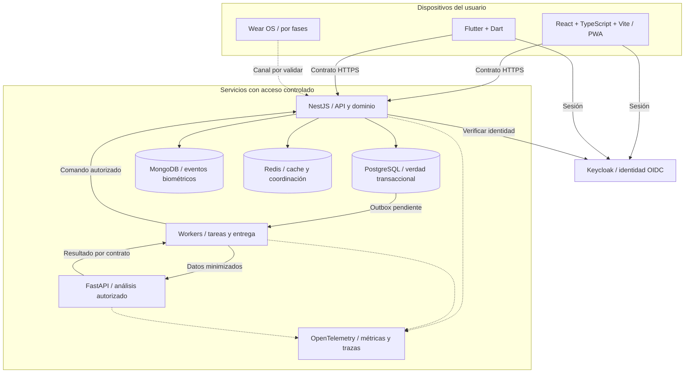

# Arquitectura de Quantify Core

**Estado:** diseño propuesto para desarrollo. El repositorio contiene documentación y un prototipo académico; estos diagramas no acreditan servicios desplegados. La base tecnológica es la del [README principal](../../README.md).

## Mapa de componentes y confianza

Los clientes solo acceden mediante contratos autorizados. La API es dueña de las mutaciones de negocio; analítica procesa lecturas minimizadas por contrato o vistas restringidas aprobadas. Las flechas de datos no conceden permisos de administrador ni lectura libre de bases.

| Lectura | Contenido |
|---|---|
| [Componentes y límites](componentes.md) | Módulos, propiedad, dependencias y fallos |
| [Flujos de integración](flujos.md) | Registro idempotente, recomendaciones y revocación |
| [Decisiones pendientes](decisiones-pendientes.md) | Qué falta decidir y cómo cerrarlo |
| [ADR](adr/README.md) | Justificación y estado de decisiones relevantes |
| [Modelo de datos](../datos-ia/modelo-datos.md) | Entidades, relaciones y diccionario |
| [API](../api/README.md) | Operaciones, esquemas y errores |

## Reglas para cambios arquitectónicos

1. Mantener React/TypeScript/Vite, Flutter/Dart, NestJS, FastAPI/Python, PostgreSQL, MongoDB, Redis, Keycloak y Docker/Compose como base propuesta. Versiones, ORM y SDK de Wear OS necesitan validación específica.
2. Empezar por un backend modular: una carpeta de dominio no obliga a desplegar un microservicio. Separar FastAPI por su responsabilidad de analítica y ciclo de vida de modelos.
3. Mantener una fuente de verdad por entidad. El resultado diario confirmado vive en PostgreSQL; una copia de evento en MongoDB no lo reemplaza. Redis nunca es el único respaldo de una operación de negocio.
4. Contratos, reglas de cálculo y esquemas se versionan. TypeScript y Dart comparten significados y pruebas, no necesariamente código de UI.
5. Diseñar para reintentos y entrega de eventos al menos una vez: idempotencia del productor y deduplicación del consumidor. No prometer entrega exactamente una vez entre almacenes.
6. Actualizar requisito, contrato, modelo, permisos, pruebas y ADR cuando una decisión transversal cambie.

El [ADR-0001](adr/0001-limites-y-propiedad-de-datos.md) propone estos límites. Su presencia no significa aceptación: la revisión y evidencia de cierre deben quedar registradas.
