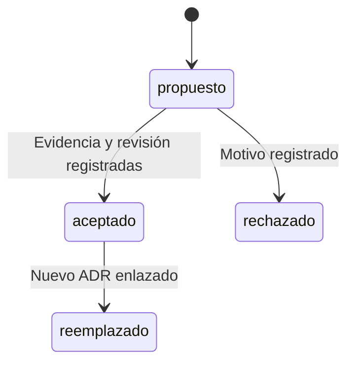

# Decisiones de arquitectura (ADR)

Un ADR conserva el motivo de una decisión que afecta arquitectura, datos, seguridad u operación. No reemplaza el contrato ni el requisito; enlaza ambos y deja visible su revisión.

| ADR | Asunto | Estado |
|---|---|---|
| [0001](0001-limites-y-propiedad-de-datos.md) | Límites de componentes y propiedad de datos | Propuesto |

Copiar la [plantilla](plantilla.md), usar el siguiente número libre y abrir PR hacia `develop` desde la rama correspondiente al cambio. Una propuesta puramente documental usa `docs/<tema>`; una decisión incluida en una funcionalidad puede acompañar su rama y PR.

No cambiar a `aceptado` sin evidencia de revisión del equipo. Una decisión reemplazada conserva su contexto y enlaza a la nueva; no se reescribe el pasado para simular aprobación.

Consultar el [registro de pendientes](../decisiones-pendientes.md) antes de añadir tecnologías, proveedores o parámetros globales.
