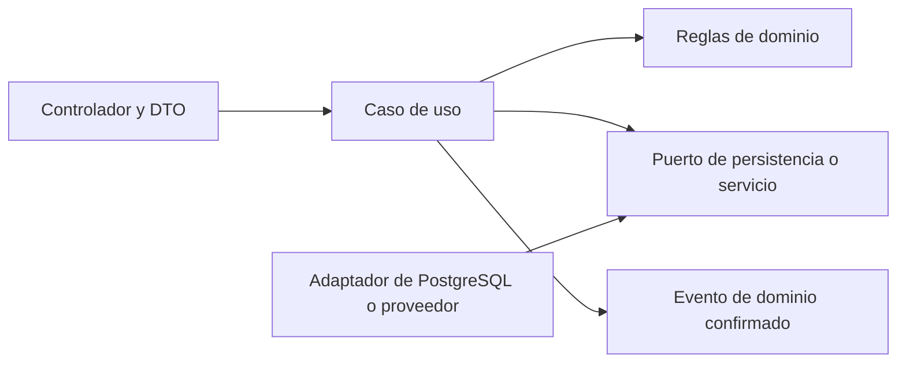

# Componentes, límites y dependencias

**Estado:** propuesta. Aplicar junto con [requisitos](../requerimientos/catalogo.md) y [seguridad](../seguridad/README.md). Los nombres de módulos son responsabilidades lógicas; no son rutas ni clases ya implementadas.

## Clientes y servicios

| Componente | Responsabilidad | No debe asumir |
|---|---|---|
| Web React + TS + Vite/PWA | Navegación, formularios, visualización, estado de sincronización y accesibilidad | Acceso a bases, secretos de servidor, autorización suficiente por ocultar botones |
| Móvil Flutter + Dart | Mismos contratos de negocio, almacenamiento local autorizado, ciclo de conexión y permisos del dispositivo | Fórmulas de racha distintas o un protocolo de escritura paralelo |
| Wear OS | Captura autorizada y sincronización de señales compatibles por fases | SDK, conectividad directa o sensores universales sin prueba técnica |
| Keycloak | Identidad, credenciales, sesiones y roles de alcance acordado | Almacenar hábitos o sustituir autorización por recurso de la API |
| API NestJS | Validación, casos de uso, autorización, transacciones y contratos de negocio | Ejecutar inferencias pesadas en cada lectura o delegar invariantes al cliente |
| Workers | Consumir trabajos durables, programar avisos, exportar y coordinar procesamiento | Decidir por su cuenta reglas distintas, conservar permiso después de revocación o escribir maestros saltándose casos de uso |
| Analítica FastAPI | Validar características autorizadas, ejecutar reglas/modelos y devolver resultado trazable | Mutar hábitos, perfiles, consentimiento o identidades; prometer diagnóstico |
| Observabilidad | Recibir telemetría técnica minimizada con OpenTelemetry; Prometheus/Grafana propuestos | Usar logs como auditoría privada ilimitada o como almacén de biometría |

La separación modular de NestJS permite exponer proveedores explícitos entre módulos; se usará para evitar acceso arbitrario a internals. Véase [documentación oficial de módulos](https://docs.nestjs.com/modules). FastAPI permite describir contratos mediante OpenAPI; el contrato interno debe mantenerse separado del contrato público. Véase [características oficiales de FastAPI](https://fastapi.tiangolo.com/features/).

## Módulos de la API

| Módulo | RF | Es dueño de | Interfaz con otros módulos |
|---|---|---|---|
| Identidad y acceso | RF-01 | Asociación con identidad externa y política de acceso local | Proporciona contexto autenticado y estado de cuenta |
| Perfil y consentimiento | RF-02 | Preferencias, zona, permisos por finalidad | Resuelve autorización de tratamiento al ejecutar tareas |
| Hábitos | RF-03 | Rutina, versiones, agenda y estado | Entrega configuración efectiva por fecha |
| Registros | RF-04 | Resultado diario, revisiones y deduplicación de comandos | Publica cambio confirmado e invalida métricas |
| Métricas | RF-05 | Cálculo de reglas y agregados reproducibles | Lee registros autorizados y versiones históricas |
| Recordatorios | RF-06 | Configuración de aviso y ocurrencias | Consulta agenda y autorización antes de entregar |
| Recomendaciones | RF-07 | Estado de sugerencias y aceptación | Solicita inferencia; crea hábito a través del caso de uso de Hábitos |
| Dispositivos | RF-08 | Vínculo de fuente, permisos y recepción de lotes | Verifica consentimiento y aplica esquema de ingesta |
| Administración | RF-09 | Casos de uso de catálogo y estado de cuenta | Invoca funciones autorizadas; no usa un acceso universal a datos personales |
| Auditoría y solicitudes de datos | RF-10 | Eventos de control, exportación y eliminación | Coordina tareas por almacén y conserva estado verificable |

## Organización interna propuesta

- El controlador traduce el transporte; no calcula rachas ni ejecuta una cadena de escrituras sin transacción.
- El caso de uso aplica permisos, invariantes y límites de la transacción. Una regla compartida se implementa una vez y se prueba con fixtures comunes.
- Adaptadores encapsulan base, IdP, cola y notificaciones. Elegir ORM, gestor de colas y librerías después de la prueba correspondiente; no fijarlos mediante ejemplos aislados.
- Evitar dependencias circulares y módulos «comunes» que acumulen todos los dominios. Exportar operaciones concretas; no exponer repositorios privados para modificar entidades ajenas.
- Los workers pueden reutilizar casos de uso dentro del mismo despliegue o invocarlos por una interfaz interna autenticada. Ese detalle depende de la topología; la propiedad de negocio se conserva.

## Persistencia y fallos

| Situación | Resultado esperado |
|---|---|
| PostgreSQL no confirma la transacción | No devolver check-in confirmado; cliente conserva operación pendiente según política |
| PostgreSQL confirma y se pierde la respuesta | Reintentar devuelve resultado existente por clave y evento; no suma de nuevo |
| Worker o Redis fuera de servicio | El outbox conserva trabajo no publicado; mostrar derivados pendientes y reanudar con deduplicación |
| MongoDB no disponible | Ingesta biométrica no se declara recibida sin persistencia durable; el núcleo manual puede seguir si no depende de ella |
| FastAPI no responde | Estado no disponible o tarea reintentable; nunca fabricar recomendación ni bloquear guardar un hábito |
| Proveedor de aviso falla | Registrar intento y reintentar con límite; no cambiar el progreso del hábito |
| Consentimiento se revoca durante el trabajo | Revalidar antes del procesamiento y persistencia/entrega; descartar resultado no autorizado |

El outbox propuesto se confirma junto al cambio de negocio en PostgreSQL. El consumidor registra identificadores procesados; un trabajo atascado pasa a revisión según límites de reintento definidos. Una cola Redis no sustituye este registro durable. Las transacciones de PostgreSQL agrupan cambios en una unidad que confirma o revierte; no extienden esa garantía automáticamente a MongoDB o proveedores. Véase [documentación oficial de transacciones](https://www.postgresql.org/docs/current/tutorial-transactions.html).

## Migraciones y extracción futura

Cada entidad tiene un módulo responsable de su migración y compatibilidad. Antes de extraer un servicio, justificar con carga, aislamiento operativo o ciclo de despliegue; documentar contrato, consistencia, recuperación y costo. Un monorepo con servicios independientes no implica una base de datos compartida con permisos de escritura globales.
