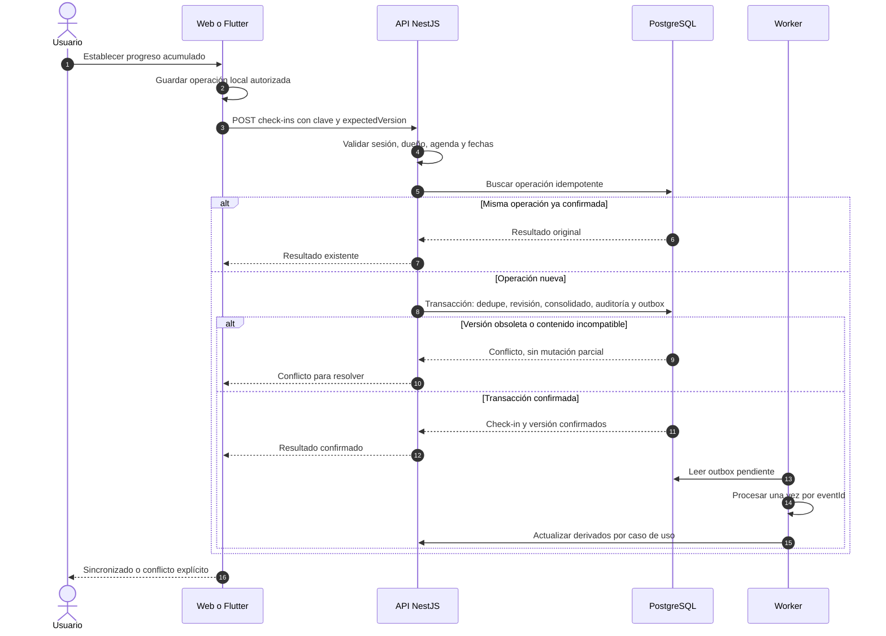
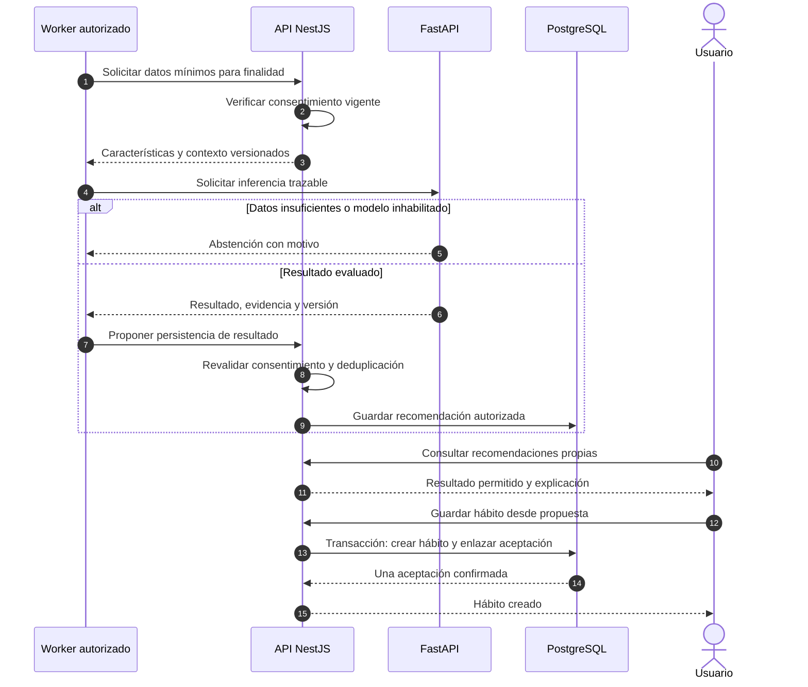
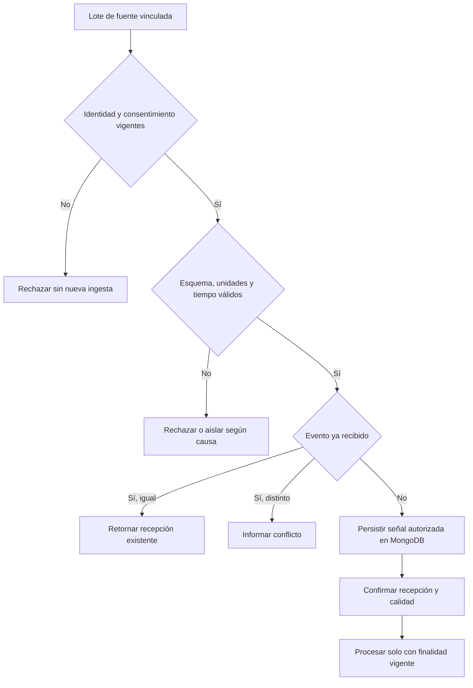

# Flujos de integración

Los diagramas describen la solución propuesta. Los campos y códigos concretos se revisan con el [contrato de API](../api/README.md). Las flechas de éxito solo ocurren después de validar sesión, permisos y pertenencia.

## RF-04: registrar progreso y repetir una solicitud

El comando usa `clientEventId`, `businessDate`, `occurredAt`, `timeZone`, `value` y `expectedVersion`. `value` es el total acumulado del día. Una creación usa revisión esperada cero; correcciones indican la revisión recibida. La API genera `receivedAt` y valida que fecha/zona correspondan a la agenda histórica.

La deduplicación por `clientEventId` dura lo que establezca la política de registros; la caché de una clave de solicitud puede tener otra retención. Reutilizar la clave o evento con contenido distinto causa conflicto. La transacción debe resolver carreras con restricciones y control de versión, no solo con un `SELECT` previo.

Si la respuesta se pierde, el cliente conserva el mismo identificador de operación y contenido al reintentar. Ante conflicto de versión muestra el estado confirmado y solicita o aplica una resolución documentada; no crea automáticamente otro incremento.

## RF-07: generar, presentar y aceptar una recomendación

Consultar una lista no exige generar inferencia en esa misma petición. Generación costosa se programa o solicita como trabajo; la consulta retorna estado y resultados ya autorizados. Cancelar la personalización no acepta ni crea el hábito. El servidor vuelve a comprobar consentimiento al servir el resultado para no presentar una recomendación retirada.

## RF-08: ingesta y revocación por fases

Recepción, interpretación y uso analítico son pasos diferentes. La revocación bloquea lotes futuros y trabajos pendientes, también si el dispositivo estuvo offline. Las señales retenidas se eliminan o conservan según política explícita; revocar no debe confundirse con borrar sin seguimiento. Protocolo, SDK, sensores y canal de emparejamiento dependen de D-06.

## RF-10: exportación y eliminación

La solicitud empieza en una sesión verificada, registra alcance y estado, y termina con evidencia por almacén. Exportación crea un artefacto privado con caducidad. Eliminación coordina PostgreSQL, MongoDB, objetos, derivados, cache y credenciales sin asumir una transacción global. Fallos parciales permanecen visibles y reintentables; no informar «eliminado» al recibir únicamente la solicitud. Véase [ciclo de vida de datos](../datos-ia/calidad-ciclo-vida.md).
