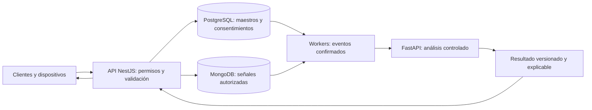

# Datos e inteligencia artificial

Esta sección establece qué datos necesita Quantify Core, quién puede cambiarlos y cómo se documentarán los indicadores y recomendaciones. **Estado:** diseño de desarrollo; todavía no hay esquemas físicos, pipelines ni modelos de producto implementados.

| Documento | Uso |
|---|---|
| [Modelo de datos](modelo-datos.md) | Entidades, propiedad, fechas, versiones e integridad. |
| [Calidad y ciclo de vida](calidad-ciclo-vida.md) | Procedencia, validación, consentimiento, retención, exportación y eliminación. |
| [Analítica e IA](analitica-ia.md) | Línea base, evaluación, explicación, abstención y seguimiento de modelos. |
| [Reglas de negocio](../requerimientos/reglas-negocio.md) | Significado funcional de hábitos, check-ins, rachas y decisiones del usuario. |

PostgreSQL es la fuente transaccional de perfiles, hábitos, revisiones, consentimientos y resultados confirmados. MongoDB se contempla para eventos y telemetría heterogénea, con justificación por volumen y acceso antes de adoptarlo. Redis ofrece cache y coordinación temporal; su contenido se puede reconstruir y no es la única evidencia de una escritura confirmada. El servicio de analítica consume datos autorizados mediante contratos y produce resultados, sin modificar entidades maestras directamente.

El prototipo de [Práctica 07](../practica-07/README.md) usa datos ficticios locales; sus fórmulas y umbrales ilustran un recorrido, no certifican calidad clínica ni son políticas aprobadas para el producto. Las decisiones abiertas están en [arquitectura](../arquitectura/decisiones-pendientes.md).
