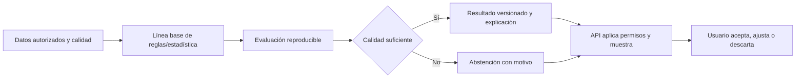

# Analítica e inteligencia artificial

**Estado:** plan de desarrollo. No hay modelo entrenado, métricas de desempeño, población validada ni servicio productivo de IA. FastAPI es la base tecnológica propuesta para ejecutar análisis separados de la API de negocio.

## Del dato a una recomendación

La primera entrega usa métricas deterministas de RF-05 y una línea base comprensible antes de plantear modelos complejos. Una correlación entre hábitos y bienestar no demuestra causalidad. Los resultados son apoyo informativo y no constituyen diagnóstico médico. Un modelo o LLM no puede modificar el resultado cuantitativo confirmado sin una regla versionada y revisada.

## Ficha obligatoria de cada análisis o modelo

| Campo | Pregunta que debe responder |
|---|---|
| Propósito y población | ¿Para quién se usa y qué decisión apoya? |
| Datos y permiso | ¿Cuál es la fuente, licencia, finalidad y consentimiento vigente? |
| Variables | ¿Qué campos se usan, cómo se tratan faltantes y cuáles se excluyen? |
| Versión | ¿Qué código, reglas, datos y artefacto produjeron el resultado? |
| Validación | ¿Cómo se separan entrenamiento y evaluación sin filtrar futuro o identidad? |
| Métricas y sesgos | ¿Cómo se mide acierto, calibración cuando aplique y desempeño por segmentos? |
| Abstención | ¿Cuándo se evita sugerir por insuficiencia, riesgo o datos fuera de distribución? |
| Explicación | ¿Qué evidencia mínima se muestra al usuario sin afirmar causalidad? |
| Operación | ¿Cómo se monitorea, revoca, retira y reproduce una inferencia? |

Si se evalúa un proveedor externo, documentar finalidad, datos transferidos, contrato, costo, retención y opción de desactivación. Nunca enviar biometría o perfiles completos por comodidad de implementación.

## Reglas y umbrales

La Práctica 05 y el prototipo de Práctica 07 contienen umbrales ilustrativos diferentes, como confianza, días mínimos y tiempo de descarte. Esos números tienen alcance académico. La [decisión D-07](../arquitectura/decisiones-pendientes.md) debe definir una puntuación interpretable, población, ventana, límites, evidencia y pruebas antes de aplicar umbrales en el producto.

El usuario puede ver motivo, ajustar una sugerencia o descartarla. Una recomendación nunca crea un hábito sin aceptación explícita; reintentar esa aceptación mantiene un solo resultado. Revocar consentimiento detiene trabajos pendientes y nuevas lecturas. Un resultado sin evidencia suficiente produce abstención comprensible.

## Criterios antes de liberar

Contar con datos autorizados, línea base, evaluación reproducible y versionado. Probar límites, sesgos conocidos, abstención, explicabilidad, aceptación/descarte idempotente y retirada de resultados. Registrar qué se midió y qué no, con datos sintéticos o autorizados conforme a política. La guía del [servicio de analítica](../../services/analytics/README.md) detalla sus fronteras técnicas.
