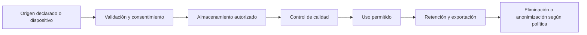

# Calidad y ciclo de vida de los datos

**Estado:** requisitos de diseño. La procedencia, la retención y la eliminación definitivas se cerrarán con [D-09](../arquitectura/decisiones-pendientes.md) antes de recopilar información real.

## Recorrido del dato

| Etapa | Registro necesario | Condición de rechazo o corrección |
|---|---|---|
| Captura | Fuente, actor/dispositivo, instante declarado y recibido, versión de esquema. | Fuente no autorizada, datos fuera de rango o lote repetido. |
| Validación | Tipo, unidad, zona horaria, tamaño, integridad e idempotencia. | Unidades ambiguas, fecha imposible o revisión obsoleta. |
| Uso | Finalidad, consentimiento vigente, versión de regla/modelo y acceso. | Revocación, ausencia de calidad suficiente o propósito distinto. |
| Conservación | Categoría, dueño, almacenes y plazo aprobado. | Plazo vencido, eliminación solicitada o dato sin justificación de permanencia. |

Separar registros declarados por el usuario, inferidos por el sistema y medidos por un dispositivo. Un valor medido no demuestra automáticamente que un hábito se cumplió. Conservar la incertidumbre, calidad y procedencia para que los análisis no conviertan datos incompletos en hechos.

## Datos faltantes y duplicados

- No convertir ausencia de señal en incumplimiento; los periodos programados se evalúan con la regla de negocio y el estado de sincronización conocido.
- Distinguir cero medido, dato faltante, dato descartado y periodo aún abierto.
- Rechazar o aislar valores fuera del contrato, fuera de orden o con fuente revocada; documentar un motivo inspeccionable sin guardar contenido sensible en logs.
- Deduplicar check-ins y lotes mediante identificadores durables y claves de idempotencia. Los reintentos no deben producir dos efectos.
- Corregir datos con una nueva revisión y auditoría; no sobrescribir silenciosamente la medición original.

## Consentimiento y derechos

Registrar consentimiento por finalidad y fuente, con versión y fecha. La autorización de sistema operativo para sensores no reemplaza el consentimiento para tratamiento o análisis. La revocación debe bloquear nuevas lecturas y trabajos aún pendientes; los resultados previos se tratan conforme a la política de conservación aprobada.

Una exportación se entrega al dueño autenticado por un canal temporal y restringido. La eliminación necesita un estado verificable para PostgreSQL, MongoDB, objetos, caches, derivados, trabajos pendientes y respaldos; los límites legales de conservación se definirán antes de ejecutar borrados. Al restaurar un respaldo se vuelve a aplicar la política de eliminación para no reactivar datos suprimidos.

Los periodos de retención, región y responsables siguen pendientes. Los entornos de desarrollo y validación usan datos sintéticos; anonimizar requiere verificar que no sea posible reidentificar al usuario mediante combinaciones de campos. Ver [seguridad](../seguridad/README.md) y [recuperación](../despliegue/recuperacion.md).
