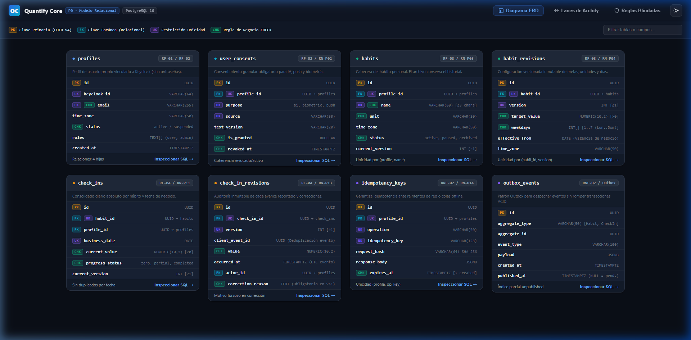
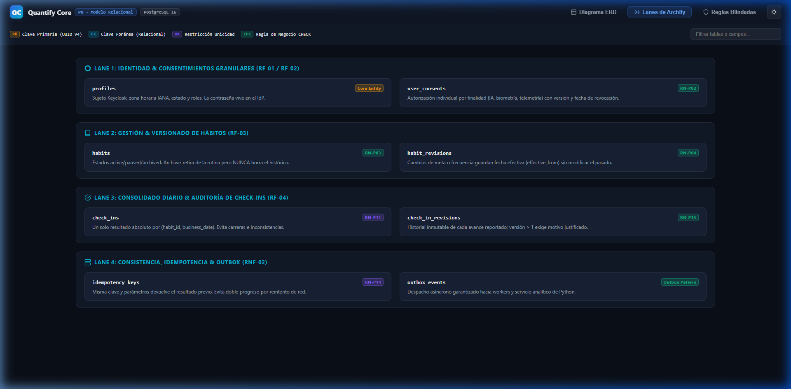
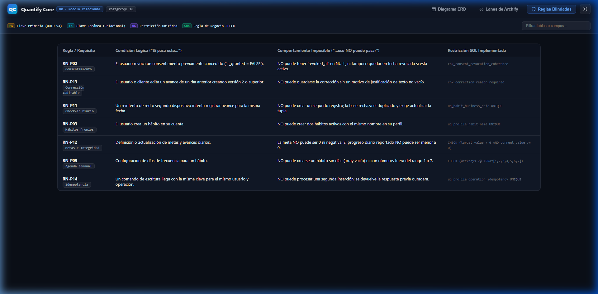

# Evidencia de Entrega: Modelo Relacional de Base de Datos (P0)

**Tarea:** Diseñar modelo relacional de usuarios, hábitos y registros  
**Prioridad:** P0  
**Rama:** `feature/p0-modelo-relacional-core`  
**Motor de Persistencia:** PostgreSQL 16 (Relacional ACID)  
**Requisitos Asignados:** RF-01, RF-02, RF-03, RF-04, RNF-01, RNF-02, RNF-03  
**Reglas de Negocio Implementadas:** RN-P01, RN-P02, RN-P03, RN-P04, RN-P06, RN-P11, RN-P12, RN-P13, RN-P14, RN-P15  

---

## 1. Cumplimiento de Criterios de Aceptación

| Criterio de Aceptación | Evidencia Técnica en el Código | Archivo Fuente |
|---|---|---|
| **Esquema SQL definido** | DDL completo y tipado en PostgreSQL 16 con tipos nativos (`UUID`, `NUMERIC(10,2)`, `TIMESTAMPTZ`, arrays tipados, `JSONB`). | [schema.sql](../../services/api/src/database/schema.sql) |
| **Claves primarias y foráneas** | Claves primarias con `gen_random_uuid()`. Claves foráneas con integridad referencial y cascada de borrado (`ON DELETE CASCADE`) controlada. | [schema.sql](../../services/api/src/database/schema.sql) |
| **Relaciones entre entidades** | Relación 1:N de `profiles` a `habits`, 1:N de `habits` a `habit_revisions`, 1:N de `habits` a `check_ins`, 1:N de `check_ins` a `check_in_revisions`, y 1:N de `profiles` a `user_consents`. | [schema.sql](../../services/api/src/database/schema.sql) |
| **Integridad de registros** | Restricciones `UNIQUE` (evitar colisiones de check-in en la misma fecha `(habit_id, business_date)`), restricciones `CHECK` (metas > 0, valores no negativos, estados válidos, motivo de corrección obligatorio para revisiones > 1). | [schema.sql](../../services/api/src/database/schema.sql) |

---

## 2. Cumplimiento de la Definición de Terminado (DoD)

### 2.1 Implementación
Se generaron los siguientes artefactos con diseño *Clean Code* y apego a la arquitectura del monorepo:
1. `services/api/src/database/schema.sql`: Definición DDL de las tablas núcleo (`profiles`, `user_consents`, `habits`, `habit_revisions`, `check_ins`, `check_in_revisions`, `idempotency_keys`, `outbox_events`).
2. `services/api/src/database/seeds.sql`: Datos sintéticos de demostración académica (perfiles de prueba, consentimientos, hábitos activos y pausados, revisiones de metas, check-ins completados y parciales, corrección justificada de progreso, clave de idempotencia y evento outbox).
3. `services/api/src/database/verify.sql`: Suite de verificación y pruebas negativas en PL/pgSQL que evalúa aserciones y excepciones deliberadas ante intentos de violar unicidad o checks.
4. `infrastructure/docker/compose.yaml` y `.env.example`: Entorno reproducible para levantar la base de datos PostgreSQL 16 con inicialización automática.
5. `docs/datos-ia/modelo-relacional.archify.json`: Especificación formal en formato Archify (Schema v2) estructurada en 4 carriles arquitectónicos (Lanes).
6. `docs/datos-ia/diagrama-modelo-relacional.html`: Visor web interactivo con vistas ERD, Lanes de Archify, matriz de reglas blindadas e inspector SQL lateral.
7. `docs/datos-ia/assets/*.png`: Diagramas e imágenes exportadas en formato PNG:
   - `assets/diagrama-erd.png`: Diagrama de Entidad-Relación con las 8 tablas, tipos de datos y badges de restricciones.
   - `assets/archify-lanes.png`: Carriles arquitectónicos de flujo (Identidad, Hábitos, Registros y Consistencia/Outbox).
   - `assets/reglas-blindadas.png`: Matriz visual de reglas de negocio protegidas a nivel motor.
   - `assets/inspector-sql.png`: Vista detallada del inspector SQL y semillas sintéticas.

#### Vistas Gráficas del Modelo Relacional:







### 2.2 Pruebas Verificadas
Se implementó y ejecutó una suite de pruebas automatizadas con Node.js:
- **Archivo de prueba:** `tests/database/schema.test.cjs`
- **Comando ejecutado:**
```bash
node --test tests/database/schema.test.cjs
```
- **Resultado real de la ejecución:**
```text
TAP version 13
# Subtest: Verificación del Modelo Relacional de Base de Datos (P0)
    # Subtest: Los archivos clave de base de datos existen y son legibles
    ok 1 - Los archivos clave de base de datos existen y son legibles
    # Subtest: Define todas las tablas requeridas por la especificación
    ok 2 - Define todas las tablas requeridas por la especificación
    # Subtest: Verifica claves foráneas y relaciones entre entidades
    ok 3 - Verifica claves foráneas y relaciones entre entidades
    # Subtest: Verifica restricciones críticas de unicidad para evitar duplicados
    ok 4 - Verifica restricciones críticas de unicidad para evitar duplicados
    # Subtest: Verifica restricciones de validación CHECK de reglas de negocio
    ok 5 - Verifica restricciones de validación CHECK de reglas de negocio
    # Subtest: Los datos sintéticos no exponen contraseñas y mantienen integridad de pruebas
    ok 6 - Los datos sintéticos no exponen contraseñas y mantienen integridad de pruebas
    # Subtest: Docker Compose expone loopback seguro y enlaza scripts oficiales de BD
    ok 7 - Docker Compose expone loopback seguro y enlaza scripts oficiales de BD
    1..7
ok 1 - Verificación del Modelo Relacional de Base de Datos (P0)
# tests 7
# suites 1
# pass 7
# fail 0
# cancelled 0
# skipped 0
# todo 0
```

Adicionalmente, se verificó que la suite previa del repositorio continuara pasando al 100%:
```bash
node --test docs/practica-07/tests/prototipo.test.cjs
# pass 21
# fail 0
```

---

## 3. Instrucciones de Ejecución para la Demo Académica

Para reproducir y demostrar el modelo relacional durante la evaluación académica:

### Paso 1: Levantar PostgreSQL con Docker Compose
```bash
cd infrastructure/docker
docker compose up -d
```
*Docker inicializará automáticamente el esquema (`01-schema.sql`) y cargará los datos de prueba (`02-seeds.sql`).*

### Paso 2: Ejecutar la Suite de Pruebas de Integridad SQL
```bash
docker exec -it quantify-postgres psql -U quantify_user -d quantify_core -f /docker-entrypoint-initdb.d/../../services/api/src/database/verify.sql
```
*(O montando `verify.sql` para validación directa).*

### Paso 3: Ejecutar la Suite Automatizada de Node.js
Desde la raíz del repositorio:
```bash
node --test tests/database/schema.test.cjs
```

---

## 4. Estado de la Integración
- **Rama de trabajo:** `feature/p0-modelo-relacional-core`
- **Rama destino para integración futura:** `develop` (vía Pull Request, conforme a [git-flow.md](../guias/git-flow.md)).
