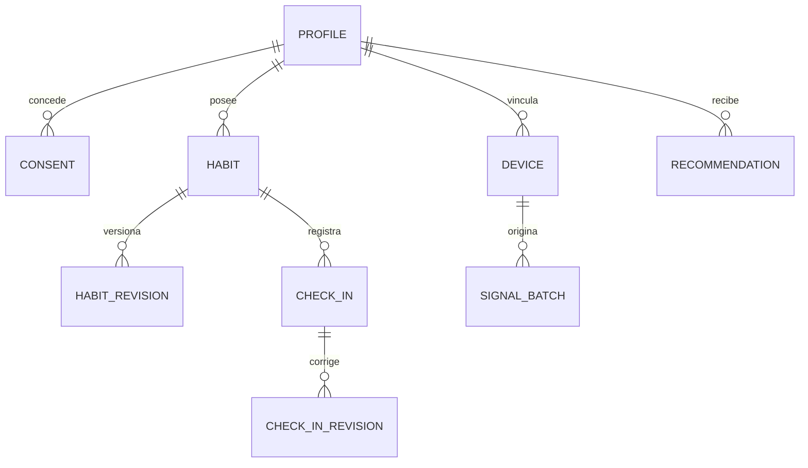
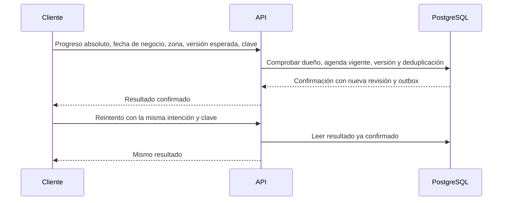

# Modelo conceptual de datos

**Estado:** propuesta para diseñar migraciones y contratos. Los nombres lógicos siguientes no son tablas existentes. El contrato público JSON usa `camelCase`; al crear SQL se usarán nombres `snake_case`. Las cardinalidades y restricciones se prueban antes de cerrar el esquema físico.

## Propiedad y ubicación propuestas

| Entidad lógica | Almacén y dueño | Campos mínimos y restricciones de diseño |
|---|---|---|
| Perfil | PostgreSQL, API | Identificador interno opaco, sujeto Keycloak, zona IANA, estado. El IdP gestiona credenciales y sesiones; el perfil no almacena contraseñas. |
| Consentimiento | PostgreSQL, API | Dueño, finalidad, fuente, versión del texto, instante de aceptación/revocación y estado. La autorización se reevalúa al usar datos. |
| Hábito | PostgreSQL, API | Dueño, estado `active/paused/archived`, identificador y revisión actual. El archivo conserva el historial. |
| Revisión de hábito | PostgreSQL, API | Meta, unidad, frecuencia, zona, vigencia `effectiveFrom` y versión. Las revisiones antiguas conservan el significado de periodos anteriores. |
| Check-in | PostgreSQL, API | Hábito, fecha de negocio y versión actual; una consolidación por hábito y fecha. Restricción única y pertenencia comprobada en servidor. |
| Revisión de check-in | PostgreSQL, API | Valor absoluto, actor, fecha de servidor, origen, motivo de corrección y versión. Nunca sumar reintentos como avance nuevo. |
| Clave idempotente | PostgreSQL, API | Actor, operación, clave, huella de petición y resultado durable. Retención alineada con el máximo periodo offline que se apruebe. |
| Evento de salida y auditoría | PostgreSQL, API | Hecho confirmado, versión, actor o servicio, recurso, resultado y correlación no sensible; el outbox precede a su publicación. |
| Dispositivo | PostgreSQL, API | Dueño, fuente, estado y consentimiento vinculado. Identificadores y credenciales con acceso limitado. |
| Lote de señal | MongoDB si se justifica, ingesta autorizada | Fuente, esquema, periodo, instante recibido, calidad y referencia de consentimiento. Señales biométricas se limitan a finalidad aprobada. |
| Recomendación | PostgreSQL, API/analítica según contrato | Dueño, resultado, evidencia mínima, versión de regla/modelo, expiración y decisión explícita del usuario. |

La ubicación del dato biométrico y la conveniencia de MongoDB requieren prueba técnica y [decisión D-04](../arquitectura/decisiones-pendientes.md). No duplicar perfiles, hábitos o consentimientos como maestros en MongoDB. Los agregados y caches son derivados y necesitan una forma de reconstrucción.

## Tiempo y cambios

Un instante técnico se representa en UTC; la fecha de negocio y la zona IANA del hábito se guardan por separado. No derivar el histórico con la zona actual del teléfono o del perfil. Un cambio de meta, frecuencia, unidad o zona crea una nueva revisión con vigencia definida; no reescribe periodos cerrados. Las reglas numéricas y el máximo plazo para corregir quedan en [decisión D-03](../arquitectura/decisiones-pendientes.md).

El cliente envía una versión esperada para resolver dos dispositivos. Ante conflicto, la API conserva el estado confirmado e informa al cliente para revisar antes de una nueva intención. Una petición repetida con la misma clave devuelve el resultado original tras comprobar permiso; la clave repetida con otro contenido se rechaza. El [contrato HTTP](../../packages/contracts/README.md) fija los campos públicos y códigos exactos.

## Integridad y acceso

La API es dueña de las transacciones de negocio. Analítica lee una vista o interfaz con datos mínimos autorizados y no escribe maestros. Los workers reciben hechos confirmados y pueden reintentar; sus efectos son idempotentes. Proteger recursos por dueño incluso cuando un cliente suministra un identificador válido. Administración gestiona catálogos y estado de cuentas con permisos específicos; no consulta rutinas privadas por defecto.

Antes de crear tablas o colecciones, acordar índices y unicidad, política de migraciones, precisión numérica, volumen previsto, retención y respaldos. Mantener datos sintéticos en ejemplos y pruebas.
