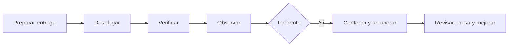

# Guías de operación y despliegue

Esta sección define los procedimientos que acompañarán a los ambientes de Quantify Core. La configuración se mantiene en [infrastructure/deployment](../../infrastructure/deployment/README.md); aquí se describe cómo operar y verificar sus cambios.

**Estado:** procedimientos de referencia por concretar con la plataforma elegida. No hay proveedor ni sistema de producto desplegado acreditado por estos documentos.

| Necesidad | Documento |
|---|---|
| Preparar ambiente y publicar una versión | [Procedimiento de publicación](publicacion.md). |
| Diagnosticar, revertir y restaurar | [Incidentes y recuperación](recuperacion.md). |
| Preparar dependencias de desarrollo | [Docker](../../infrastructure/docker/README.md). |
| Consultar señales y alertas | [Observabilidad](../../infrastructure/observability/README.md). |
| Preparar la copia local y saber qué falta instalar | [Installation](../Installation/README.md). |

Antes de ejecutar un procedimiento, completar ambiente, responsable, versión, accesos, comandos verificados, recursos afectados y criterio de éxito. Las referencias a consolas o proveedores se incorporan cuando exista una elección; nunca se documentan credenciales reales.
