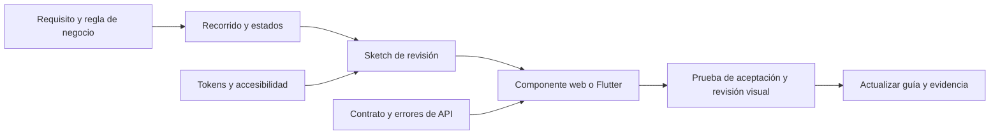

# Diseño de experiencia e interfaz

**Estado: base documental para desarrollo; no certifica pantallas de producto implementadas.** Esta guía conecta los recorridos académicos con las reglas, contratos y componentes que deberán usar web, móvil y, en su alcance aprobado, Wear OS.

| Necesidad | Documento |
|---|---|
| Diseñar una pantalla o componente | [Sistema de diseño](sistema-diseno.md) |
| Entender acciones, cancelaciones y errores | [Recorridos y estados](recorridos.md) |
| Consultar colores, temas y valores compartidos | [Tokens de diseño](../../packages/design-tokens/README.md) |
| Consultar comportamiento funcional | [Requisitos](../requerimientos/catalogo.md) y [reglas de negocio](../requerimientos/reglas-negocio.md) |
| Implementar web o móvil | [Guías de aplicaciones](../../apps/README.md) |
| Revisar la experiencia existente | [Prototipo Práctica 07](../practica-07/README.md) |

## Explorar la referencia interactiva

| Prototipo de pantallas | Mapa de navegación |
|---|---|
| [Abrir demo móvil y PWA](https://angeljesus13.github.io/Quantify-Core/docs/practica-07/) | [Abrir mapa de recorridos](https://angeljesus13.github.io/Quantify-Core/docs/practica-07/navegacion.html) |
| Permite alternar rol, probar formularios y visualizar estados locales | Permite inspeccionar conexiones y condiciones entre sketches |

La demo contiene 15 sketches de Usuario y 9 de Administrador. Sus cuentas, código de verificación, fecha fija, almacenamiento local y cifras ilustrativas sirven para revisión. El visor PWA no implementa instalación, service worker ni sincronización remota, y el cambio de rol no representa autorización real.

## Qué es canónico y qué queda pendiente

La paleta base del [README general](../../README.md) usa **Laser Blue `#275BC0`**. El azul `#1E54C9` y otros colores de la Práctica 05/07 se conservan como material histórico de sketch; no deben copiarse silenciosamente al tema del producto. Los [tokens](../../packages/design-tokens/README.md) documentan esa correspondencia y sus límites de contraste.

Las prácticas muestran una intención de diseño y decisiones de ejemplo. Los umbrales numéricos de IA, estado “terminado” de una historia académica, endpoints ilustrativos, Riverpod o SQLite no constituyen evidencia de implementación ni decisiones aprobadas de V2.0. Consultar las reglas y contratos vigentes, y registrar cualquier diferencia que todavía requiera resolución.

Tipografía, escala de espaciado, radios, iconos, breakpoints y librerías de UI requieren decisión del equipo. Las propuestas visuales de esta sección se identifican como tales; no instalar un kit por inferencia.

Lista de revisión antes de entregar una pantalla

- [ ] RF, regla y rol vinculados; administración sin acceso a rutinas privadas.
- [ ] Acciones, cancelación, retorno y conservación del borrador definidos.
- [ ] Carga, vacío, éxito, validación, permiso insuficiente, desconexión y conflicto representados.
- [ ] Token semántico usado, contraste medido y estados identificables sin color.
- [ ] Teclado, lector de pantalla, foco, texto grande y reducción de movimiento revisados.
- [ ] Mensajes comprensibles; no se presenta un dato pendiente como confirmado.
- [ ] Gráficas con periodo, unidad, zona/fecha relevante, leyenda y alternativa textual.
- [ ] Datos de demostración identificados, sin capturas de información personal real.
- [ ] Evidencia visual con pantalla/rol/ambiente/versión y límites de la prueba.
- [ ] Pruebas de aceptación y documentación actualizadas en el mismo cambio.

## Mantenimiento

Un cambio de regla se resuelve primero en requisitos y contratos; un cambio visual compartido se resuelve en tokens y catálogo. Los clientes consumen esas decisiones, evitando valores y mensajes distintos para la misma acción. Documentar en un ADR las decisiones que alteren arquitectura, privacidad o dependencias.

[Volver a documentación](../README.md) · [Decisiones pendientes](../arquitectura/decisiones-pendientes.md)
