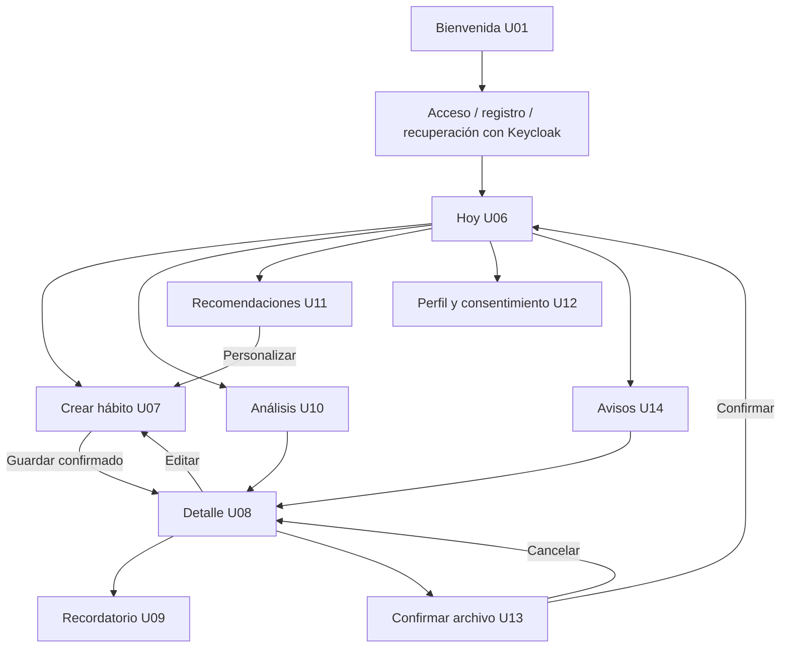
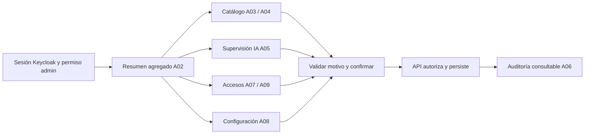

# Recorridos y estados de interfaz

**Estado: guía para implementación y pruebas; los IDs U/A identifican sketches académicos.** Consultar las [reglas vigentes](../requerimientos/reglas-negocio.md), los [criterios de aceptación](../requerimientos/aceptacion.md) y los [contratos](../../packages/contracts/README.md) antes de escribir código. Las pantallas no deciden permisos ni resultados de negocio por su cuenta.

## Mapa del usuario



La bienvenida y el retorno de autenticación pertenecen al cliente. Las credenciales, verificación y recuperación se delegan a Keycloak; U02–U05/U15 muestran la intención del sketch, no justifican implementar un sistema paralelo de contraseñas. No trasladar cuentas ni códigos de demo al producto.

| Requisito | Referencia de sketch | Entrada y resultado esperado | Alternativas que deben diseñarse |
|---|---|---|---|
| RF-01 Identidad | U01–U05/U15, A01 | Sesión válida y retorno interno autorizado | Cancelación, verificación pendiente, acceso fallido, sesión vencida |
| RF-02 Perfil y consentimiento | U12 | Preferencias y finalidades guardadas explícitamente | Rechazo de permisos, retiro, error al guardar, borrador sin confirmar |
| RF-03 Hábitos | U06–U08/U13 | Crear/editar con programación versionada; archivo conserva historia | Validación, duplicado, cancelación, versión obsoleta, archivo concurrente |
| RF-04 Check-ins | U06/U08 | Valor acumulado por fecha de negocio confirmado | Doble envío, progreso parcial, desconexión, respuesta perdida, conflicto |
| RF-05 Rachas y métricas | U08/U10 | Periodo, unidad, última actualización y datos confirmados | Vacío, carga, datos parciales, ausencia de señal y día todavía abierto |
| RF-06 Recordatorios | U09/U14 | Preferencias explícitas y vínculo al hábito | Permiso denegado, cambio de zona, hábito archivado, canal no disponible |
| RF-07 Recomendaciones | U11 → U07 | Personalizar y guardar antes de aceptar definitivamente | Sin consentimiento, insuficiencia, expiración, descarte, conflicto |
| RF-08 Dispositivos | Sin sketch completo | Vincular, revisar capacidad/consentimiento y desvincular | No compatible, permiso revocado, reloj offline y lote rechazado |
| RF-09 Administración | A01–A09 | Cambios autorizados con motivo y auditoría | Acceso denegado, cuenta protegida, conflicto, cancelación |
| RF-10 Auditoría y datos | A06; solicitud personal por diseñar | Consultar auditoría autorizada; gestionar datos propios | Solicitud pendiente, fallida, duplicada o no autorizada |

Las vistas de dispositivos, exportación y eliminación de datos requieren diseño adicional; no están cubiertas por los 24 sketches. La exportación/eliminación debe explicar alcance, estado y consecuencias según política, y confirmar acciones irreversibles. Nunca convertir un botón de demo en una operación real sin esos criterios.

## Crear y editar un hábito

1. Abrir un borrador con nombre, categoría si aplica, meta/unidad, días y zona horaria. Consultar límites y validaciones del contrato vigente.
2. Validar en cliente para dar ayuda inmediata; el servidor vuelve a validar y autorizar. Conservar borrador si devuelve un error corregible.
3. Al guardar, bloquear el doble envío visual y usar idempotencia cuando corresponda. La desactivación del botón no reemplaza el control del servidor.
4. Tras confirmación, mostrar detalle actualizado. Cancelar creación vuelve a Hoy; cancelar edición vuelve al detalle sin modificar el hábito.
5. Una edición de meta o programación conserva las versiones históricas. Informar desde qué periodo aplica; no presentar el histórico recalculado con la meta nueva.
6. Un conflicto obliga a consultar el estado vigente y revisar el borrador antes de reenviarlo. No descartar silenciosamente la edición de otro dispositivo.

Archivar exige confirmación, conserva registros, retira el hábito de acciones activas y cancela sus recordatorios conforme a reglas. Pausar y archivar son estados distintos; no usar “eliminar” para describirlos. Los recorridos de pausa y reactivación deben acordarse antes de añadir esos controles a las pantallas.

## Registrar avance con conexión intermitente

```mermaid
sequenceDiagram
  actor U as Usuario
  participant C as Cliente
  participant Q as Cola local aprobada
  participant API as API NestJS
  U->>C: Guardar valor acumulado para fecha de negocio
  C->>Q: Persistir comando y clave idempotente
  C-->>U: Pendiente de sincronizar
  Q->>API: Enviar con sesión, versión y misma clave
  alt Aceptado o reintento ya aplicado
    API-->>Q: Resultado confirmado
    Q->>C: Actualizar estado y versión
    C-->>U: Avance confirmado
  else Conflicto de versión
    API-->>C: Conflicto y datos para reconciliar
    C-->>U: Revisar cambios antes de volver a guardar
  else Respuesta no recibida
    C-->>U: No se pudo confirmar; conservar pendiente
  end
```

Este flujo aplica **solo cuando el soporte offline esté implementado y aprobado**. Hasta entonces, la UI exige conexión para guardar. Una acción repetida tras perder respuesta conserva la misma clave; una corrección posterior es otra operación. El valor es absoluto: registrar 4 unidades dos veces no suma 8.

Mostrar por separado el avance local pendiente y la racha confirmada. No permitir que el reloj del cliente determine unilateralmente periodos válidos ni alterar la fecha de negocio al sincronizar días después. Si se pierde la sesión, pausar la cola; si cambia la cuenta, aislarla y resolver su eliminación conforme a la política de cierre.

## Recomendaciones y consentimiento

1. Consultar elegibilidad y recomendaciones disponibles; la UI no ejecuta inferencias ni inventa una recomendación mientras espera.
2. Si no hay consentimiento, presentar su finalidad y opción voluntaria; si faltan datos, explicar esa situación sin una cifra inventada.
3. Mostrar fundamento, periodo/fuentes permitidas y límite informativo del resultado. No convertir el puntaje de un modelo en probabilidad clínica ni en certeza personal.
4. “Personalizar” abre el formulario de hábito con un borrador. Solo el guardado confirmado incorpora el hábito y resuelve la recomendación según el contrato.
5. Cancelar personalización no acepta la sugerencia. Descartar registra una decisión explícita; su plazo de reaparición pertenece a la política vigente.
6. Si la propuesta expiró, el consentimiento se retiró o cambió una regla antes de sincronizar, explicar el rechazo y actualizar la vista.

Los valores 7 días, 15 eventos, 0.75/80 %, dos sugerencias o 21/30 días de las prácticas son reglas de simulación o propuestas históricas; no codificarlos como reglas de producto sin cierre en requisitos y analítica.

## Mapa de administración



El administrador opera información autorizada y agregada. No existe un enlace administrativo para inspeccionar rutinas personales. Motivo obligatorio y confirmación aplican a las operaciones definidas por requisitos; cancelar no crea una mutación ni un evento de cambio. Los intentos fallidos pueden generar eventos técnicos de seguridad separados.

Cambiar una plantilla afecta futuras propuestas; no reescribe los hábitos ya creados por personas. Suspender acceso requiere reflejar la política real de revocación de sesiones; cambiar una etiqueta en UI no acredita que las sesiones hayan sido revocadas.

## Verificación por recorrido

Para cada fila de la matriz registrar precondiciones, datos sintéticos, acción, respuesta contractual y resultado visible. Cubrir camino correcto, cancelación, validación, errores 401/403, reintento y concurrencia cuando correspondan. Probar el mismo resultado funcional en web y móvil aunque la navegación sea distinta.

Las pruebas visuales verifican jerarquía, legibilidad, foco y componentes; las de integración verifican persistencia y autorización. El [prototipo interactivo](../practica-07/README.md) permite revisar intención y navegación, pero sus pruebas no sustituyen pruebas del producto.

[Índice de diseño](README.md) · [Sistema de diseño](sistema-diseno.md) · [Aplicaciones](../../apps/README.md)
