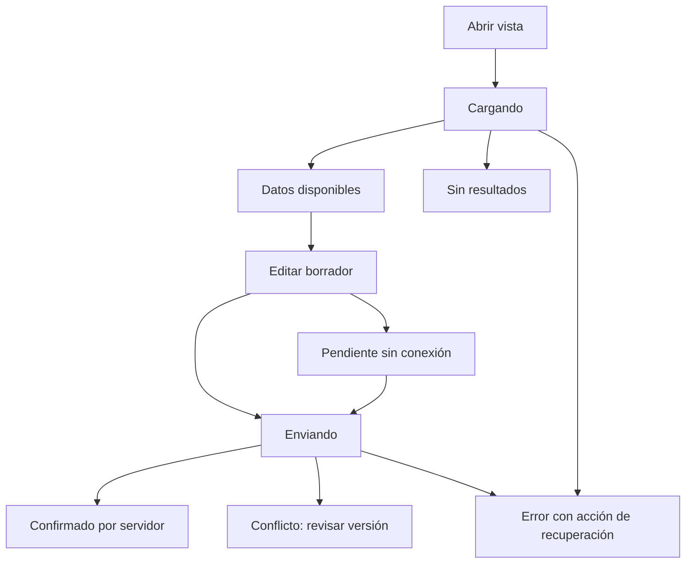

# Sistema de diseño

**Estado: guía de implementación propuesta para V2.0.** Los colores base proceden de la identidad del proyecto; los componentes descritos todavía no son una biblioteca instalada. Las decisiones abiertas se indican para que desarrolladores y agentes no generen estilos incompatibles.

## Principios de experiencia

1. La acción principal de una pantalla debe ser reconocible y tener un resultado verificable. Mostrar “Guardado” solo tras confirmación; usar “Pendiente de sincronizar” para datos locales.
2. Mantener consistencia de lenguaje y comportamiento entre React y Flutter. Adaptar la distribución al espacio disponible, sin ocultar acciones esenciales por plataforma.
3. Pedir consentimiento específico, comprensible y revocable. Una autorización del sistema operativo no reemplaza el consentimiento de tratamiento.
4. Conservar contexto al corregir un error o volver del detalle. Una confirmación explica la consecuencia y permite cancelar sin aplicar cambios.
5. Priorizar información sobre hábitos, periodos y evidencia. Las recomendaciones presentan sus límites y no expresan diagnósticos.

## Base visual

Consultar los [tokens](../../packages/design-tokens/README.md) antes de elegir un color. Usar nombres por propósito (`color.action.primary`, `color.text.primary`) y no copiar HEX en cada componente. Una variante de tema necesita contrastes comprobados para texto, iconos, bordes interactivos, foco y estados.

Propuesta para validar con pantallas reales, **pendiente de aprobación**:

| Aspecto | Propuesta inicial | Criterio de cierre |
|---|---|---|
| Tipografía | Familia del sistema sin descarga externa; escala con unidades adaptables | Legibilidad, caracteres en español y consistencia de pesos en ambas plataformas |
| Espaciado | Escala base de 4 unidades con pasos 4, 8, 12, 16, 24, 32 y 48 | Formularios y listas a tamaños compactos y amplios |
| Tamaño de texto | Texto base equivalente a 16 CSS px en web, respetando escalado nativo móvil | Zoom, texto grande y densidad sin recortes |
| Radios | Pocos niveles semánticos para controles, tarjetas y diálogos | Revisión visual; no inferirlos de la demo |
| Iconos | Una familia con licencia y semántica verificadas | Compatibilidad web/Flutter y etiquetas accesibles |
| Distribución | Una columna en espacio compacto; paneles adicionales si el contenido cabe | Breakpoints derivados de contenido, no de marcas de dispositivo |
| Movimiento | Transiciones breves y opcionales, sin comunicar información solo por animación | Preferencia de movimiento reducido y pruebas de interacción |

Las propuestas no autorizan librerías, fuentes ni dependencias externas. La selección final se registra junto con su versión y forma de distribución.

## Catálogo de componentes

| Componente | Contrato visual y de interacción | Estados necesarios |
|---|---|---|
| Navegación de aplicación | Sección actual, enlaces con nombre, retorno coherente, acceso a sesión | Activo, foco, acceso restringido, espacio compacto |
| Botón de acción | Verbo concreto; una acción principal por bloque; icono acompañado de nombre | Normal, hover en web, foco, presionado, ocupado, deshabilitado con motivo |
| Campo de formulario | Etiqueta persistente, ayuda, unidad, requerido y error asociado | Vacío, editado, válido, inválido, solo lectura, deshabilitado |
| Selector de días y meta | Selección legible por texto/estado; unidad visible y ayuda sobre programación | Sin selección, seleccionado, inválido, bloqueado |
| Tarjeta de hábito | Nombre, avance/meta, unidad, programación y estado del día | Programado, parcial, completo, pausado, archivado, pendiente de sincronizar |
| Control de check-in | Expresa valor acumulado del día y confirma resultado del servidor | Editando, enviando, confirmado, pendiente, conflicto, rechazado |
| Tarjeta de métrica | Valor, unidad, periodo y fecha de actualización | Carga, disponible, sin registros, dato insuficiente, desactualizado |
| Gráfica / calendario | Título, ejes/leyenda, periodo y resumen o tabla equivalente | Sin datos, parcial, selección, carga, error |
| Recomendación | Propuesta, fundamento, fuentes/ventana cuando existan, límites y decisión | No elegible, carga, disponible, sin resultados, personalizando, pendiente, resuelta |
| Aviso y banner | Mensaje breve, consecuencia y acción útil; prioridad explícita | Informativo, confirmación, advertencia, error, offline |
| Diálogo de confirmación | Acción y entidad nombradas; efecto explicado y cancelación visible | Abierto, validación, enviando, error; foco al abrir y restauración al cerrar |
| Centro de avisos | Origen, fecha, lectura y destino; no prometer entrega externa | Vacío, no leído, leído, destino ya no disponible |
| Control de consentimiento | Finalidad, datos, opción voluntaria y forma de retirar | Activo, desactivado, pendiente de guardar, error, permiso SO denegado |
| Estado de dispositivo | Compatibilidad, vínculo, permisos y última sincronización | No vinculado, vinculando, sin permiso, offline, sincronizado, revocado |
| Tabla administrativa | Filtros y paginación por contrato; datos operativos permitidos | Carga, vacío, error, cambio pendiente, permiso insuficiente |
| Evento de auditoría | Fecha, actor permitido, acción, entidad, motivo y correlación | Consulta/filtrado; sin edición o borrado de eventos desde UI |

Los nombres son contratos de experiencia, no nombres obligatorios de clases. Extraer un componente compartido cuando represente el mismo comportamiento; evitar copias de formularios con validaciones divergentes.

## Estados y redacción

| Situación | Mensaje orientativo | Acción |
|---|---|---|
| Sin hábitos | “Todavía no tienes hábitos.” | Crear hábito |
| Sin registros en periodo | “No hay registros para este periodo.” | Elegir periodo; no dibujar una tendencia ficticia |
| Check-in sin conexión | “Avance pendiente de sincronizar.” | Ver pendientes o reintentar |
| Respuesta perdida | “Aún no pudimos confirmar el guardado.” | Reintentar la misma operación idempotente |
| Conflicto | “Este hábito cambió en otro dispositivo.” | Revisar información actual antes de guardar de nuevo |
| Datos insuficientes para IA | “Aún no hay información suficiente para una recomendación.” | Explicar requisito vigente sin inventar evidencia |
| Consentimiento desactivado | “Activa el análisis si quieres recibir recomendaciones.” | Revisar finalidad y elegir voluntariamente |
| Sesión vencida | “Tu sesión terminó. Inicia sesión para continuar.” | Acceso; no revelar datos privados tras cerrar sesión |
| Permiso denegado | “Tu cuenta no tiene acceso a esta acción.” | Volver a una sección permitida |

Los mensajes son ejemplos de tono; deben corresponder al código de error contractual y a la acción real. No mostrar detalles internos, tokens, SQL ni excepciones de infraestructura.

## Accesibilidad

Objetivo de producto: **WCAG 2.2 nivel AA** en web y criterios equivalentes comprobables en móvil. La conformidad debe probarse; esta guía no la declara conseguida. Como base, validar texto normal con contraste de al menos 4.5:1 y texto grande de 3:1; componentes y estados visuales relevantes requieren su evaluación específica. [WCAG 2.2](https://www.w3.org/TR/WCAG22/).

- Dar nombre, función y estado accesible a cada control. Preferir HTML semántico en web y semántica nativa de Flutter.
- Permitir completar recorridos con teclado, mantener orden lógico y foco visible; no ocultarlo bajo barras fijas ni atraparlo fuera de diálogos modales.
- Los diálogos reciben foco, admiten cancelación apropiada y devuelven foco al control que los abrió. Un modal abierto no permite interactuar con el contenido de fondo.
- Identificar errores junto al campo y en un resumen cuando el formulario lo necesite; conservar el dato corregible. No depender de un mensaje temporal para errores que requieren acción.
- Comunicar carga y confirmaciones a lectores de pantalla sin anunciar cada cambio de progreso repetidamente.
- Reflujo y texto grande deben conservar contenido y acciones. Probar zoom al 200 % y reflujo a 320 CSS px en web; para tablas o gráficas que requieran dos dimensiones, ofrecer controles y alternativa legible.
- WCAG 2.2 AA establece un mínimo de 24 × 24 CSS px para objetivos de puntero, con excepciones específicas. Como objetivo de comodidad del proyecto se propone 44 × 44 CSS px en web táctil y 48 unidades lógicas en móvil, por validar en diseño. [Criterio de tamaño mínimo](https://www.w3.org/WAI/WCAG22/Understanding/target-size-minimum.html).
- Respetar movimiento reducido; no usar parpadeos, sonido o háptica como única señal. Distinguir estados también mediante palabras, iconos o patrones.
- Cada gráfica ofrece resumen de tendencia y valores consultables. Anunciar unidad, periodo y ausencia de datos; no depender de hover ni color.

En Flutter, probar TalkBack/VoiceOver, escalado de texto, etiquetas y API de pruebas de accesibilidad en dispositivos representativos. [Pruebas de accesibilidad Flutter](https://docs.flutter.dev/ui/accessibility/accessibility-testing).

## Entrega y evolución

Un componente se incorpora con descripción, variantes, estados, permisos, ejemplos de contenido y evidencia de accesibilidad. Un cambio compartido actualiza tokens, consumidores y referencias del mismo concepto. Versionar las capturas indicando si son sketch o producto, rol, pantalla, ambiente y commit.

Pendientes: biblioteca de componentes, tipografía, radios, escalas finales, iconografía, temas aprobados, breakpoints y proceso de revisión visual. Registrar la decisión y la evidencia en [arquitectura](../arquitectura/decisiones-pendientes.md).

[Índice de diseño](README.md) · [Recorridos](recorridos.md) · [Recursos gráficos](../../assets/images/README.md)
