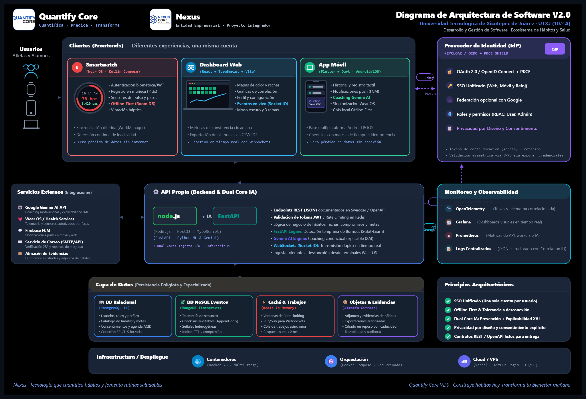
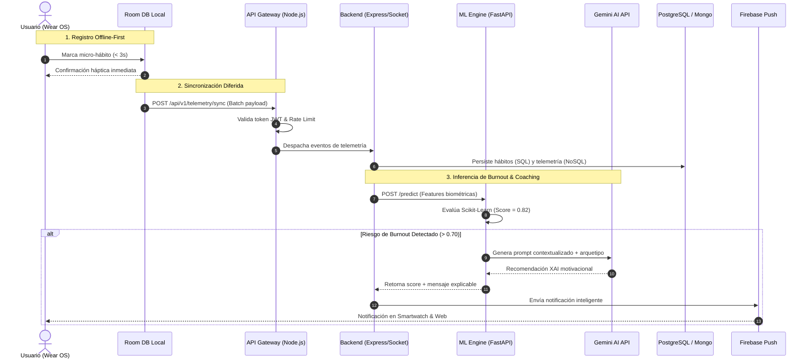

# Examen de Unidad — Arquitectura de Software del Proyecto Integrador

> **Alcance:** este plano y su memoria son un entregable académico propuesto. Las tecnologías, integraciones, métricas y garantías descritas aquí no acreditan una implementación. Para desarrollar el producto se siguen el [stack y estado del README principal](../../README.md), las [decisiones de arquitectura](../arquitectura/README.md) y los [contratos compartidos](../../packages/contracts/README.md).

**Proyecto:** Quantify Core — Ecosistema Inteligente de Hábitos Cuantitativos y Bienestar  
**Universidad:** Universidad Tecnológica de Xicotepec de Juárez (UTXJ)  
**Programa Educativo:** Ingeniería en Desarrollo y Gestión de Software  
**Asignatura:** Arquitectura de Software · **Nivel:** 10° Cuatrimestre  
**Fecha:** Octubre 2026  

---

## Equipo de Desarrollo

| Integrante | Rol en el Proyecto |
| :--- | :--- |
| **Francisco García García** | Arquitectura de Software, Backend & ML Ops |
| **Ángel de Jesús Baños Téllez** | Desarrollo Frontend, Wearables & UI/UX |
| **Jesús Alejandro Artiaga Morales** | Infraestructura Cloud, DevOps & Seguridad |
| **Al Farías Leyva** | Gestión de Datos, QA & Documentación |

---

## 1. Resumen Ejecutivo y Enlace al Plano Interactivo

El presente documento constituye la memoria técnica del **Examen de Unidad**, en el que se formaliza la arquitectura de software integral de **Quantify Core**. 

A diferencia de las aplicaciones monolíticas convencionales de seguimiento de hábitos, el examen propone una **arquitectura distribuida cliente-servidor en capas y microservicios**, con enfoque **Offline-First** en terminales wearables (Wear OS), ingestión reactiva mediante WebSockets y un **Dual Core de Inteligencia Artificial** que combina machine learning supervisado (*Scikit-Learn*) para la detección temprana de *Burnout* con modelos de lenguaje generativo (*Google Gemini AI*) para coaching conductual explicable (*Explainable AI - XAI*).

> ### 🧭 Explorar el Plano Arquitectónico Interactivo
> 
> Se ha desarrollado un visor arquitectónico autocontenido en HTML/SVG con diseño de *blueprint de ingeniería*, interactividad por nodos, simulación de flujo de datos en tiempo real, 3 temas visuales unificados y descarga en alta resolución:
> 
> * **[Abrir Plano Interactivo de Arquitectura (index.html)](./index.html)**
> * **[Descargar Plano en Alta Resolución (PNG)](./arquitectura-quantify.png)**

---

## 2. Diagrama General de Arquitectura de Software

A continuación se presenta el mapa arquitectónico global del ecosistema **Quantify Core**, desglosado en sus 7 capas estructurales:



```
+-------------------------------------------------------------------------------------------------------------+
|                                  ECOSISTEMA INTEGRAL QUANTIFY CORE                                          |
+-------------------------------------------------------------------------------------------------------------+
| 1. ACTORES        | 2. FRONTENDS      | 3. GATEWAY / SEG. | 4. LÓGICA & DUAL IA | 5. DATOS     | 6. EXTERNOS    |
|-------------------+-------------------+-------------------+---------------------+--------------+----------------|
| • Usuario Final   | • Smartwatch      | • API Gateway     | • Node.js Backend   | • PostgreSQL | • Gemini AI    |
|   (Atleta/Alumno) |   (Wear OS)       |   (Reverse Proxy) |   (Ingesta/Sockets) |   (TiDB SQL) | • Health Conn. |
| • Administrador   | • Dashboard Web   | • JWT & Refresh   | • FastAPI ML Engine | • MongoDB    | • Firebase FCM |
|   (ML Ops/Dev)    |   (React 18)      | • Rate Limiting   |   (Scikit-Learn)    |   (TS Data)  | • Resend Email |
|                   | • Smart TV (Plan) | • HIPAA Shield    | • Gemini AI Engine  | • Redis RAM  | • Stripe Pay   |
|                   | • PWA (Plan)      | • TLS 1.3 / CORS  |   (Coaching XAI)    | • Room DB    | • AWS S3 Store |
+-------------------+-------------------+-------------------+---------------------+--------------+----------------+
| 7. INFRAESTRUCTURA Y OBSERVABILIDAD: Docker Compose · Render Cloud VPS · Prometheus · Grafana · Winston Logs|
+-------------------------------------------------------------------------------------------------------------+
```

---

## 3. Guía en Lenguaje Claro: ¿Cómo entender esta arquitectura si no eres técnico?

Para cualquier persona, docente o evaluador que no provenga del área de sistemas o ingeniería de software, la arquitectura de **Quantify Core** puede entenderse fácilmente mediante **la analogía del cuerpo humano y su sistema nervioso**:

| Componente en la Arquitectura | Analogía del Cuerpo Humano | ¿Qué hace en la vida real? | ¿Por qué beneficia al usuario? |
| :--- | :--- | :--- | :--- |
| **Smartwatch Wear OS & Sensores** | **Los Sentidos (Ojos, Piel)** | Detecta pasos, horas de sueño, pulsaciones y registros rápidos tocando la pantalla. | Puedes registrar tu progreso en 2 segundos mientras corres o entrenas sin distracciones. |
| **Room DB (Offline-First)** | **La Memoria Inmediata** | Guarda tus hábitos en el reloj aunque salgas a la montaña o al parque sin internet ni señal celular. | **Cero pérdida de datos:** tus rachas y logros nunca se borran por falta de señal. |
| **API Gateway & HIPAA Shield** | **El Sistema Inmune & Aduana** | Filtra accesos no autorizados y cifra la información como si fuera una transferencia bancaria. | **Privacidad total:** tus datos de salud y hábitos están blindados legalmente. |
| **FastAPI ML & Scikit-Learn** | **El Instinto de Fatiga** | Modela matemáticamente si estás agotado o durmiendo mal antes de que colapses. | **Prevención del Burnout:** te avisa a tiempo si tu meta de hábitos es insostenible. |
| **Google Gemini AI Engine** | **El Entrenador Personal Empático** | Escribe consejos personalizados en lenguaje humano y motivador adaptados a tu contexto. | **Consejos útiles y cálidos**, en lugar de alertas frías, robóticas o genéricas. |
| **React Dashboard & WebSockets** | **El Reflejo en el Espejo** | Muestra tus gráficos, rachas y mapas de calor en la computadora al instante. | Ves tus logros cambiar en tiempo real sin tener que recargar la página web. |
| **Bases de Datos (SQL / NoSQL / Redis)** | **La Biblioteca de Recuerdos** | Organiza tus datos en estanterías ultra-rápidas, seguras y con copias de respaldo continuas. | Tu información vive para siempre y tus consultas cargan en milisegundos. |
| **Docker & Nube (Render)** | **La Casa Segura** | Empaqueta cada servicio en módulos independientes que nunca se caen todos juntos. | La plataforma siempre está en línea y operativa las 24 horas del día. |

### El Viaje del Hábito en 4 Pasos Simples

1. **Paso 1 (Tu muñeca):** Sales a entrenar o estudias. Tocas el reloj inteligente. Si no hay internet, la memoria interna del reloj retiene tu logro de forma segura.
2. **Paso 2 (El viaje protegido):** Al llegar a casa y conectarte a Wi-Fi, los datos viajan por un túnel cifrado con los más altos estándares de privacidad médica (HIPAA).
3. **Paso 3 (El análisis inteligente):** Nuestro doble cerebro de IA evalúa si mantienes un ritmo sano y redacta un consejo motivacional realista.
4. **Paso 4 (El resultado en vivo):** El reloj vibra con una felicitación y tu computadora actualiza tus mapas de consistencia al instante.

---

## 4. Justificación de Patrones y Decisiones Arquitectónicas

### 4.1. Arquitectura en Capas y Microservicios Desacoplados
La separación entre la capa de **Presentación** (React/Kotlin), **Seguridad/Gateway** (Node.js), **Lógica de Negocio** (Node.js) e **Inferencia de IA** (Python FastAPI) obedece al principio de responsabilidad única (*Single Responsibility Principle*):
* **Independencia de Escalabilidad:** La ingesta masiva de telemetría de wearables requiere alta concurrencia I/O (resuelta por el *Event Loop* asíncrono de Node.js), mientras que los cálculos matriciales y modelos de ML requieren las librerías científicas de Python (`scikit-learn`, `numpy`). Separarlos previene que un cuello de botella de CPU bloquee la API Gateway.
* **Tolerancia a Fallos:** Si el servicio de IA requiere mantenimiento o actualización de dependencias, la plataforma sigue registrando hábitos y telemetría sin interrupción.

### 4.2. Estrategia Offline-First en Wearables (Room DB + WorkManager)
Los usuarios registran actividad física en gimnasios, piscinas o pistas sin cobertura garantizada de internet:
* El Smartwatch Wear OS almacena las marcas de micro-progreso en una base local **SQLite** gestionada con **Android Room DB**.
* El componente **Android WorkManager** encola las solicitudes y las despacha con reintentos exponenciales (*exponential backoff*) únicamente cuando se detecta conectividad Wi-Fi, Bluetooth o LTE.

### 4.3. Dual Core de Inteligencia Artificial (ML Supervisado + LLM Generativo)
Para evitar el problema de "caja negra" y reducir costos de cómputo:
1. **Filtro Estadístico (Scikit-Learn):** Evalúa series de tiempo de cumplimiento, sueño y frecuencia cardíaca para clasificar en milisegundos si existe riesgo inminente de abandono (*Burnout Risk Score* entre 0.0 y 1.0).
2. **Síntesis Motivacional (Gemini AI API):** Solo cuando el riesgo supera el umbral crítico (> 0.70) o en el resumen circadiano vespertino, se invoca a Gemini AI con un *prompt* enriquecido con el arquetipo del usuario para redactar recomendaciones empáticas y explicables (*Explainable AI - XAI*).

---

## 5. Desglose Detallado por Capas

### Capa 1: Usuarios / Actores del Sistema
* **Usuario Final:** Individuo que utiliza la plataforma para construir y consolidar hábitos saludables. Interactúa prioritariamente desde el reloj inteligente para registros ultrarrápidos (< 3 segundos) y acude al dashboard web para análisis detallado y correlaciones de bienestar.
* **Administrador & ML Ops:** Equipo técnico de Quantify Core que supervisa la tasa de aciertos de los modelos (*F1-Score*), detecta pérdida de precisión (*data drift*), gestiona las cuotas de consumo de tokens y administra las pasarelas de cobro sin vulnerar la privacidad médica del usuario.

### Capa 2: Clientes (Frontends - Capa de Presentación)
1. **App Smartwatch Wear OS (Kotlin + Jetpack Compose):**
   * Lectura de sensores de frecuencia cardíaca y podómetro con autorización del usuario.
   * Interfaz adaptada a pantallas circulares con respuesta háptica y micro-interacciones.
   * Persistencia local en SQLite con Room DB y sincronización con WorkManager.
2. **Dashboard Web React (React 18 + TypeScript + Vite + Tailwind CSS + Recharts):**
   * Gráficas avanzadas de consistencia, rachas consecutivas y mapas de calor.
   * Conexión dúplex persistente con Socket.IO para actualizar el estado instantáneamente.
   * Sistema de diseño con 3 paletas temáticas (`Tech`, `Cognitive AI`, `Behavioral`) y alternador de modo claro/oscuro.
3. **Smart TV Ambient Dashboard (Fase Planeada):**
   * Aplicación Android TV / WebOS orientada a la visualización pasiva en espacios comunes.
4. **Capa PWA (Fase Planeada):**
   * Respaldo web móvil ligero con Service Workers para ejecución sin conexión en smartphones.

### Capa 3: Seguridad, API Gateway y Control de Acceso
* **Reverse Proxy & Gateway (Node.js + Express):** Punto central de enrutamiento y balanceo de carga interno.
* **Autenticación Criptográfica:** Emisión de tokens **JWT** (JSON Web Tokens) de corta duración (15 minutos) combinados con *Refresh Tokens* revocables almacenados en Redis.
* **Control de Acceso Basado en Roles (RBAC):** Restricción de endpoints según el rol validado (`ROLE_USER`, `ROLE_ADMIN_MLOPS`).
* **Rate Limiting:** Algoritmo *Token Bucket* implementado en Redis que limita a 100 peticiones/minuto por dirección IP para mitigar ataques de fuerza bruta y DDoS.
* **Blindaje de Privacidad (HIPAA / GDPR):** Enmascaramiento y separación física de identificadores personales (PII) respecto a la telemetría biométrica.

### Capa 4: Lógica de Negocio y Dual Core de Inteligencia Artificial
* **Backend de Negocio & WebSockets (Node.js / Express / Socket.IO):**
  * Control del ciclo de vida de hábitos, metas diarias y cálculo atómico de rachas (*streaks*).
  * Distribución reactiva de eventos en tiempo real entre múltiples dispositivos del mismo usuario.
  * Orquestador de notificaciones push inteligentes hacia Firebase Cloud Messaging (FCM).
* **Microservicio ML & Coaching (Python 3.11 / FastAPI / Scikit-Learn / Gemini SDK):**
  * **Burnout Predictor:** Modelo supervisado entrenado con variables normalizadas de sueño, variabilidad de ritmo cardíaco (HRV) y caídas de adherencia.
  * **Clustering K-Means:** Agrupamiento no supervisado para segmentar usuarios en arquetipos (ej. *Matutino Constante*, *Intensivo de Fin de Semana*, *Propenso a Sobrecarga*).
  * **Motor XAI con Gemini AI:** Generador de sugerencias personalizadas contextuales con explicación de la causa raíz.
  * **Swagger / OpenAPI:** Interfaz interactiva de pruebas y contratos de datos en `/docs`.

### Capa 5: Persistencia Híbrida (Estrategia Políglota)
Para maximizar el rendimiento y la durabilidad, cada tipo de dato reside en el motor óptimo:
* **PostgreSQL / TiDB Serverless (Relacional SQL):** Datos transaccionales con garantía ACID (`users`, `habits`, `streaks`, `subscriptions`, `audit_logs`).
* **MongoDB (NoSQL Documental Time-Series):** Telemetría continua de alta frecuencia (`telemetry_events`, `heart_rate_samples`, `ml_predictions`).
* **Redis (In-Memory Data Store):** Caché de sesiones activas, colas Pub/Sub para propagación horizontal de WebSockets y contadores de rate limiting.
* **Room DB (SQLite Local):** Buffer de almacenamiento en el smartwatch para garantizar tolerancia total a fallos de red.

### Capa 6: Servicios Externos e Integraciones
* **Google Gemini AI API:** Inferencia de lenguaje natural para síntesis de coaching empático y explicabilidad de hábitos.
* **Health Connect / Google Fit:** Sincronización transparente de pasos, horas de descanso y calorías con consentimiento granular.
* **Firebase Cloud Messaging (FCM):** Notificaciones push a baja latencia (< 500 ms) sincronizadas entre smartwatch y navegador.
* **Resend / SendGrid API:** Envío de correos transaccionales para verificación en dos pasos (2FA) y reportes semanales.
* **Stripe Payments API:** Pasarela de cobro segura que procesa suscripciones premium bajo estándar PCI-DSS sin tocar datos de tarjetas en el backend.
* **AWS S3 / Cloud Storage:** Almacenamiento seguro de respaldos encriptados de bases de datos.

### Capa 7: Infraestructura, Despliegue y Observabilidad
* **Docker & Docker Compose:** Contenedores modulares multi-stage para cada microservicio, garantizando aislamiento y paridad entre desarrollo y producción.
* **Despliegue Cloud (Render / Cloud VPS):** Orquestación automatizada conectada con CI/CD en GitHub y certificados TLS 1.3 gestionados por Let's Encrypt.
* **Prometheus Server:** Recolección periódica de métricas de CPU, consumo de memoria RAM, latencia de endpoints P95/P99 y conexiones Socket.IO activas.
* **Grafana Dashboards:** Paneles visuales para el equipo de desarrollo con visualización de salud del sistema y tasa de error.
* **Winston Logs:** Pipeline estructurado de logs en formato JSON con correlación de identificadores de solicitud (*Correlation ID*).

---

## 6. Matriz de Flujos de Datos Principales



---

## 7. Métricas Cuantitativas de la Arquitectura

| Parámetro de Arquitectura | Valor de Diseño | Justificación Técnica |
| :--- | :--- | :--- |
| **Clientes Soportados** | 4 (Wear OS, React Web, Smart TV, PWA) | Cobertura multi-dispositivo sin duplicar lógica de negocio. |
| **Microservicios Backend** | 2 principales (Gateway/Ingesta + FastAPI ML) | Aislamiento entre carga I/O de red y cómputo de inteligencia artificial. |
| **Motores de Persistencia** | 4 (PostgreSQL, MongoDB, Redis, Room DB) | Persistencia políglota: transacciones, series de tiempo, caché y offline. |
| **Servicios Externos** | 6 integraciones API | IA generativa, biometría, push, correo transaccional, pagos y almacenamiento. |
| **Tiempo de Registro Local** | < 500 ms en Smartwatch | Eliminación de latencia de red en la interacción humana directa. |
| **Latencia de Inferencia ML** | < 120 ms (Scikit-Learn) | Clasificación en tiempo real previa a la decisión de invocar LLM. |
| **Disponibilidad Objetivo** | 99.9% Uptime | Contenedores Docker orquestados con reinicio automático. |

---

## 8. Verificación y Evidencia de Entregables

Dentro de esta carpeta (`docs/examen/`) se encuentran los tres entregables solicitados:

1. **`index.html` (Plano Interactivo):**
   * Interfaz responsiva con diseño de blueprint y 3 paletas temáticas.
   * Sistema de físicas en fondo reactivo al movimiento del cursor.
   * Simulación interactiva de flujo de datos (*Ver flujo*) y filtrado (*Mostrar planeado*).
   * Modales con información técnica, endpoints y fragmentos de código para cada componente.
   * Exportador nativo a formato vectorial SVG y gráfico PNG.
2. **`arquitectura-quantify.png` (Imagen Rasterizada):**
   * Gráfico estático generado en alta resolución del plano de arquitectura para consulta directa.
3. **`README.md` (Memoria Técnica):**
   * Este documento con la fundamentación conceptual, desglose de capas y diagramas de secuencia.

---

**Quantify Core** · Universidad Tecnológica de Xicotepec de Juárez · 2026
