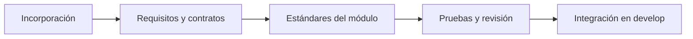

# Guías de desarrollo

Punto de entrada para preparar una tarea, implementar con criterios comunes y entregar evidencia revisable. La documentación operativa del producto se ampliará conforme existan componentes ejecutables.

| Necesidad | Guía |
|---|---|
| Entender qué existe y cómo empezar | [Incorporación al proyecto](incorporacion.md). |
| Programar y documentar con las mismas convenciones | [Estándares de desarrollo](estandares-desarrollo.md). |
| Utilizar agentes sin perder el contexto del proyecto | [Guía para agentes](../../AGENTS.md). |
| Elegir rama, integrar y preparar versiones | [Git Flow](git-flow.md). |
| Revisar y presentar un cambio | [Contribución](../../CONTRIBUTING.md). |
| Consultar las comprobaciones de esta entrega documental | [Validación documental](validacion-documental.md). |

Qué debe incluir una nueva guía

Propósito, estado, público, requisitos, ruta desde la que se ejecuta cada comando, pasos, resultado esperado, recuperación y referencias. Si los archivos necesarios aún no existen, describir el trabajo pendiente sin publicar instrucciones ficticias. Usar datos sintéticos y enlazar el documento responsable de cada regla en vez de duplicarlo.

