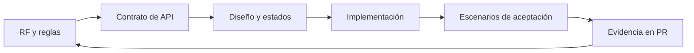

# Requerimientos de Quantify Core

Esta es la base documental propuesta para construir el producto. Describe qué debe hacer cada entrega y cómo demostrarlo; no acredita funciones implementadas ni aprobación del equipo. El [README principal](../../README.md) fija el stack de referencia.

Para consultar por tipo de documento: [BRs](../BRs/README.md) · [FRs](../FRs/README.md) · [NFRs](../NFRs/README.md) · [UHs](../UHs/README.md). Estos índices conservan los IDs y remiten a las definiciones de esta carpeta.

## Ruta de lectura

| Documento | Decisión que permite tomar |
|---|---|
| [Catálogo de requisitos](catalogo.md) | Qué desarrollar, con qué prioridad y qué condiciones cumplir |
| [Reglas de negocio](reglas-negocio.md) | Cómo interpretar hábitos, fechas, progreso, rachas y recomendaciones |
| [Aceptación y trazabilidad](aceptacion.md) | Qué escenarios verificar antes de entregar una función |
| [Arquitectura](../arquitectura/README.md) | Qué componente implementa cada responsabilidad |
| [Diseño](../diseno/README.md) | Qué recorrido y estados debe mostrar el cliente |

El gráfico muestra el ciclo de revisión: cada cambio funcional debe actualizar su requisito, contrato, interfaz y evidencia. Un diagrama de prototipo por sí solo no demuestra integración.

## Alcance y orden

1. **Núcleo:** RF-01 a RF-05; acceso, consentimiento, hábitos, registros y métricas coherentes.
2. **Continuidad de uso:** RF-06 y aplicación Flutter, incluidos reintentos y sincronización.
3. **Operación y control:** RF-09 y RF-10 se construyen junto con las funciones que gobiernan. Autorización, auditoría, exportación y eliminación son puertas de entrada del piloto con datos personales.
4. **Integraciones:** RF-08 avanza por prueba técnica y dispositivo compatible; no bloquea el registro manual.
5. **Recomendaciones:** RF-07 necesita datos autorizados y evidencia de evaluación; puede comenzar con reglas explicables sin biometría.

Las fases expresan dependencias, no fechas. Cada ticket debe identificar RF, reglas aplicables, contrato, escenarios, alcance y enlace a su PR. No declarar terminado un RF completo si solo se entregó un recorrido de demo.

## Actores y permisos

| Actor | Puede hacer | Límite |
|---|---|---|
| Usuario | Gestionar perfil, consentimiento, hábitos, registros, avisos y resultados propios | Debe verificarse la pertenencia de cada recurso en la API |
| Administrador | Gestionar catálogo, estado de cuentas y métricas operativas agregadas | No accede por defecto a rutinas, biometría ni recomendaciones privadas |
| Servicios internos | Ejecutar tareas técnicas con identidad y permisos limitados | Son componentes, no un tercer rol humano ni una vía para eludir consentimiento |

No se adopta un modelo de suscripciones o pagos por aparecer en antecedentes académicos; requiere alcance y decisiones propios.

## Qué es antecedente y qué se implementará

- La [Práctica 05](../Practica05/README.md) aporta actores y funciones. Su [historia de recomendaciones](../Practica05/HU-Recomendaciones-IA.md) es un antecedente de RF-07; la etiqueta histórica «aprobada» no aprueba automáticamente esta arquitectura ni sus umbrales.
- La [Práctica 07](../practica-07/README.md) permite revisar 24 sketches y recorridos con datos locales. Sus códigos de acceso, fecha fija, métricas administrativas y reglas numéricas son de demostración.
- Los umbrales de confianza de 0.75 y 80%, la ventana de 7 días y el descarte por 21 días deben evaluarse y versionarse antes de aplicarlos al producto. No deben convertirse en constantes globales copiadas por agentes.
- El estado actual de cada componente debe comprobarse en su código y pruebas. Los documentos de esta sección son una especificación inicial, no un reporte de cobertura.

Si dos documentos discrepan, registrar el conflicto en [decisiones pendientes](../arquitectura/decisiones-pendientes.md), mantener la base tecnológica del README y resolver la regla en una revisión del equipo antes de cambiar el contrato.
