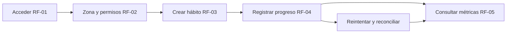

# Aceptación y trazabilidad

Esta matriz define pruebas por construir. No afirma que se hayan ejecutado. Conservar los identificadores al crear casos automatizados y enlazar la evidencia desde cada PR. Los AC completos se encuentran en el [catálogo](catalogo.md).

## Primer recorrido verificable



| Caso | Dado / Cuando / Entonces | Cubre | Evidencia necesaria |
|---|---|---|---|
| CA-01 | Dado usuario A, cuando consulta/modifica un hábito de B, se deniega sin revelar contenido | AC-01.1, AC-03.1; RNF-01 | Integración API con dos cuentas y acceso directo por identificador |
| CA-02 | Dada sesión vencida o cuenta suspendida, cuando intenta una mutación, se aplica la política de acceso; el cliente preserva la intención sin duplicar al volver a autenticarse | AC-01.4, AC-09.3 | Integración con IdP y recuperación del cliente |
| CA-03 | Dado un hábito en zona distinta de UTC, cuando registra cerca de medianoche, el resultado queda en la fecha de agenda correcta | AC-02.1, AC-04.1; RNF-03 | Casos unitarios de tiempo e integración del contrato |
| CA-04 | Dada una creación inválida, cuando envía meta no positiva o frecuencia vacía, API y formulario rechazan y no queda registro parcial | AC-03.1/4 | Validación de contrato y recorrido de formulario |
| CA-05 | Dado progreso de 10, cuando establece 15 y reintenta por respuesta perdida, el consolidado es 15 con una sola aplicación de la operación | AC-04.1/2 | Integración de persistencia, idempotencia y auditoría |
| CA-06 | Dada una clave usada, cuando se reenvía con otro contenido, se devuelve conflicto sin modificar el consolidado | AC-04.2/4; RNF-02 | Dos solicitudes con misma clave y cuerpos distintos |
| CA-07 | Dados dos dispositivos con revisión N, cuando ambos corrigen, una revisión obsoleta se informa y no sobrescribe silenciosamente | AC-04.4 | Integración concurrente y UI de resolución |
| CA-08 | Dada meta de 20 hasta ayer y 30 desde hoy, cuando consulta historial, ayer conserva su meta y hoy utiliza 30 | AC-03.2, AC-05.1 | Fixture con versiones y comparación de métricas |
| CA-09 | Dados lunes y miércoles completos, cuando llega un jueves no programado o un día pausado, la racha permanece; un día programado solo la extiende o rompe al cerrar, dentro del intervalo consultado | AC-05.2 | Prueba determinista del motor con reloj controlado |
| CA-10 | Dado un periodo sin oportunidades, cuando consulta cumplimiento, recibe ausencia y razón; el gráfico no dibuja un cero engañoso | AC-05.3 | Contrato y componente visual |
| CA-11 | Dado hábito con historia y recordatorio, cuando confirma archivo, desaparece de la rutina activa, no admite nuevas marcas y conserva historia | AC-03.3, AC-06.2 | Integración API/worker y recorrido de confirmación |
| CA-12 | Dado progreso local sin conexión, cuando vuelve la red, la cola se sincroniza una sola vez y cambia de pendiente a confirmado | AC-04.2/4; RNF-02 | Prueba del cliente con corte de red y respuesta perdida |
| CA-13 | Dado consentimiento de IA revocado con un trabajo pendiente, cuando el worker lo ejecuta, se cancela sin generar ni entregar recomendación | AC-02.3, AC-07.1 | Integración de autorización en ejecución y lectura |
| CA-14 | Dada una recomendación, cuando cancela su personalización no crea hábito; cuando guarda y reintenta, hay un solo hábito enlazado | AC-07.3/4 | Transacción, idempotencia y recorrido de UI |
| CA-15 | Dada plantilla ya usada, cuando el administrador la pausa, hábitos personales previos permanecen iguales y se registra motivo | AC-09.1/2/4 | Integración y verificación de auditoría sin datos privados |
| CA-16 | Dada exportación de A, cuando B intenta acceder, se deniega; cuando vence, el enlace deja de entregar datos | AC-10.2 | Prueba de autorización y caducidad del artefacto |
| CA-17 | Dada eliminación autorizada, cuando se procesa, hay estado por almacén/derivado; restaurar respaldo no reactiva datos borrados sin aplicar la política | AC-10.3/4 | Ejercicio aislado de borrado y restauración |
| CA-18 | Dado dispositivo revocado, cuando reenvía un lote nuevo o pendiente, la ingesta se deniega y no añade señales | AC-08.2/3 | Integración de dispositivo, consentimiento y credenciales |
| CA-19 | Dado envío de aviso con respuesta incierta, cuando se reintenta, la misma ocurrencia/canal no se entrega dos veces según capacidades del proveedor | AC-06.3 | Prueba del adaptador y registro de entrega |
| CA-20 | Dado modelo sin calidad suficiente o datos faltantes, cuando se solicita una sugerencia, responde abstención con motivo y no fabrica evidencia | AC-07.2/5 | Dataset sintético, evaluación y contrato de salida |

## Plantilla de historia implementable

```text
RF y AC:
Como [actor] quiero [acción] para [resultado].
Incluye / excluye:
Reglas RN-P:
Pantallas y estados (cargando, vacío, error, pendiente, conflicto):
Operaciones y esquema de contrato:
Datos, migración y autorización:
Casos CA y otros escenarios relevantes:
Decisiones pendientes que bloquean el cambio:
Evidencia de validación y limitaciones:
```

Una historia está lista cuando puede implementarse sin inventar permisos, fórmula, campos o comportamiento ante errores. Está terminada cuando cumple los criterios de su alcance, registra pruebas reales, actualiza documentos y pasa revisión; una casilla marcada en esta guía no sustituye esa evidencia.
