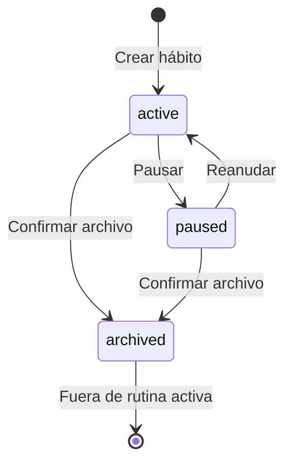

# Reglas de negocio

**Estado:** propuesta coherente para la primera implementación. Los parámetros pendientes deben cerrarse en [decisiones](../arquitectura/decisiones-pendientes.md) y reflejarse en contratos antes de habilitar funciones dependientes. Los nombres RN-P distinguen estas reglas de las RN históricas del prototipo.

## Identidad, privacidad y estados

| Regla | Comportamiento esperado |
|---|---|
| RN-P01 · Pertenencia | El usuario solo opera recursos propios. El identificador del dueño se deriva de la sesión; un campo enviado por el cliente no concede acceso |
| RN-P02 · Consentimiento | Registrar finalidad, alcance/fuente, versión del texto, instante y revocación. Autorizar captura no implica autorizar entrenamiento ni proveedor externo |
| RN-P03 · Estados del hábito | `active`, `paused`, `archived`. Pausar suspende oportunidades futuras durante el intervalo; archivar retira de la rutina y avisos. Ninguna acción borra registros |
| RN-P04 · Versionado | Cambiar meta, unidad, frecuencia o zona genera versión efectiva; los días anteriores conservan su configuración. Cambios retroactivos necesitan un caso de uso y recálculo explícitos |
| RN-P05 · Catálogo | Una plantilla sirve de origen para un hábito personal. Se guarda la versión utilizada; editar la plantilla no modifica hábitos ya incorporados |

El historial persiste en los tres estados. Restaurar un hábito archivado queda pendiente de definición de producto; una interfaz no debe añadir esa transición sin actualizar requisito, reglas y contrato.

## Agenda y tiempo

- **RN-P06:** cada hábito conserva una zona de agenda y versiones de programación. Un check-in guarda el instante ocurrido en UTC, instante recibido en UTC, fecha de negocio y zona usada para asignarla. La API valida su coherencia y la ventana permitida de corrección.
- **RN-P07:** la fecha de negocio se obtiene de la zona de agenda efectiva para esa ocurrencia; no del reloj del servidor. Una fecha no se convierte en instante simplemente agregando medianoche UTC.
- **RN-P08:** cambiar la zona del perfil no mueve registros previos. Aplicar una zona nueva a hábitos existentes requiere una fecha efectiva visible y evita crear dos oportunidades para el mismo periodo.
- **RN-P09:** un día programado crea una oportunidad. Días fuera de frecuencia, pausados o posteriores al archivo quedan excluidos del denominador. El primer alcance usa frecuencia semanal por días; frecuencias como «tres veces en cualquier día de la semana» requieren otra regla.
- **RN-P10:** horas inexistentes o repetidas por cambio horario requieren política explícita para recordatorios y una sola ocurrencia identificable. Hasta cerrarla, no prometer entrega exacta en todas las zonas.

## Progreso, correcciones y concurrencia

- **RN-P11:** para el primer flujo, el comando de progreso declara un **valor acumulado absoluto** del día; no un incremento. Por ejemplo, pasar de 10 a 15 minutos envía 15. La API mantiene un resultado por `(habitId, businessDate)` y un historial de revisiones.
- **RN-P12:** meta positiva y unidad explícita. Valor no negativo y compatible con la unidad. Precisión decimal, máximos y tratamiento del sobrecumplimiento se cierran en D-03; no copiar el límite de la demo como decisión de producto.
- **RN-P13:** `completed` se deriva de cumplir la meta histórica; `partial`, de tener avance positivo menor a la meta. La ausencia de registro no equivale a un registro explícito de cero. «Deshacer» crea corrección auditable y recalcula derivados.
- **RN-P14:** cada comando de escritura reintentable tiene clave idempotente acotada a actor y operación. Misma clave y mismo contenido retorna el resultado existente; misma clave y contenido distinto produce conflicto. La ventana de retención se define según el máximo periodo offline admitido.
- **RN-P15:** cada actualización indica la revisión conocida. Dos dispositivos con una revisión obsoleta reciben conflicto y deben recargar o pedir resolución; no se elige el último reloj del cliente como ganador.
- **RN-P16:** los clientes distinguen `pending`, `synced`, `conflict` y `failed` para la cola local. El progreso pendiente puede mostrarse como provisional, pero solo la API confirma persistencia y métricas oficiales. El cierre de sesión debe proteger o eliminar datos locales según la política elegida.

## Métricas reproducibles

| Indicador | Definición propuesta | Caso límite |
|---|---|---|
| Cumplimiento de un periodo | Oportunidades cerradas completadas / oportunidades cerradas elegibles × 100 | Denominador cero: resultado ausente con causa, no 0% |
| Progreso diario | Valor confirmado / meta vigente para esa oportunidad | Presentación del sobrecumplimiento pendiente; el valor original no se pierde |
| Racha actual del periodo | Número de oportunidades cerradas consecutivas completadas desde la última incumplida, limitado al intervalo consultado | Días no programados/pausados se omiten; hoy abierto no rompe ni extiende la racha |
| Mejor racha | Máximo de la misma regla en el intervalo histórico consultado | Indicar intervalo y versión; no comparar con una ventana distinta sin aclararlo |
| Cobertura de datos | Oportunidades con dato confirmado / oportunidades esperadas de la ventana | Debe separarse del cumplimiento y de la calidad de biometría |

**RN-P17:** las métricas del primer contrato usan solo oportunidades cerradas dentro de `[from, to]`; el progreso de hoy se muestra aparte. Ejemplo: lunes y miércoles programados, ambos completos; el jueves no afecta una racha de 2. El viernes programado mantiene 2 mientras siga abierto; al cerrar pasa a 3 si está completo o a 0 si incumplió. Las rachas se etiquetan «en este periodo»: un límite `from` que corta la historia también limita el cálculo. No presentarlas como racha global.

**RN-P18:** cada agregado conserva ventana, zona, versión de reglas y fecha de cálculo. Una corrección invalida agregados afectados; mostrar recálculo pendiente si no puede resolverse en la misma solicitud. El cliente no inventa otra fórmula.

## Recomendaciones, dispositivos y administración

- **RN-P19:** una sugerencia requiere permiso de la finalidad, datos suficientes y regla/modelo habilitado. Un score se etiqueta según su significado validado; no se convierte automáticamente en probabilidad o certeza clínica.
- **RN-P20:** aceptar implica guardar un hábito válido y enlazarlo a la recomendación de forma atómica. Cancelar no consume ni acepta la propuesta; reintentar aceptación no duplica hábito.
- **RN-P21:** ventanas de elegibilidad, máximo de sugerencias, confianza y caducidad/descarte son parámetros versionados pendientes de evaluación. Los 7 días, 80% y 21 días de la demo son hipótesis.
- **RN-P22:** una señal biométrica tiene fuente, unidad, instante, calidad y autorización. Falta de sensor o permiso no significa señal cero; la biometría no certifica automáticamente el cumplimiento manual.
- **RN-P23:** suspender una cuenta o modificar catálogo/modelos requiere permiso y motivo auditado. Evitar dejar el servicio sin un administrador habilitado; la política de cuentas privilegiadas debe probarse.
- **RN-P24:** un administrador consulta métricas agregadas autorizadas. Abrir una pantalla administrativa no concede acceso a registros personales ni habilita entrenamiento con ellos.
