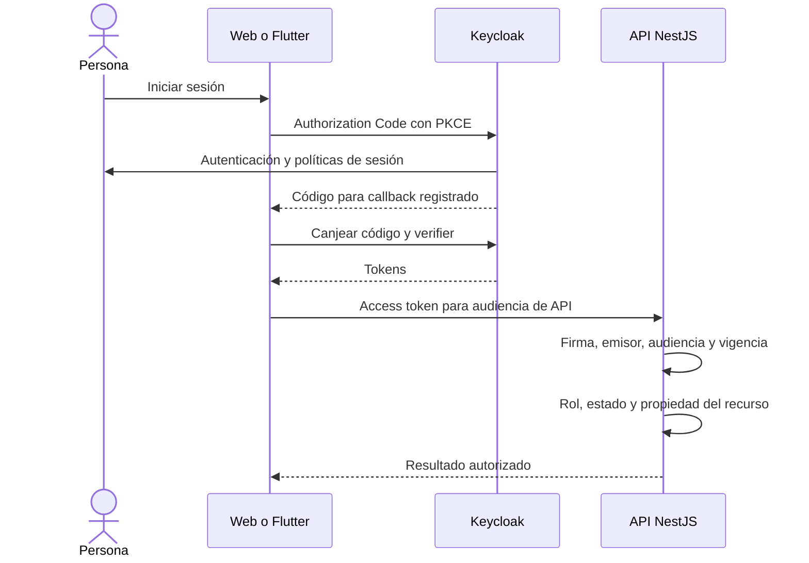

# Seguridad y privacidad

> **Estado: requisitos de diseño; controles pendientes de implementación y verificación.** Esta guía define el mínimo técnico para RF-01, RF-02, RF-09 y RF-10. No certifica cumplimiento normativo ni autoriza recopilar datos reales.

Consultar [amenazas y controles](amenazas.md), [API](../api/README.md), [ciclo de vida de datos](../datos-ia/calidad-ciclo-vida.md) y [decisiones pendientes](../arquitectura/decisiones-pendientes.md).

## Identidad y sesiones

Keycloak es dueño del registro, autenticación, recuperación de credenciales, sesiones y federación opcional. Los clientes usan **OpenID Connect Authorization Code con PKCE S256**. No crear endpoints de contraseña propia, un JWT adicional ni un formulario que envíe la contraseña a NestJS. La identidad interna se enlaza mediante `(issuer, subject)`; el correo no es una clave de autorización.

Este flujo es conceptual: la topología de web, SPA con tokens en memoria o BFF con cookies, sigue pendiente de ADR. Si se incorpora BFF, el canje y custodia de tokens se moverán al servidor; no copiar este diagrama como requisito de almacenar tokens en JavaScript.

| Control | Criterio verificable |
|---|---|
| Redirect URI y origen | Lista exacta por ambiente; sin comodines amplios ni redirecciones controladas por entradas del usuario |
| PKCE y protección del flujo | Exigir S256, validar estado de la transacción y nonce cuando corresponda al flujo OIDC; no habilitar implicit o password grant |
| Validación de access token | Firma y algoritmos permitidos, `iss`, `aud`, `exp`, `nbf` cuando exista y contexto de cliente autorizado; ID token no sirve como bearer de API |
| JWKS | URL fijada por configuración del emisor, caché acotada y renovación ante rotación; no seguir URLs de claves arbitrarias recibidas en un token |
| Estado y revocación | Suspensión local bloquea las peticiones de negocio aunque el token no haya expirado; documentar latencia de invalidación, caché y cierre de sesión |
| Sesiones de administradores | Política reforzada y MFA antes de habilitar operación sobre datos reales; privilegios separados de credenciales de despliegue |
| Error de identidad | Fallar cerrado cuando no pueda validarse el token; no usar tokens no verificables durante una caída del IdP |

Las políticas se basan en la [guía OIDC de Keycloak](https://www.keycloak.org/securing-apps/oidc-layers) y las [prácticas de seguridad OAuth de RFC 9700](https://datatracker.ietf.org/doc/html/rfc9700). Su configuración exacta deberá comprobarse contra la versión que se fije para el proyecto.

## Autorización por rol y propiedad

Hay dos roles de producto: `usuario` y `admin`. Una cuenta puede recibir permisos para su propia experiencia personal además de funciones operativas; el rol no sustituye la comprobación de propiedad. Las identidades de servicio tienen permisos técnicos acotados y no son un tercer rol de usuario.

| Operación | Usuario | Administrador | Restricción |
|---|---|---|---|
| Ver/editar perfil, hábitos, progreso y métricas personales | Propios | Propios si tiene experiencia personal habilitada | Resolver propietario desde el token; nunca confiar en un `ownerId` enviado |
| Consentir/revocar biometría o análisis | Propios | Propios | Ningún administrador consiente en nombre de otra persona |
| Vincular/desvincular dispositivo | Propio | Propio | Desafío de un uso y posesión del dispositivo |
| Leer rutinas o biometría de terceros | Denegado | Denegado por defecto | Una futura excepción de soporte necesita finalidad, permiso acotado, caducidad y auditoría |
| Consultar métricas operativas agregadas | Denegado | Permitido según función | Evitar grupos pequeños o filtros que permitan reidentificación |
| Gestionar catálogos/plantillas públicas | Denegado | Permitido | Validación, revisión de cambios y auditoría |
| Suspender/restaurar cuentas | Denegado | Permitido según política | Motivo obligatorio; preservar al último administrador activo y evitar autobloqueo no recuperable |
| Asignar privilegios | Denegado | No concedido automáticamente | Procedimiento restringido en Keycloak y auditoría; endpoint de producto pendiente de decisión |
| Solicitar exportación/eliminación | Propios | Propios | Reautenticación para operaciones sensibles y confirmación explícita |
| Consultar auditoría técnica | Solo información propia si se habilita | Permitido según función | Redacción de contenido personal, accesos registrados y exportación controlada |

Todas las rutas personales aplican un filtro por actor, también en búsquedas, agregados, paginación y descargas. Frente a identificadores ajenos responder `404` sin revelar si existen. Un `403` sirve para una operación global conocida para la cual falta permiso. La interfaz oculta opciones, pero la API es quien autoriza.

## Protección del cliente, API y datos

- Web: prevenir XSS, limitar fuentes con CSP y revisar dependencias; no insertar HTML libre de recomendaciones. La [guía del adaptador de Keycloak](https://www.keycloak.org/securing-apps/javascript-adapter) desaconseja persistir los tokens. La decisión SPA/BFF debe incluir renovación, cierre de sesión y comportamiento offline.
- BFF, si se aprueba: cookies `HttpOnly`, `Secure`, `SameSite` según flujo y mitigación CSRF explícita para operaciones con sesión; CORS no sustituye estos controles.
- Móvil: almacenamiento seguro de la plataforma para credenciales que deban persistir; la cola offline no guarda tokens dentro de cada comando y se aísla por cuenta.
- API: validación de esquema y dominio, consultas parametrizadas, límites de tamaño, tiempo y concurrencia, restricción de métodos y orígenes. Evitar asignación masiva mediante lista explícita de campos permitidos.
- Bases/objetos/backups: cifrado en tránsito y reposo, permisos por servicio, redes restringidas, restauración probada y acceso temporal a exportaciones. No publicar una URL permanente con evidencia personal.
- Integraciones: limitar destinos de salida, validar tipo/tamaño de archivos y respuestas de proveedores. Un nombre de archivo, URL de evidencia o texto de LLM nunca es una instrucción confiable.
- Logs/trazas: no registrar `Authorization`, cookies, refresh tokens, contraseñas, cuerpo biométrico, texto privado de hábitos ni URLs firmadas. Registrar actor seudónimo solo cuando sea necesario para auditoría protegida.

## Consentimiento y derechos sobre datos

Cada finalidad opcional se explica por separado y se registra con versión del aviso, instante del servidor, fuente y estado. El rechazo de biometría/IA conserva la funcionalidad básica de hábitos. La revocación se comprueba al encolar, ejecutar y publicar un trabajo; debe cancelar ingesta futura y tareas pendientes de la finalidad revocada.

Exportación, eliminación, copias de seguridad y auditoría necesitan una política acordada de retención y un proceso verificable. Un registro append-only no autoriza retención indefinida. Seudonimización, anonimización y eliminación no son intercambiables. Antes de datos reales, el equipo debe determinar jurisdicción y políticas institucionales aplicables con la persona responsable; este repositorio no fija un plazo legal inventado.

## Secretos y desarrollo asistido por agentes

Guardar secretos en el gestor del ambiente o variables protegidas. Mantener ejemplos con nombres y valores ficticios; no versionar `.env`, exportaciones de Keycloak con secretos, llaves privadas, dumps, tokens o respaldos. Separar credenciales de desarrollo, demostración y producción. Un secreto expuesto se revoca y rota; borrarlo del archivo actual no lo elimina del historial Git.

Los agentes trabajan con datos sintéticos. No enviar información personal, biometría, secretos ni contenido completo de logs a un modelo externo sin tratamiento autorizado. Revisar código sugerido, dependencias, permisos y salidas. No permitir que una recomendación de IA ejecute acciones administrativas o modifique el consentimiento.

## Incidentes y reporte

1. Contener el acceso afectado, revocar credenciales comprometidas y preservar evidencia de forma restringida.
2. Registrar alcance, recursos, personas potencialmente afectadas, reloj de referencia UTC y acciones realizadas sin publicar datos privados.
3. Recuperar desde una versión/configuración confiable, comprobar integridad y restauración, y vigilar recurrencia.
4. Coordinar comunicaciones y obligaciones aplicables con el responsable designado. Documentar causas y acciones de prevención.

El canal privado y responsables de incidentes siguen pendientes. No publicar vulnerabilidades explotables o datos personales en issues públicos. Antes de un piloto debe existir un canal definido, responsables disponibles y un simulacro de respuesta.

## Evidencia para habilitar un piloto

- Pruebas de aislamiento entre cuentas y de permisos administrativos.
- Rotación de claves, expiración, suspensión y cierre de sesión comprobados.
- Revocación durante sincronización offline, inferencia y entrega de notificaciones.
- Exportación privada, eliminación y retención conciliadas con auditoría/backups.
- Escaneo de secretos/dependencias, restauración y ejercicio de incidente.

La revisión de [amenazas](amenazas.md) se actualiza cuando cambien clientes, proveedores, datos, permisos o fronteras de red.
