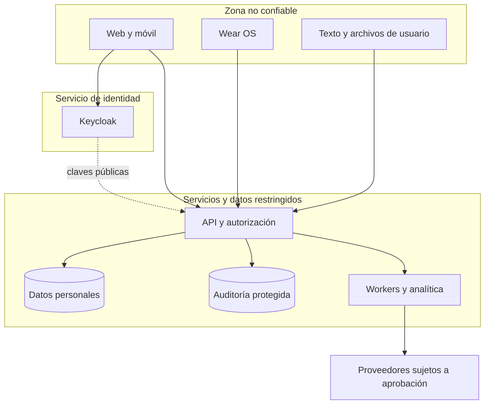

# Modelo inicial de amenazas

**Estado: análisis de diseño, pendiente de verificar contra implementación.** Prioriza activos y fronteras de Quantify Core. Las categorías de [OWASP API Security Top 10](https://api-security.owasp.org/editions/2023/en/0x11-t10/) sirven para revisar riesgos de autorización, consumo de recursos y dependencias; las medidas de la tabla son requisitos específicos del proyecto.

## Activos y escenarios

| ID | Amenaza concreta | Control que debe implementarse | Evidencia de prueba |
|---|---|---|---|
| AM-01 | Usuario cambia `habitId` y lee/edita progreso ajeno | Propiedad filtrada en cada consulta y caso de uso; no confiar en propietario del body | Dos cuentas, UUID válido ajeno, respuesta `404`, ninguna mutación |
| AM-02 | Admin usa panel o exportación para consultar rutinas individuales | Matriz de permisos, consultas agregadas, exclusión de datos personales y accesos auditados | Admin sin permiso personal obtiene denegación igual que usuario ajeno |
| AM-03 | Token robado, falsificado o emitido para otro cliente | TLS, custodia segura, validación de firma/emisor/audiencia/vigencia, suspensión y rotación | Token alterado, ID token, audiencia errónea y clave retirada rechazados |
| AM-04 | Callback OIDC o sesión BFF manipulados | Redirects exactos, PKCE, contexto de transacción y CSRF si hay cookies | Código interceptado sin verifier y origen no permitido no completan sesión |
| AM-05 | Reintento offline duplica progreso o reemplaza otro dispositivo | `clientEventId`, `Idempotency-Key`, valor absoluto y versión esperada durables | Repetición y concurrencia no suman dos veces; conflicto explícito |
| AM-06 | Reloj o zona del dispositivo manipulan rachas | Instante del servidor, fecha de negocio validada y agenda histórica versionada | Cambio de zona, fecha futura y periodo no programado se rechazan o resuelven según regla |
| AM-07 | Dispositivo revocado continúa enviando biometría | Vinculación con posesión, credencial acotada, fuente asociada y revisión de consentimiento | Lote repetido, fuente ajena y revocación en mitad de cola no ingresan datos nuevos |
| AM-08 | Revocación no llega a un worker o a un resultado en caché | Comprobación al ejecutar/publicar e invalidación por versión de consentimiento | Trabajo en curso termina descartado y no muestra una recomendación revocada |
| AM-09 | Fuga por logs, métricas, trazas, archivos o backups | Redacción por lista permitida, cifrado, permisos, URLs temporales, retención | Buscar secretos y datos sintéticos marcados en logs; comprobar expiración de descargas |
| AM-10 | Inyección SQL/NoSQL, asignación masiva o HTML malicioso | Parámetros, DTO estricto, consultas construidas por servidor y renderizado seguro | Campos `role`/`ownerId`, operadores MongoDB y scripts no alteran permisos ni se ejecutan |
| AM-11 | URL/archivo enviado provoca SSRF o agotamiento | Destinos permitidos, límites de archivos, tipo real y presupuestos de recursos | Bloquear IP internas, redirecciones a metadatos y payloads excesivos |
| AM-12 | Texto de usuario intenta dirigir al LLM a filtrar o actuar | Separar instrucciones/datos, minimización, salida validada y herramientas sin privilegios de negocio | Instrucciones en un hábito no exponen otras cuentas ni ejecutan acciones |
| AM-13 | Caída de Redis o reentrega pierde/duplica tareas | Outbox durable, deduplicación y reconciliación de efectos | Reinicio en cada punto de commit/publicación/ack conserva el estado |
| AM-14 | Dependencia, imagen o token de CI comprometen entregas | Dependencias fijadas, revisión, permisos mínimos y escaneo | Build reproducible y credencial de CI sin permisos fuera de su función |
| AM-15 | Agregado permite inferir a una persona por grupo pequeño | Restricción de dimensiones, tamaño mínimo por definir y prevención de consultas diferenciales | Filtros sucesivos no permiten aislar rutinas individuales |
| AM-16 | Auditoría mutable o completa bloquea eliminación | Registro de cambios protegido, minimización y política de retención compatible | Cambio auditado no pierde trazabilidad; eliminación respeta política documentada |

## Priorización y cierre

Antes del primer flujo real se deben cerrar AM-01 a AM-06, AM-09, AM-10 y AM-13. Wear OS, IA y administración requieren además sus amenazas específicas antes de habilitar esas capacidades. La prioridad final, responsable, prueba, riesgo residual y fecha de revisión se registrarán en Jira; una tabla de diseño no acredita que un control exista.

Al agregar un proveedor o permiso, identificar qué dato cruza la frontera, quién puede acceder, cuánto tiempo se conserva y qué sucede al revocarlo. La aceptación de un riesgo necesita una decisión documentada, propietario y condición de revisión. Volver a [seguridad y privacidad](README.md).
