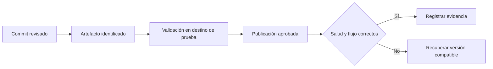

# Despliegue y recuperación

Esta carpeta contendrá la configuración para publicar componentes de Quantify Core y recuperar una versión conocida cuando una actualización falle. Cada entrega debe poder relacionarse con su código, sus artefactos, su configuración y el resultado de su verificación.

**Estado actual:** base documental. No hay proveedor de backend, manifiestos ni automatización de despliegue definidos en esta carpeta. Las [convenciones de infraestructura](../README.md) y las decisiones de arquitectura guían su implementación futura.

## Qué se desarrollará

- Configuración versionada de los ambientes aprobados y de sus recursos.
- Publicación de los artefactos de web, API, workers y analítica conforme se implementen.
- Integración con identidad, almacenamiento y otras dependencias aprobadas.
- Procedimientos de migración, comprobación posterior, reversión y restauración de datos.
- Automatización en [`.github/`](../../.github/CONFIGURACION.md) cuando el proceso y sus permisos estén definidos.

Aquí se mantiene la configuración ejecutable del despliegue. Las guías completas para las personas que operen el sistema se ubicarán en [docs/despliegue](../../docs/despliegue/README.md) y se enlazarán desde este README para evitar instrucciones duplicadas.

## Ambientes previstos

Estos nombres forman la base documental para los ambientes que se habiliten; no indican que ya existan.

| Ambiente | Propósito | Requisitos |
|---|---|---|
| `local` | Desarrollo individual mediante el entorno de [docker](../docker/README.md). | Datos sintéticos y recursos aislados de ambientes compartidos. |
| `test` | Ejecución automatizada de pruebas. | Datos desechables, limpieza controlada y resultados reproducibles. |
| `staging` | Validar una entrega antes de publicarla. | Configuración representativa del destino y datos sintéticos; responsables y acceso definidos. |
| `production` | Operar una entrega aprobada con usuarios reales. | Seguridad, recuperación, soporte y tratamiento de datos definidos y comprobados antes de habilitarla. |

Crear cada ambiente cuando el alcance lo justifique. Separar credenciales, bases de datos, almacenamiento y permisos entre ambientes. Una rama de Git no es un ambiente ni implica que exista un despliegue automático.

## Información necesaria antes del primer despliegue

| Decisión | Información que se necesita |
|---|---|
| Alojamiento | Proveedor, región, recursos, presupuesto y restricciones institucionales. |
| Responsables | Quién mantiene el ambiente, quién publica y quién atiende fallos. |
| Artefactos | Registro o repositorio de distribución, acceso y retención de versiones recuperables. |
| Red e identidad | Dominios, TLS, rutas públicas e internas, emisor OIDC, URL de retorno y reglas de CORS según los contratos. |
| Secretos | Almacenamiento, inyección, acceso, rotación y recuperación; los valores quedan fuera de Git. |
| Datos | Propietario de cada esquema, migraciones, respaldos, restauración y retención. |
| Operación | Señales de salud, objetivos de servicio y procedimiento de atención de incidentes. |

La propuesta de web es React + Vite; GitHub Pages corresponde a documentación y prácticas, y Vercel es una opción propuesta para la aplicación. El alojamiento de API y otros procesos sigue pendiente. No asumir que un sitio estático puede ejecutar esos servicios ni adoptar Kubernetes u otra plataforma sin una decisión justificada.

## Identificación y configuración de una entrega

Registrar por entrega el commit de origen, la versión de cada componente, el identificador inmutable del artefacto, la revisión de configuración, las migraciones incluidas y el resultado de las pruebas. Si un artefacto es una imagen, conservar su digest y no depender únicamente de una etiqueta mutable.

Promover el mismo artefacto entre ambientes cuando permita configuración en ejecución. Si un cliente web incorpora valores públicos durante la compilación, registrar un artefacto por ambiente, sus entradas y sus pruebas; no afirmar que dos compilaciones distintas son el mismo artefacto. Nunca incluir secretos en el contenido distribuido al navegador.

La configuración común se reutiliza y las diferencias por ambiente se declaran explícitamente. Deben documentarse límites de recursos, variables obligatorias, almacenamiento persistente, dependencias y comprobaciones de salud. Las rutas definitivas de los manifiestos dependen de la plataforma seleccionada.

## Secuencia de publicación prevista

1. **Validar el cambio:** revisar contratos, configuración y pruebas aplicables. Registrar fallos o limitaciones que impidan publicar.
2. **Preparar el artefacto:** construirlo, identificarlo y comprobar sus dependencias y configuración requerida.
3. **Preparar el destino:** verificar accesos, capacidad, secretos, compatibilidad de datos y versión recuperable.
4. **Ejecutar migraciones:** usar el mecanismo del servicio propietario, con ejecución coordinada, registro del resultado y estrategia ante fallos.
5. **Publicar y verificar:** comprobar salud y un flujo funcional representativo; observar errores, latencia y dependencias durante la ventana acordada.
6. **Registrar el resultado:** ambiente, fecha, responsable, versión efectiva y evidencia. Si se cumplen los criterios de fallo, ejecutar la recuperación documentada.

El [Git Flow](../../docs/guias/git-flow.md) lleva el trabajo a `develop` y las releases o hotfixes a `main`, con su sincronización posterior. Los disparadores y permisos de automatización se definirán expresamente; hacer push a una rama no debe interpretarse como autorización automática para publicar en todos los ambientes.

## Migraciones, reversión y respaldos

Las migraciones pertenecen al servicio responsable de los datos. Evitar que varias instancias ejecuten cambios de esquema concurrentemente sin coordinación. Cuando deba convivir más de una versión del servicio, documentar qué esquemas y contratos son compatibles durante la transición.

Volver a una imagen anterior no revierte una migración ni recupera datos. Antes de publicar, indicar si se puede volver a la versión previa, si hace falta una corrección adicional o si se requiere restauración. Los cambios que eliminen o transformen datos necesitan una estrategia de recuperación comprobada.

Cada recurso persistente debe tener responsable, frecuencia y retención de respaldos, control de acceso y procedimiento de restauración. Definir la pérdida máxima de datos tolerada (**RPO**) y el tiempo objetivo de recuperación (**RTO**) según el alcance; sus valores siguen pendientes. La existencia de un respaldo no sustituye una prueba de restauración.

## Criterios de entrega

- La configuración del ambiente está versionada y coincide con sus variables, contratos y documentación.
- Se conoce qué versión está desplegada y cómo recuperar una versión compatible.
- Se prueba la publicación y la comprobación funcional en el ambiente de validación que corresponda.
- Se ensaya la reversión y, cuando hay datos persistentes, la restauración; se conserva evidencia de resultados y limitaciones.
- Los accesos, secretos, responsables y señales de [observabilidad](../observability/README.md) necesarios para operar están definidos.

Quedan pendientes proveedor, dominios, ambientes efectivamente necesarios, responsables, registro de artefactos, presupuesto y objetivos de recuperación. Hasta resolver las dependencias aplicables, este documento describe el trabajo previsto y no una plataforma lista para producción.
