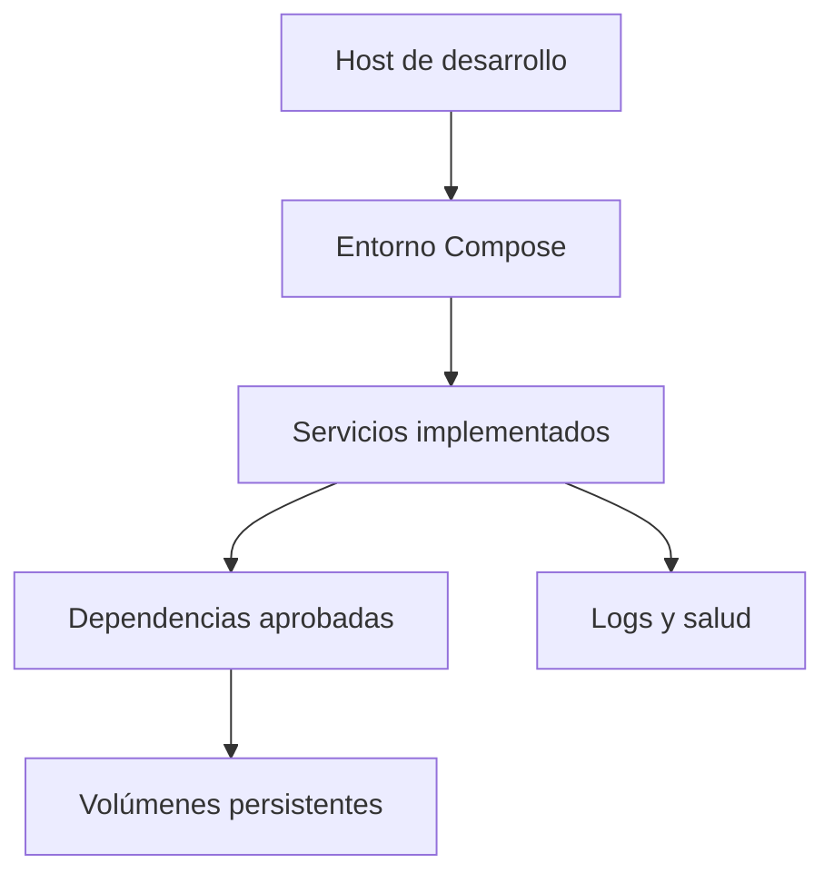

# Contenedores y entorno local

Esta carpeta definirá cómo construir imágenes y levantar las dependencias de Quantify Core para desarrollo y pruebas. El resultado esperado es que un integrante nuevo pueda preparar el entorno siguiendo una única guía y obtener los mismos componentes y versiones que el resto del equipo.

**Estado actual:** base de persistencia relacional implementada. Disponibles `compose.yaml` y `.env.example` para levantar PostgreSQL 16 local con inicialización automática de esquema y semillas. Los Dockerfiles de los microservicios continúan en desarrollo. Leer primero las [convenciones de infraestructura](../README.md).

## Alcance

- Construir imágenes de los servicios implementados en [services](../../services/README.md) y, cuando corresponda, del cliente [web](../../apps/web/README.md).
- Preparar las dependencias aprobadas del primer flujo: la propuesta incluye PostgreSQL, MongoDB, Redis y Keycloak, pero cada una deberá justificar su inclusión.
- Aislar redes, configuración y almacenamiento del entorno local y de las pruebas.
- Permitir activar componentes opcionales sin exigir que todos se ejecuten en cada máquina.

El código fuente, las migraciones y los datos sintéticos pertenecen al componente que los mantiene. Aquí se documenta cómo construirlo o ejecutarlo, evitando copias de esos archivos. La compilación móvil y de Wear OS requiere una guía específica en sus aplicaciones; no se presupone resuelta por Compose.

## Requisitos antes de implementar

| Requisito | Qué debe quedar definido |
|---|---|
| Herramientas | Versiones compatibles de Docker Engine o Docker Desktop y del complemento Docker Compose. |
| Equipo de desarrollo | Sistemas operativos y arquitecturas probados, memoria, CPU y disco necesarios según mediciones. Documentar WSL 2 si forma parte del entorno Windows elegido. |
| Servicios | Componentes que ya pueden construirse, comandos reales de arranque y dependencias necesarias. |
| Red y acceso | Puertos libres, acceso a registros de imágenes y reglas de conexión entre host y contenedores. |
| Datos | Migraciones disponibles, datos sintéticos, credenciales locales y volúmenes que se deben conservar. |

Las versiones y los recursos mínimos están pendientes de prueba; no se deben sustituir por valores supuestos.

## Artefactos previstos

| Artefacto | Responsabilidad |
|---|---|
| `compose.yaml` | Definición base del entorno y sus dependencias. Crear variantes o perfiles solo cuando resuelvan una diferencia concreta. |
| `<servicio>.Dockerfile` | Construcción del componente correspondiente; documentar su contexto de construcción y ruta del código fuente. |
| `.env.example` | Catálogo de variables con valores de ejemplo no sensibles, obligatoriedad y explicación de su uso. |
| `.dockerignore` en el contexto de construcción | Excluir archivos locales, secretos y contenido que la imagen no necesita. Su ubicación depende del contexto elegido. |
| Instrucciones en este README | Preparación, construcción, inicio, comprobación, parada y recuperación con comandos verificados. |

Estas rutas son una convención para el trabajo futuro, no archivos disponibles. Las exclusiones de Git deben prepararse antes de generar `.env` u otros archivos locales con credenciales.

## Reglas de construcción y configuración

Usar imágenes base de procedencia confiable, versiones explícitas y un registro del digest utilizado para las entregas. Documentar cómo se actualizan para incorporar correcciones. Separar compilación y ejecución cuando reduzca dependencias en la imagen final; ejecutar los servicios propios sin privilegios de administrador cuando sea compatible con su funcionamiento. Estas prácticas se apoyan en la [guía oficial de construcción de Docker](https://docs.docker.com/build/building/best-practices/).

Cada imagen debe corresponder a una responsabilidad y utilizar los archivos de dependencias del servicio. No instalar paquetes manualmente dentro de un contenedor como paso necesario para reproducir el entorno.

La configuración debe distinguir valores públicos de secretos y valores de compilación de valores de ejecución. Nunca incorporar secretos en imágenes, argumentos de construcción, repositorio o archivos del cliente web. Si una construcción necesita autenticación, documentar un mecanismo de secretos de construcción que no los conserve en la imagen.

## Red, salud y persistencia

- Mantener una tabla por servicio con puerto interno, puerto del host si se publica, protocolo, consumidores y motivo de exposición. Los puertos concretos están pendientes.
- Publicar en la máquina local únicamente lo necesario; las dependencias internas se comunican por la red del entorno. Las publicaciones locales de desarrollo se limitarán a la interfaz de loopback salvo una necesidad documentada.
- Distinguir las direcciones que usan los contenedores de las que usan el navegador o el host. En OIDC, comprobar también el emisor y las URL de retorno; no asumir que un nombre interno del contenedor será accesible desde el navegador.
- Documentar cuándo un proceso está vivo y cuándo está listo para atender solicitudes. El orden de arranque no garantiza que una dependencia esté disponible; los servicios necesitan una comprobación de disponibilidad y reintentos limitados.
- Declarar los datos que deben sobrevivir a la recreación del contenedor y los volúmenes que los alojan. Separar datos locales persistentes de datos desechables de pruebas.
- Diferenciar en la guía detener servicios, recrearlos y eliminar sus datos. Toda limpieza que borre volúmenes debe identificar los recursos afectados y requerir una elección explícita de quien la ejecuta.

## Procedimiento que se deberá documentar

1. Comprobar prerrequisitos y preparar la configuración de ejemplo con credenciales locales.
2. Validar la configuración sin publicar secretos en salidas compartidas.
3. Construir y arrancar los componentes seleccionados.
4. Ejecutar las migraciones y cargar los datos sintéticos mediante los mecanismos del servicio responsable.
5. Comprobar salud, comunicación y un flujo funcional mínimo.
6. Consultar logs, detener los servicios y volver a iniciarlos conservando los datos esperados.
7. Explicar cómo recuperar un entorno dañado y, por separado, cómo reiniciar sus datos.

No se publican comandos de arranque todavía porque no existe configuración ejecutable que los respalde.

## Criterios de entrega

- La configuración se valida y las imágenes se construyen desde una copia limpia, con las versiones documentadas.
- Un segundo integrante puede iniciar el entorno con datos sintéticos y reproducir la comprobación funcional.
- Se comprueban el comportamiento ante una dependencia no disponible y la conservación de datos tras recrear contenedores.
- Las variables de ejemplo cubren las requeridas, no existen secretos en los archivos o imágenes y los puertos publicados coinciden con el inventario.
- Las instrucciones distinguen operaciones que conservan datos de operaciones que los borran y registran los sistemas operativos realmente probados.

Quedan pendientes las versiones, los puertos, el consumo mínimo de recursos, el inventario inicial de servicios y sus responsables. La configuración de publicación se coordinará con [deployment](../deployment/README.md) y las señales técnicas con [observability](../observability/README.md).
