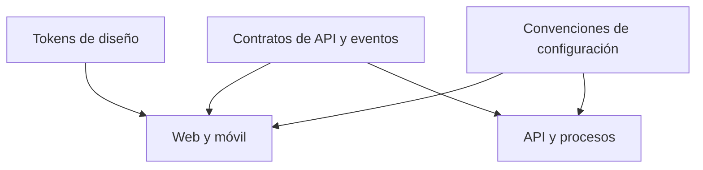

# Paquetes compartidos

Reúne definiciones reutilizables entre aplicaciones y servicios para evitar duplicar contratos, identidad visual y configuración.

- [`contracts/`](contracts/README.md): contratos REST, eventos y esquemas.
- [`design-tokens/`](design-tokens/README.md): colores, tipografía y tokens de interfaz.
- [`config/`](config/README.md): configuración común no secreta.

**Estado:** documentación y especificaciones de desarrollo. La presencia de estas carpetas no implica paquetes publicados, generadores de clientes ni un gestor de monorepo instalado.

Cada definición tiene un propietario y consumidores identificados. Los cambios de contratos o tokens deben indicar compatibilidad, versión, impacto y pruebas necesarias en sus consumidores. Compartir definiciones no obliga a compartir una biblioteca ejecutable entre TypeScript, Dart y Python.

El código generado se identifica como tal y no se edita manualmente; el generador y su versión se documentarán cuando se adopten. Las definiciones no incluyen secretos, configuración específica de una cuenta ni reglas de negocio duplicadas.
