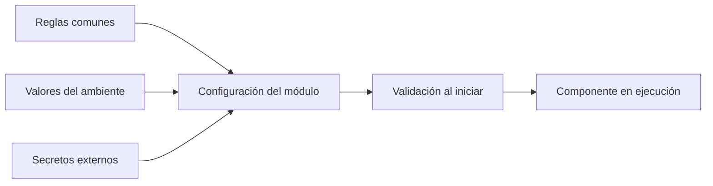

# Configuración compartida

Esta carpeta define el lugar de las convenciones y configuraciones reutilizables de herramientas. **Estado:** documentación; todavía no existen configuraciones de compilador, formateador, linter, gestor de paquetes o monorepo en esta carpeta.

## Qué se compartirá

| Área | Definición esperada |
|---|---|
| TypeScript | Opciones comunes compatibles con web y API; cada consumidor conserva sus diferencias de entorno. |
| Formato y análisis | Herramientas y reglas por lenguaje con versiones, exclusiones justificadas y comandos. |
| Pruebas | Convenciones de ubicación, nombres, fixtures sintéticos y reporte de resultados. |
| Documentación | Formato Markdown, diagramas, rutas y revisión de enlaces. |

Las versiones se eligen al crear los manifiestos de cada módulo y se registran con sus lockfiles. No se presupone npm, pnpm, Yarn, una herramienta Python o una biblioteca Flutter particular solo porque aparezca en una práctica.

## Contrato de configuración

Cada variable debe documentar nombre, tipo, consumidor, obligatoriedad, ejemplo sin secretos, validación, ambiente y momento de lectura. Distinguir valores incorporados en la compilación de los que se leen al ejecutar. Las variables públicas del frontend se consideran visibles para quien descarga la aplicación.

Las variables propias usan `UPPER_SNAKE_CASE`; las de una dependencia conservan el nombre oficial. Configuración común sin secretos pertenece aquí; diferencias por ambiente a [deployment](../../infrastructure/deployment/README.md); variables específicas de un módulo a su README. Evitar definiciones duplicadas.

## Antes de crear archivos ejecutables

Confirmar runtimes y herramientas con el equipo, preparar exclusiones de archivos locales y generar ejemplos de configuración sin valores reales. Documentar cómo falla el arranque si falta un valor obligatorio. Ningún componente debe usar credenciales de producción como valor predeterminado.

## Criterio de entrega

Una configuración nueva debe tener consumidores identificados, funcionar con sus versiones documentadas y producir el mismo resultado en desarrollo y en la automatización. Las excepciones se justifican; las instrucciones y ejemplos se mantienen alineados con la validación real.
