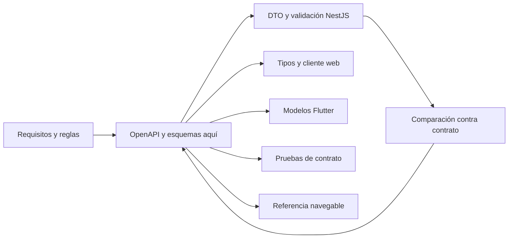

# Contratos compartidos

> **Estado: borrador documental.** Esta carpeta es la fuente canónica de interfaces de Quantify Core. [openapi.json](openapi.json) describe el primer flujo propuesto y **no acredita una API operativa**. La versión `0.1.0-draft` identifica el documento, no una versión liberada de la aplicación.

## Inventario y autoridad

| Archivo | Propósito | Estado |
|---|---|---|
| [openapi.json](openapi.json) | OpenAPI 3.1.1: perfil propio, hábitos, check-ins y métricas | Borrador para implementar y revisar |
| [events/README.md](events/README.md) | Reglas de entrega y criterios para crear esquemas de eventos | Diseño; aún no existen esquemas de mensajes implementados |
| [Guía de integración](../../docs/api/README.md) | Explica semántica HTTP y casos de error, referenciando este contrato | Guía de diseño |



Los tipos generados son artefactos derivados. No editar a mano una copia en cada cliente, ni generar un OpenAPI distinto desde NestJS y declarar ambos como autoridad. Se podrá comparar el documento emitido por el servidor con este contrato; toda diferencia debe resolverse en el mismo PR.

## Alcance del borrador

- RF-01: acceso mediante token emitido por Keycloak; no se definen login, registro ni contraseñas de la API.
- RF-02: lectura de perfil propio con zona horaria y roles. Edición de perfil/consentimientos se formalizará en una ampliación.
- RF-03: alta, consulta y cambios de hábitos, incluida pausa y archivo con control de versión.
- RF-04: listar y registrar valores absolutos por fecha de negocio, idempotencia y corrección auditable.
- RF-05: métricas y rachas sobre periodos cerrados dentro de una ventana explícita.
- RF-06 a RF-10: pendientes de contratos detallados. La presencia de esos módulos en otras guías no autoriza a inventar endpoints.

## Decisiones explícitas del borrador

JSON usa `camelCase`, identificadores UUID, timestamps UTC con `Z`, fechas de negocio `YYYY-MM-DD` y zonas IANA. Los límites técnicos incluidos en OpenAPI (longitudes, paginación y formatos) son propuestas del contrato para revisión; no se presentan como políticas ya medidas en producción. Un texto con formato de zona todavía necesita validación contra una base IANA, y `format` no reemplaza validación de negocio.

Las cantidades se expresan como número JSON finito en la unidad del hábito. Antes del scaffold se fijarán catálogo de unidades, precisión decimal, redondeo y almacenamiento en [decisiones pendientes](../../docs/arquitectura/decisiones-pendientes.md). No convertir una cantidad en punto flotante binario y asumir exactitud para todas las unidades. Las frecuencias iniciales son días de semana programados; no se prometen calendarios arbitrarios en este borrador.

## Cómo cambiar un contrato

1. Identificar requisito RF-XX, regla y consumidores afectados.
2. Editar el esquema canónico y añadir un ejemplo sintético válido por comportamiento nuevo.
3. Revisar autorización, idempotencia, compatibilidad y semántica temporal.
4. Validar sintaxis, referencias y especificación OpenAPI; ejecutar pruebas de consumidor cuando existan.
5. Actualizar guía, DTO/validadores y modelos generados en el mismo PR. Acordar transición si afecta clientes publicados.

**Compatibilidad:** agregar campos opcionales de respuesta suele ser compatible si los clientes toleran desconocidos. Quitar o renombrar campos, hacer obligatorio un opcional, cambiar tipo, unidad o significado, restringir valores previamente válidos o añadir un valor de enum que rompe clientes exhaustivos exige evaluación explícita. `v1` en la URL es la familia pública; `info.version` versiona el documento. Un cambio incompatible publicado requiere una nueva familia o un plan de migración aprobado, con fecha y consumidores conocidos.

## Validación y publicación de referencia

Comprobación básica disponible con Node.js, desde la raíz:

```sh
node -e "const fs=require('node:fs');const s=JSON.parse(fs.readFileSync('packages/contracts/openapi.json','utf8'));if(s.openapi!=='3.1.1')throw Error('OpenAPI inesperado');console.log(s.info.version,Object.keys(s.paths).length,'rutas')"
```

Este comando solo comprueba JSON y metadatos; la revisión debe incluir un validador compatible con OpenAPI 3.1 y resolver todos los `$ref`. La herramienta y su versión deberán fijarse al incorporar CI. Importar el archivo en un visor OpenAPI permite explorar modelos y operaciones; no activar **Try it out** contra un ambiente real sin URLs, políticas de CORS y acceso confirmadas.

El documento utiliza un servidor relativo `/api/v1` sin dominio inventado. Referencia de formato: [especificación oficial OpenAPI 3.1.1](https://spec.openapis.org/oas/v3.1.1.html). Para empezar a implementar consultar [guía API](../../docs/api/README.md) y [servicio NestJS](../../services/api/README.md).
