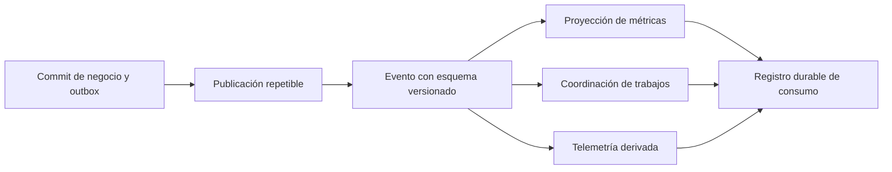

# Contratos de eventos y trabajos

> **Estado: diseño.** No hay un broker elegido, esquemas desplegados ni consumidores implementados. Esta carpeta será la fuente canónica de JSON Schemas de eventos; las explicaciones de este documento no sustituyen esos archivos.

## Qué se publica

Un **evento** informa de un hecho confirmado (`HabitCreated`, `CheckInRecorded`, `ConsentRevoked` son nombres de trabajo por acordar). Un **comando/trabajo** pide ejecutar una acción que aún puede fallar. Los clientes no publican directamente eventos confiables al broker: envían comandos a la API, que valida y registra el hecho.

## Campos que debe resolver el primer esquema

| Concepto | Uso requerido |
|---|---|
| Identificador estable | Deduplicar reentregas del mismo hecho; no regenerarlo en cada intento |
| Tipo y versión de esquema | Seleccionar validador y estrategia de compatibilidad |
| Instante del servidor | UTC; el reloj del cliente se conserva como evidencia separada si es necesario |
| Agregado y revisión | Orden lógico por entidad; detectar saltos, eventos obsoletos y recuperación |
| Correlación y causalidad | Relacionar petición, evento y trabajo sin propagar secretos |
| Productor | Servicio autorizado y versión compatible |
| Payload mínimo | Solo referencias/datos imprescindibles para el consumidor y su finalidad |
| Contexto de consentimiento | Referencia/versionado para volver a comprobar autorización al procesar |

Los nombres finales se definirán una sola vez en un JSON Schema versionado aquí. Un consumidor no podrá depender de una tabla de Markdown como contrato ejecutable.

## Garantías

- Entrega al menos una vez, sin orden global. Los consumidores rechazan o posponen revisiones fuera de orden según el caso de uso.
- Publicación mediante outbox durable de la API. Redis nunca es la única evidencia de un evento pendiente.
- Dedupe persistente y operación idempotente por consumidor. Un evento válido no obliga a repetir su efecto.
- Validar esquema al publicar y consumir; errores permanentes se aíslan y permiten inspección autorizada sin pérdida silenciosa.
- Eventos de negocio no incluyen tokens, contraseñas ni biometría completa. Los datos sensibles se consultan mediante interfaces autorizadas cuando sean necesarios.
- Un evento de consentimiento revocado no basta por sí solo: el consumidor comprueba vigencia antes de leer datos o publicar resultados.

## Criterios para incorporar un evento

El PR incluirá productor, consumidores, RF-XX, JSON Schema, ejemplo sintético válido, estrategia de compatibilidad, retención, partición/orden, deduplicación, recuperación y pruebas de reentrega. Antes de retirar un esquema se identifican consumidores pendientes y se documenta su migración.

Véase [workers](../../../services/workers/README.md), [modelo de datos](../../../docs/datos-ia/modelo-datos.md) y [contratos HTTP](../README.md).
