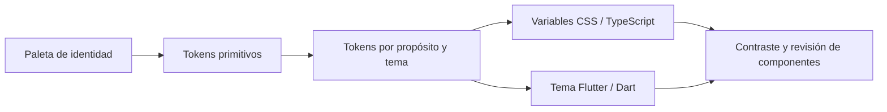

# Tokens de diseño

**Estado: contrato visual documental; todavía no hay paquete, generador ni archivos de tokens ejecutables.** La identidad del [README principal](../../README.md) es la referencia de color para Quantify Core V2.0. Este documento propone nombres semánticos y registra decisiones necesarias antes de distribuir valores a React o Flutter.

## Paleta base canónica

| Familia | Nombre | HEX | Propósito de identidad |
|---|---|---|---|
| Marca | Laser Blue | `#275BC0` | Acción principal y marca |
| Marca | Sky Laser | `#4A7DE8` | Acento y selección; uso interactivo condicionado a contraste |
| Marca | Deep Cobalt | `#183D87` | Énfasis y estado presionado |
| Neutro | Obsidian Slate | `#0B0F17` | Fondo oscuro y texto sobre claro |
| Neutro | Midnight Navy | `#161F2E` | Superficie oscura |
| Neutro | Steel Border | `#283548` | Divisores de la familia oscura; revisar controles |
| Neutro | Cool Gray | `#8A99AD` | Metadatos sobre fondos compatibles |
| Neutro | Pure Mist | `#F4F7FD` | Fondo claro |
| Neutro | Optical White | `#FFFFFF` | Superficie clara y texto sobre oscuro |
| Semántico | Emerald | `#10B981` | Éxito / rachas |
| Semántico | Amber | `#F59E0B` | Advertencia / pendiente |
| Semántico | Crimson | `#EF4444` | Error / interrupción |
| Semántico | Electric Cyan | `#0EA5E9` | IA / métricas |

La paleta no garantiza por sí sola contraste ni obliga a usar todos sus colores. `#1E54C9`, `#2C3036` y el resto de variables de las prácticas se preservan en sus sketches como evidencia; no son sustituciones silenciosas de estos valores.

## Capas y nombres propuestos

| Capa | Ejemplo de nombre | Regla |
|---|---|---|
| Primitiva | `color.brand.laserBlue` | Un valor de paleta, sin asumir contraste |
| Semántica | `color.action.primary`, `color.text.primary`, `color.surface.canvas` | Referencia a un primitivo según propósito y tema |
| Estado | `color.feedback.error`, `color.focus.ring`, `color.sync.pending` | Texto/icono/patrón acompañan el color |
| Tipografía | `font.family.body`, `font.size.body`, `font.weight.label` | Familia y escala pendientes |
| Geometría | `space.4`, `radius.control`, `size.target.touch` | Escalas propuestas, no exportadas todavía |
| Movimiento | `motion.duration.feedback`, `motion.reduce` | Equivalente sin animación obligatoria |

La sintaxis concreta y el formato fuente se decidirán junto con el generador. No mantener archivos CSS y Dart como dos fuentes manuales independientes: escoger una fuente versionada y generar adaptadores, o documentar explícitamente la sincronización temporal hasta disponer de generación.

Propuesta inicial de temas: claro con `Pure Mist`/`Optical White` y texto `Obsidian Slate`; oscuro con `Obsidian Slate`/`Midnight Navy` y texto `Optical White`. Los roles secundarios, bordes, hover, foco y deshabilitado necesitan pruebas específicas; no heredar las combinaciones del sketch por defecto.

## Contrastes medidos y decisiones de uso

Relaciones calculadas con luminancia relativa sRGB según WCAG, sobre colores sólidos, redondeadas a dos decimales. Transparencia, gradientes y superposición obligan a medir el resultado final. El mínimo para texto normal AA es 4.5:1; texto grande tiene un umbral distinto. [WCAG 2.2, contraste mínimo](https://www.w3.org/WAI/WCAG22/Understanding/contrast-minimum.html).

| Par de colores | Relación | Texto normal AA |
|---|---:|---|
| Laser Blue / blanco | 6.28:1 | Sí |
| Sky Laser / blanco | 3.90:1 | No |
| Cool Gray / blanco | 2.90:1 | No |
| Cool Gray / Midnight Navy | 5.70:1 | Sí |
| Emerald / blanco | 2.54:1 | No |
| Amber / blanco | 2.15:1 | No |
| Crimson / blanco | 3.76:1 | No |
| Electric Cyan / blanco | 2.77:1 | No |
| Obsidian Slate / Pure Mist | 17.87:1 | Sí |

Por tanto, no usar texto pequeño blanco sobre botones Sky Laser solo porque el README lo menciona como hover, ni texto Cool Gray sobre tarjetas blancas. Conservar contraste mediante otro par aprobado, texto oscuro o una variante semántica derivada que se mida y documente. Los colores de éxito/error/IA pueden funcionar como acento acompañado de texto legible; no se autoriza cualquier combinación de ellos.

## Entrega del futuro paquete

1. Aprobar formato, nombres, temas, tipografía, escalas e iconografía en la revisión de diseño.
2. Mantener valor, tipo, propósito, tema y estado de cada token; distinguir provisional y aprobado.
3. Producir adaptadores para web y móvil sin introducir lógica de negocio ni dependencias de componentes.
4. Documentar generación, comprobación y actualización con comandos reales cuando exista el paquete.
5. Revisar consumidores y contrastes cuando cambie un token. Renombrar/eliminar un token es un cambio de contrato; acompañarlo de migración y versión.
6. Comprobar que los valores generados coinciden con su fuente y que los componentes representativos mantienen accesibilidad en ambos temas.

No hay API de importación publicada. Hasta la implementación, cualquier mockup debe citar esta paleta y señalar qué decisiones visuales son provisionales.

[Sistema de diseño](../../docs/diseno/sistema-diseno.md) · [Recorridos](../../docs/diseno/recorridos.md) · [Paquetes compartidos](../README.md)
