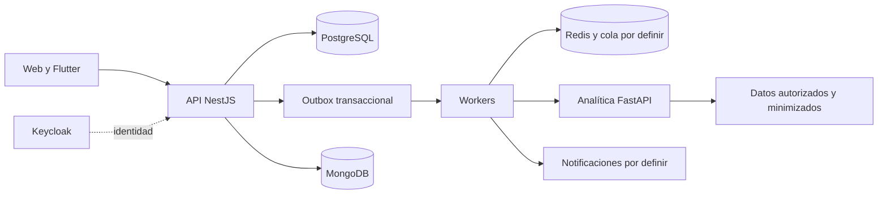

# Servicios de Quantify Core

> **Estado: diseño para desarrollo.** Estas carpetas documentan componentes previstos; aún no ofrecen servidores ejecutables, manifiestos de dependencias ni comandos de arranque. El stack base es NestJS/TypeScript para negocio, Python/FastAPI para analítica y Redis como apoyo al procesamiento asíncrono.

## Responsabilidades y dependencias

| Componente | Es dueño de | Acceso y límites | Guía |
|---|---|---|---|
| API | Reglas de negocio, autorización, maestros, transacciones y migraciones de PostgreSQL | Expone REST; ningún cliente escribe directamente en bases de datos | [API](api/README.md) |
| Analítica | Preparación de características, reglas analíticas, evaluación e inferencia | Solo insumos autorizados y permisos mínimos; no modifica hábitos, perfiles ni consentimientos | [Analítica](analytics/README.md) |
| Workers | Entrega, reintentos y ejecución de tareas | Las mutaciones de negocio reutilizan casos de uso de la API; no duplican reglas | [Workers](workers/README.md) |
| Keycloak | Credenciales, sesiones y emisión de tokens | API valida tokens y aplica permisos de negocio; no mantiene contraseñas | [Seguridad](../docs/seguridad/README.md) |

El motor de reglas transaccionales de hábitos y rachas pertenece a la API. FastAPI puede producir análisis derivados, pero no redefinir el cumplimiento de un hábito. Los workers podrán compartir código de aplicación de NestJS cuando se seleccione su runtime; la biblioteca concreta de colas y el mecanismo de despliegue se documentarán en un ADR.

## Acuerdos compartidos

1. Leer [requerimientos](../docs/requerimientos/README.md), [reglas de negocio](../docs/requerimientos/reglas-negocio.md) y [contratos](../packages/contracts/README.md) antes de implementar.
2. Definir el contrato antes del controlador. DTO de transporte, entidad de negocio y registro de persistencia cumplen propósitos diferentes; no exportar entidades de BD como respuestas.
3. Una operación tiene un actor autenticado, permiso, recurso, identificador de correlación y resultado auditable. No aceptar `ownerId` del cliente para asignar propiedad.
4. Las transacciones locales terminan antes de llamar a proveedores. Outbox, reintentos e idempotencia resuelven la entrega posterior; no prometer transacciones atómicas entre PostgreSQL, MongoDB y Redis.
5. Configurar plazos de espera, cancelación, tamaño máximo y concurrencia. Los valores se fijarán con mediciones y quedarán documentados por ambiente.
6. Ningún log, traza, excepción o mensaje de cola debe incluir tokens, secretos o biometría cruda innecesaria.

## Preparación del primer servicio

El primer scaffold debe añadir versiones fijadas, archivos de dependencias y bloqueo, configuración validada, ejemplo sin secretos, migraciones, datos sintéticos, pruebas y comandos realmente ejecutados. Cada README se actualizará con su evidencia y dejará de presentar como pendientes únicamente las capacidades verificadas.

**Revisión mínima:** límites de módulos, contrato compatible, autorización por propiedad, migración reversible o recuperación documentada, fallos de dependencias, telemetría sin datos sensibles y pruebas del flujo completo. Consultar [infraestructura](../infrastructure/README.md) y [guías del equipo](../docs/guias/README.md).
