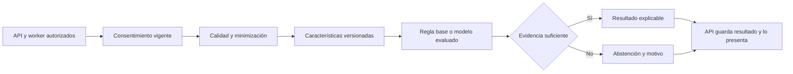

# Analítica e inteligencia artificial · Python + FastAPI

> **Estado: diseño.** No existe un modelo entrenado, endpoint operativo ni precisión validada. El servicio procesará datos autorizados para RF-07 y apoyará el análisis de RF-05/RF-08. Las métricas transaccionales de cumplimiento siguen siendo responsabilidad de la API.

## Responsabilidad

FastAPI ofrecerá interfaces internas para preparación e inferencia. Los routers, dependencias y validadores se separarán de los pipelines de datos según la [organización modular oficial de FastAPI](https://fastapi.tiangolo.com/tutorial/bigger-applications/). El cliente web o móvil accederá a resultados a través de la API NestJS; no se publicará el servicio de modelos directamente a Internet.

## Entradas, salidas y propiedad

| Interfaz prevista | Condiciones obligatorias |
|---|---|
| Solicitud interna | `jobId`, referencia seudónima, ventana temporal, finalidad, versión del consentimiento, de características y reglas/modelo |
| Insumos | Solo campos necesarios, origen, calidad, unidad y zona; acceso temporal limitado |
| Resultado | Estado calculado/abstención/error, versión del modelo, ventana de evidencia, límites, instante del servidor y trazabilidad |
| Persistencia | La API valida y registra el resultado de negocio; analítica no cambia perfiles, hábitos, roles ni consentimientos |

Los nombres y esquemas de estas interfaces se formalizarán en [contratos](../../packages/contracts/README.md) antes del primer consumidor. Esta tabla describe requisitos y no define otro esquema independiente. PostgreSQL se consultará únicamente mediante vistas/permisos de lectura o extractos suministrados por la API; MongoDB mediante credenciales de lectura acotadas a fuentes y finalidades autorizadas.

## Reglas de desarrollo

1. Comenzar con una línea base reproducible y comparar modelos contra ella. Separar preparación, entrenamiento, evaluación e inferencia; no entrenar dentro de una petición HTTP de usuario.
2. Mantener particiones temporales y por persona cuando corresponda para evitar fuga de información. Documentar cobertura, faltantes, procedencia y representatividad.
3. Aplicar consentimiento al seleccionar datos y al entregar el resultado. Si se revoca durante el trabajo, cancelar o descartar la salida; no publicar una recomendación obsoleta.
4. Un UUID seudonimiza; no garantiza anonimato. Evitar nombres de hábitos libres, notas, correo, ubicación y biometría cruda si no son necesarios.
5. Producir el resultado cuantitativo antes de una explicación. Un LLM, si se aprueba proveedor y tratamiento, solo podrá reformular evidencia autorizada; nunca decidir permisos o modificar registros.
6. No presentar correlación como causalidad, ni indicadores de bienestar como diagnósticos médicos. Mostrar abstención cuando falten datos o el caso esté fuera de distribución.
7. Congelar versión, parámetros, características, semilla cuando aplique y artefacto evaluado. Registrar cambios y posibilidad de retirar o volver a una versión previa.

Los umbrales de siete días, quince eventos, confianza de 0.75/0.80 y ventanas de recomendaciones presentes en Práctica 05 son **hipótesis académicas por conciliar y evaluar**, no reglas productivas. La fuente para su resolución es [analítica e IA](../../docs/datos-ia/analitica-ia.md).

## Aceptación y pruebas

- La misma entrada y versión producen resultados reproducibles dentro de la tolerancia documentada.
- Casos sin datos, datos tardíos, unidades inválidas, valores imposibles y cambio de zona se identifican antes del modelo.
- Una revocación impide nuevas lecturas e impide presentar resultados pendientes derivados de la finalidad revocada.
- El conjunto de evaluación incluye perfiles con cobertura desigual; se informan errores y límites por subgrupo cuando el tamaño permita hacerlo sin reidentificación.
- Timeout, saturación o indisponibilidad generan un estado controlado; el registro de hábitos continúa disponible.
- Las explicaciones no inventan hechos, no filtran datos de otras personas y resisten instrucciones maliciosas dentro de texto de entrada.

Consultar [modelo de datos](../../docs/datos-ia/modelo-datos.md), [ciclo de vida](../../docs/datos-ia/calidad-ciclo-vida.md) y [amenazas](../../docs/seguridad/amenazas.md). Versiones de Python, FastAPI y bibliotecas de ML, proveedor LLM y formatos de artefactos siguen pendientes del scaffold/ADR.
