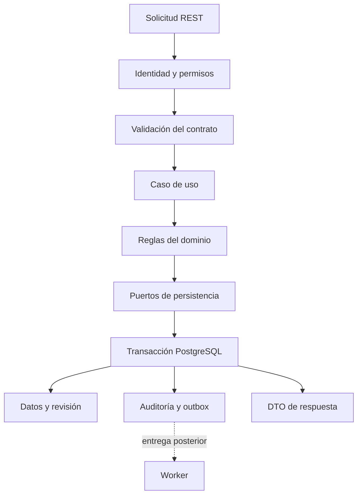

# API principal · NestJS + TypeScript

> **Estado: especificación, sin implementación.** La API será la autoridad del dominio y de las escrituras transaccionales en PostgreSQL. [OpenAPI](../../packages/contracts/openapi.json) es un borrador de interfaces, no un servicio desplegado.

## Módulos y fronteras

| Módulo previsto | Responsabilidad | Requisitos |
|---|---|---|
| Identity | Validar tokens de Keycloak y mapear `(issuer, subject)` a identidad interna | RF-01 |
| Profiles / Consent | Preferencias, zona IANA, finalidades y revocaciones | RF-02 |
| Habits | Meta, programación versionada, archivo e historial | RF-03 |
| CheckIns | Valores absolutos, concurrencia, idempotencia y correcciones auditables | RF-04 |
| Metrics | Cumplimiento y rachas conforme a reglas versionadas | RF-05 |
| Reminders | Preferencias y comandos de programación para workers | RF-06 |
| Recommendations | Solicitudes, resultados y aceptación explícita de sugerencias | RF-07 |
| Devices / Telemetry | Asociación de dispositivos, autorización y validación de lotes | RF-08 |
| Administration | Operación autorizada, catálogos y agregados | RF-09 |
| Audit / DataRights | Trazabilidad, exportación y solicitudes de eliminación | RF-10 |

Estos nombres expresan límites de negocio, no obligan a generar diez servicios independientes. Empezar con un monolito modular NestJS y extraer componentes solo mediante un ADR justificado.



## Organización prevista

```text
src/
  modules/<dominio>/
    presentation/    # Controladores y mapeo HTTP
    application/     # Casos de uso y límites de transacción
    domain/          # Reglas, valores y políticas sin transporte
    infrastructure/  # Repositorios y adaptadores
  platform/          # Configuración, identidad y observabilidad
```

Una capa importa hacia las reglas de negocio. Los controladores no consultan tablas directamente y los repositorios no deciden permisos. Evitar un directorio común que mezcle todas las entidades. El ORM, gestor de paquetes y versiones de Node.js/NestJS están pendientes de fijarse en el scaffold; no introducirlos como decisiones ya aprobadas.

## Recorrido de una escritura

1. Validar firma, algoritmo permitido, emisor, audiencia y vigencia del access token; rechazar ID tokens como credencial de API.
2. Resolver el actor interno y su estado. Un rol `admin` no concede acceso automático a hábitos de otras personas.
3. Validar DTO y campos permitidos. Rechazar atributos desconocidos en comandos; ignorarlos silenciosamente puede esconder errores o permitir asignación masiva.
4. Autorizar el recurso en la consulta y nuevamente en el caso de uso si cambia su contexto. Un identificador ajeno se responde como recurso no encontrado en rutas personales.
5. Resolver `Idempotency-Key`, verificar huella de la petición y versión esperada. La autorización se comprueba también al repetir una clave.
6. Guardar cambio, revisión, resultado idempotente y outbox en una transacción PostgreSQL. Las restricciones únicas impiden carreras entre instancias.
7. Confirmar la respuesta tras el commit; los workers distribuyen eventos y efectos posteriores. Si la transacción falla, no se publica un éxito.

NestJS permite implementar políticas mediante guards y validación mediante pipes. Su uso debe seguir la [guía oficial de autorización](https://docs.nestjs.com/security/authorization) y [validación](https://docs.nestjs.com/techniques/validation), con pruebas que demuestren los permisos reales.

## Persistencia y consistencia

- La API mantiene migraciones, índices y restricciones de PostgreSQL. Los demás servicios reciben vistas de solo lectura, exportaciones minimizadas o interfaces internas autorizadas.
- MongoDB contiene telemetría/eventos derivados con `eventId` único y `schemaVersion`; no reemplaza la transacción principal ni el registro durable de auditoría requerido para una escritura.
- Redis soporta caché, limitación de frecuencia y colas. La pérdida de Redis no debe borrar hábitos, correcciones ni trabajos de negocio pendientes de publicar.
- Las llamadas a Keycloak, analítica, objetos o notificaciones usan adaptadores con plazo máximo. No mantener una transacción abierta durante una llamada remota.
- El borrado físico y la retención necesitan política propia. Archivar un hábito solo impide nuevo progreso y conserva su historia conforme a [reglas de negocio](../../docs/requerimientos/reglas-negocio.md).

## Pruebas necesarias

| Nivel | Casos que deben demostrar |
|---|---|
| Unitarias de dominio | Periodos programados, cambio de zona, metas versionadas, archivo y rachas sin contar el día abierto como fallo |
| Contrato | Ejemplos, campos obligatorios, formatos, errores, paginación y compatibilidad de OpenAPI |
| Integración con PostgreSQL | Dos escrituras concurrentes, restricción única, rollback, outbox y reintento tras respuesta perdida |
| Autorización | Usuario A consulta/modifica B; administrador intenta ver hábitos ajenos; token inválido o audiencia errónea |
| Sistema | Crear hábito, registrar valor, repetir petición, corregir con versión, archivar y consultar historia |
| Fallos | Redis o MongoDB caídos, evento repetido, JWKS rotadas y servicio analítico indisponible |

No hay comando de arranque verificable todavía. El scaffold deberá añadir pruebas, migraciones y configuración local enlazadas a [Docker](../../infrastructure/docker/README.md), sin documentar éxitos que no se hayan ejecutado.
