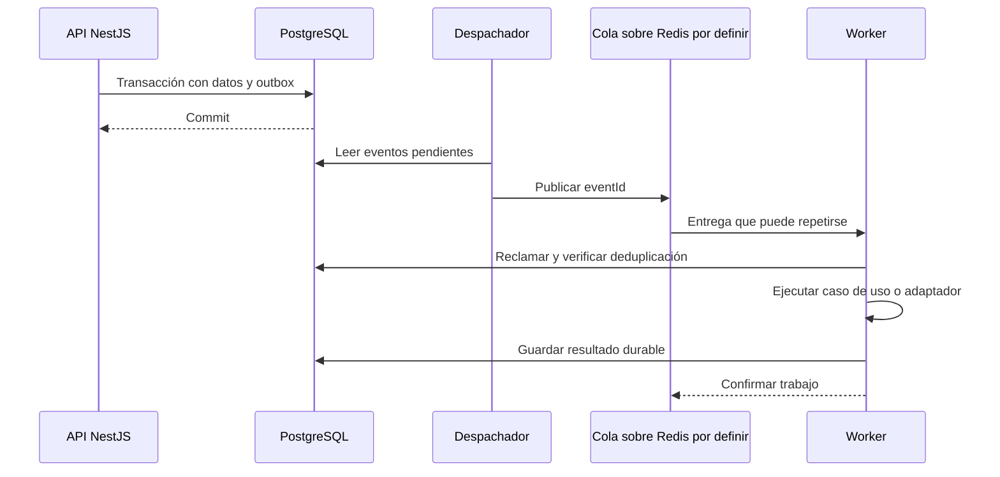

# Workers y procesos asíncronos

> **Estado: diseño para implementación.** Redis forma parte del stack de apoyo; el runtime del worker, la biblioteca de colas y la planificación concreta están pendientes de ADR. No asumir BullMQ, Celery ni otro componente como instalado.

## Trabajos previstos

| Trabajo | Disparador | Garantía de negocio |
|---|---|---|
| Publicar eventos | Outbox confirmada en PostgreSQL | El commit y su evento pendiente no se separan |
| Actualizar proyecciones | Cambio de hábito/check-in | Idempotencia por evento y versión; no sobrescribir con una versión antigua |
| Recordatorios (RF-06) | Periodo y preferencia vigente | Revisar estado del hábito, zona, permiso y deduplicación antes de enviar |
| Inferencia (RF-07) | Solicitud autorizada o criterio aprobado | Consentimiento comprobado al procesar y al publicar |
| Telemetría (RF-08) | Lote aceptado | Fuente autorizada, validación, deduplicación y calidad |
| Exportación/eliminación (RF-10) | Solicitud del titular validada | Progreso durable, acceso limitado y cierre auditable |

El diagrama representa propiedad lógica: los workers usan permisos acotados y casos de uso/repositorios del dominio para las tablas autorizadas. No reciben permiso general para cambiar maestros. La publicación de outbox, el ack de cola y el efecto externo no forman una sola transacción distribuida.

## Entrega, reintentos y recuperación

- Suponer entrega **al menos una vez**. Cada trabajo lleva `eventId` o `jobId` estable; un intento nuevo no representa un negocio nuevo.
- Conservar outbox y registro de procesamiento en almacenamiento durable. Redis no será el único lugar donde exista un pendiente o la evidencia de que ya se ejecutó.
- Confirmar un trabajo después de guardar el resultado. Recuperar bloqueos vencidos con un lease y resolver duplicados mediante restricciones únicas.
- Reintentar fallos transitorios con espera progresiva y variación aleatoria. Plazo, límite de intentos y concurrencia deben ser configurables y documentados por tipo de tarea.
- Un error permanente va a cuarentena con motivo sin datos sensibles. La reejecución manual requiere permiso, razón y auditoría; no equivale a borrar la evidencia de fallos.
- Si un proveedor acepta un mensaje y el worker cae antes de registrar el envío, usar una clave de deduplicación o reconciliación del proveedor. Si no ofrece esta capacidad, documentar el riesgo de duplicados; no prometer entrega exactamente una vez.
- Una caída después de publicar y antes de marcar outbox puede duplicar eventos. Los consumidores deben tolerarlo; marcar publicado no es prueba suficiente de procesamiento final.

## Tiempo, privacidad y observabilidad

Programar según zona IANA y reglas de calendario, almacenar instantes UTC y reconstruir la programación cuando cambien preferencias. Reiniciar un worker no debe reenviar todos los recordatorios atrasados: se necesita una política de vigencia por trabajo antes de habilitarlos.

El mensaje transporta referencias mínimas; tokens de sesión, secretos, adjuntos completos o biometría no viajan en el payload. El worker obtiene autorización de servicio propia y vuelve a comprobar consentimiento y estado del recurso. Propagar correlación de trazas sin usar correo o nombre como etiquetas.

Medir antigüedad del pendiente más viejo, tamaño de cola, duración, intentos, tasa de éxito y trabajos en cuarentena. Documentar qué hacer cuando crece cada señal en [observabilidad](../../infrastructure/observability/README.md).

## Pruebas que desbloquean la implementación

1. Publicar y consumir el mismo evento varias veces sin duplicar el efecto.
2. Caer antes/después de cada commit, publicación y ack; recuperar el pendiente.
3. Recibir eventos fuera de orden y mantener la revisión más reciente.
4. Revocar permiso mientras el trabajo espera y comprobar que se cancela.
5. Reprogramar por cambio de zona y horario de verano sin duplicar un periodo.
6. Simular timeout del proveedor y reconciliar una respuesta incierta.

Ver [contratos de eventos](../../packages/contracts/events/README.md), [API](../api/README.md) y [despliegue](../../infrastructure/deployment/README.md).
