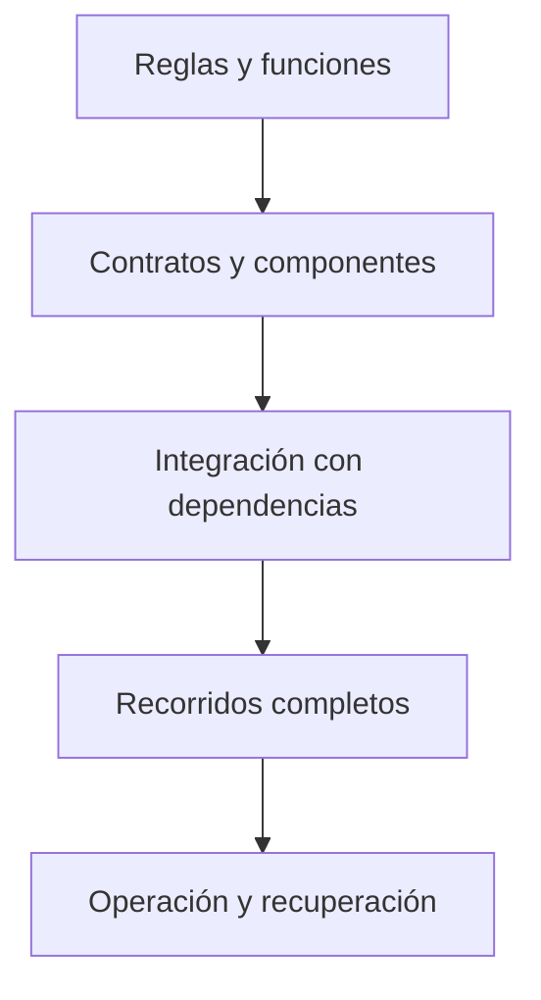

# Estrategia de pruebas

Esta carpeta reúne la estrategia para verificar Quantify Core. **Estado:** las pruebas ejecutables disponibles pertenecen al prototipo de la Práctica 07; las aplicaciones, servicios e infraestructura de producto aún no tienen implementación que validar. Los casos siguientes son obligaciones de desarrollo, no resultados ya aprobados.



## Niveles y ubicación

| Nivel | Qué verifica | Ubicación prevista |
|---|---|---|
| Unidad | Reglas, conversiones, validadores y estados aislados. | Junto al módulo propietario. |
| Contrato | Esquemas, errores y compatibilidad entre consumidores. | Comprobaciones del contrato y sus consumidores. |
| Integración | Identidad, persistencia, transacciones, colas y exportación de señales. | Por servicio o en esta carpeta cuando cruza módulos. |
| Sistema | Flujos completos web/móvil, accesibilidad y comportamiento offline. | En esta carpeta o en el cliente según la herramienta elegida. |
| Operación | Migraciones, capacidad, publicación, reversión y restauración. | Evidencia vinculada con infraestructura y guías operativas. |

## Matriz mínima de comportamiento

| Requisito | Casos que debe cubrir la implementación |
|---|---|
| RF-01 · Identidad | Token válido, vencido, emisor/audiencia incorrectos, sesión revocada y permisos por recurso. |
| RF-02 · Perfil y consentimiento | Cambio de zona, consentimiento granular, revocación y valores inválidos. |
| RF-03 · Hábitos | Datos inválidos, frecuencia, edición versionada, pausa, archivo e historial conservado. |
| RF-04 · Check-ins | Reintento con la misma clave, clave reutilizada con otro cuerpo, doble dispositivo, corrección auditable y fecha inválida. |
| RF-05 · Métricas | Días programados/no programados, día abierto, cambio horario, meta histórica y ausencia de datos. |
| RF-06 · Recordatorios | Permiso denegado, cambio de zona, deduplicación y desactivación. |
| RF-07 · Recomendaciones | Sin consentimiento, evidencia insuficiente, abstención, aceptación explícita y descarte. |
| RF-08 · Dispositivos | Vinculación, lotes duplicados, desconexión, revocación y fuente no autorizada. |
| RF-09 · Administración | Acciones permitidas, motivo requerido, auditoría y denegación de acceso a rutinas privadas. |
| RF-10 · Derechos y auditoría | Exportación con control de acceso, eliminación conforme a política, trazabilidad y minimización. |

La definición exacta está en [aceptación](../docs/requerimientos/aceptacion.md), [reglas de negocio](../docs/requerimientos/reglas-negocio.md) y [contratos](../packages/contracts/README.md). La prueba debe señalar el requisito y versión de regla que valida.

## Datos y reproducibilidad

Usar fixtures sintéticos, reloj controlable y zonas horarias explícitas. Aislar recursos entre ejecuciones y distinguir datos de prueba desechables de datos persistentes. Probar límites de confianza con usuarios distintos, no solo con una cuenta administradora.

Registrar runtime, herramienta, commit, configuración no sensible, comandos y resultado. Los tests que dependen de servicios externos deben indicar sus requisitos y no pasar silenciosamente cuando el servicio está ausente.

## Comprobaciones ejecutables hoy

Desde la raíz y con Node.js disponible:

```bash
# 1. Pruebas del modelo relacional e integridad de base de datos (P0)
node --test tests/database/schema.test.cjs

# 2. Pruebas del prototipo académico
node --test docs/practica-07/tests/prototipo.test.cjs
```

Este conjunto verifica la integridad de claves, relaciones y restricciones de base de datos relacional (P0) así como la lógica del prototipo en memoria. Ver [evidencia del modelo relacional](../docs/datos-ia/evidencia-modelo-relacional.md), [evidencia de la práctica](../docs/practica-07/VALIDACION.md) y [validación de esta documentación](../docs/guias/validacion-documental.md).

## Condiciones de revisión

Una funcionalidad no se marca verificada sin pruebas de sus caminos principales y fallos relevantes. Elegir las herramientas y umbrales de cobertura cuando existan módulos medibles; no usar un porcentaje arbitrario como sustituto de comportamiento comprobado. Una corrección que afecte contratos debe verificar también a sus consumidores.

Para documentación se comprueban enlaces, diagramas, ejemplos y consistencia semántica. Los cambios de seguridad, migraciones, datos sensibles o recuperación requieren evidencia específica del riesgo que modifican.
